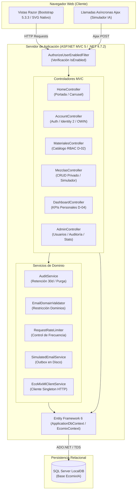
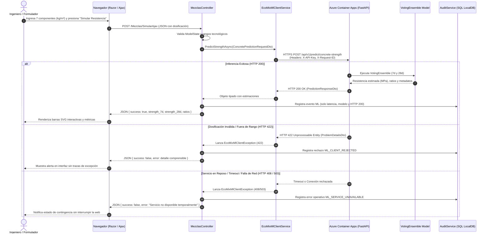

# UNIVERSIDAD PRIVADA DE TACNA
### FACULTAD DE INGENIERÍA
#### Escuela Profesional de Ingeniería de Sistemas

---

# Proyecto: Sistema de EcoMix IA
**Diseño y Optimización de Mezclas de Concreto Ecológico con Indicadores de Sostenibilidad y Costos**

* **Curso:** Programación Web II  
* **Docente:** Mtro. Enrique Félix LANCHIPA VALENCIA  
* **Integrantes:**  
  * Guillén Laveriano, Joel Adrián &nbsp;&nbsp;&nbsp;&nbsp;&nbsp;&nbsp;&nbsp;&nbsp; *(Código: 0098018499)*  
  * Medina Quispe, Joan Cristian &nbsp;&nbsp;&nbsp;&nbsp;&nbsp;&nbsp;&nbsp;&nbsp;&nbsp; *(Código: 2022074255)*  
* **Lugar y Fecha:** Tacna – Perú, 2026  

---

[](https://dotnet.microsoft.com/)
[](https://dotnet.microsoft.com/apps/aspnet/mvc)
[](https://learn.microsoft.com/ef/ef6/)
[](https://www.microsoft.com/sql-server)
[](https://getbootstrap.com/)
[](https://fastapi.tiangolo.com/)
[](https://azure.microsoft.com/services/machine-learning/)
[-success)](#8-pruebas-automatizadas-y-calidad-de-software)

---

## Tabla de Contenidos

1. [Presentación de EcoMix IA](#1-presentación-de-ecomix-ia)
2. [Características Principales](#2-características-principales)
3. [Tecnologías Utilizadas](#3-tecnologías-utilizadas)
4. [Arquitectura del Sistema](#4-arquitectura-del-sistema)
5. [Matriz de Roles y Control de Acceso (RBAC)](#5-matriz-de-roles-y-control-de-acceso-rbac)
6. [Requisitos e Instalación en Entorno Local](#6-requisitos-e-instalación-en-entorno-local)
7. [Configuración e Integración del Servicio ML](#7-configuración-e-integración-del-servicio-ml)
8. [Pruebas Automatizadas y Calidad de Software](#8-pruebas-automatizadas-y-calidad-de-software)
9. [Estado de Implementación y Limitaciones](#9-estado-de-implementación-y-limitaciones)
10. [Documentación Técnica Oficial](#10-documentación-técnica-oficial)
11. [Seguridad, Privacidad y Buenas Prácticas](#11-seguridad-privacidad-y-buenas-prácticas)
12. [Créditos Académicos y Licencia](#12-créditos-académicos-y-licencia)

---

## 1. Presentación de EcoMix IA

La producción de concreto convencional representa aproximadamente el 8% de las emisiones antropogénicas globales de dióxido de carbono ($\text{CO}_2$), originadas principalmente durante la descarbonatación de la caliza y el clinkerizado a altas temperaturas en la fabricación del cemento Portland. Al mismo tiempo, la industria de la construcción en el Perú y la región enfrenta una alta volatilidad en los precios de los agregados y aditivos químicos, lo que dificulta equilibrar las exigencias de resistencia mecánica estructural con presupuestos competitivos y metas de descarbonización.

**EcoMix IA** es una plataforma web de ingeniería civil y de materiales desarrollada sobre **ASP.NET MVC 5** y **.NET Framework 4.7.2**, cuyo propósito es resolver este problema técnico mediante:

- **Dosificación Precisa por Metro Cúbico ($1\text{ m}^3$):** Formulación de concretos estructurales y ecológicos incorporando materiales cementicios suplementarios (cenizas volantes, escorias granuladas de alto horno, microsílice y aditivos reductores de agua).
- **Indicadores de Sostenibilidad en Tiempo Real:** Evaluación simultánea del costo unitario ($\text{S/./m}^3$) y de la huella de carbono ($\text{kg CO}_2/\text{m}^3$) con trazabilidad inmutable mediante snapshots históricos.
- **Inferencia Predictiva con Inteligencia Artificial:** Integración de un modelo supervisado `VotingEnsemble` (entrenado y registrado en Azure Machine Learning, y servido vía microservicio REST en FastAPI / Azure Container Apps) que estima la resistencia a la compresión a los **7 y 28 días** en megapascales ($\text{MPa}$).
- **Aislamiento Privado y Auditoría Estructurada:** Privacidad absoluta entre formuladores bajo control de acceso basado en roles (RBAC), mitigación de vulnerabilidades IDOR y una pista de auditoría administrativa con retención controlada de 30 días.

---

## 2. Características Principales

### 2.1 Portal Web y Catálogo de Materiales
- **Página de Inicio Informativa:** Portal accesible con carrusel responsive de navegación por teclado y descargo de responsabilidad estructural explícito: las inferencias del modelo son de carácter orientativo y no reemplazan los ensayos destructivos de probetas cilíndricas bajo norma ASTM C39 / NTP 339.034 ni los factores de seguridad del Reglamento Nacional de Edificaciones (RNE E.060).
- **Catálogo Global de Insumos (`MaterialesController`):** Registro de parámetros técnicos normalizados en `TiposMaterial` (*Cemento, Adición, Agregado fino, Agregado grueso, Agua, Aditivo*), incluyendo densidad relativa ($\text{g/cm}^3$), costo unitario por kilogramo ($\text{S/./kg}$) y factor de emisión de $\text{CO}_2$ ($\text{kg CO}_2/\text{kg}$).
- **Control de Acceso RBAC en Catálogo:**
  - *Usuarios Autenticados (`Registrado` y `Administrador`):* Consulta y detalle técnico en modo solo lectura (`[Authorize]`).
  - *Administradores:* Operaciones de creación, edición y baja física (`[Authorize(Roles="Administrador")]`).
  - *Visitantes Anónimos:* Desafiados automáticamente y redirigidos al inicio de sesión (Directiva D-02).
- **Integridad Referencial:** Bloqueo en servidor de la eliminación de materiales que formen parte de fórmulas activas en la base de datos.

### 2.2 Gestión de Mezclas y Dosificación Privada
- **Dosificación por Metro Cúbico (`MezclasController`):** Especificación de resistencia requerida ($f'c$ en $\text{MPa}$), edad de diseño, relación agua/cemento ($a/c$), asentamiento (*slump* en $\text{cm}$) y dosificación detallada de cada insumo en $\text{kg/m}^3$.
- **Aislamiento Estricto por Propietario (`OwnerUserId`):** Las mezclas son de visibilidad y edición exclusiva del usuario que las formuló. El backend aplica filtros automáticos `Where(m => m.OwnerUserId == CurrentUserId)` y bloquea cualquier intento de acceso directo a recetas ajenas (IDOR), respondiendo con códigos seguros HTTP 404/403.
- **Duplicación Segura:** Permite clonar formulaciones existentes para realizar iteraciones dosimétricas sin alterar la fórmula base.

### 2.3 Indicadores de Sostenibilidad y Snapshots Inmutables
- **Métricas Reproducibles:**
  $$\text{Costo Total/m}^3 = \sum (\text{Cantidad}_i \times \text{CostoPorKgGuardado}_i)$$
  $$\text{CO}_2\text{ Total/m}^3 = \sum (\text{Cantidad}_i \times \text{Co2PorKgGuardado}_i)$$
  $$\text{Masa Total Fresca/m}^3 = \sum \text{Cantidad}_i$$
- **Persistencia con Precisión `decimal(18,6)`:** Columnas de snapshot `CostoPorKgGuardado` y `Co2PorKgGuardado` en `dbo.MezclaComponentes` fijadas al momento del guardado (`FechaSnapshotUtc`). Si los precios o factores del catálogo cambian con el tiempo, las mezclas guardadas preservan intactos sus costos históricos originales (Directiva D-09 / RF-14).
- **Safe Denial de Procedencia:**
  - `OrigenSnapshot = 'CAPTURADO'`: Factores capturados desde catálogo vigente; habilitan cálculos inmutables auténticos.
  - `OrigenSnapshot = 'LEGADO_SIN_VERIFICAR'`: Fórmulas legadas sin captura previa; el sistema evita presentar estimaciones como precios históricos auténticos y muestra leyendas de cálculo referencial.

### 2.4 Simulador con Inteligencia Artificial
- **Entrada Tipada de Siete Insumos:** Inyección de proporciones en $\text{kg/m}^3$ (cemento, escoria de alto horno, ceniza volante, agua, superplastificante, agregado grueso y agregado fino).
- **Predicción de Resistencia a Compresión:** Estimación en $\text{MPa}$ para curado estándar a **7 días** y **28 días** generada por el modelo supervisado `VotingEnsemble`.
- **Acceso Abierto y Protección de Fórmulas:** El cálculo manual en el simulador está disponible abiertamente para fines didácticos sin requerir autenticación previa. Por el contrario, la precarga de fórmulas guardadas desde base de datos (`?mezclaId=...`) implementa una política estricta de **Safe Denial (D-01 / D-08)**: únicamente el usuario propietario puede precargar sus recetas; solicitudes anónimas o ajenas reciben una advertencia y un formulario en blanco sin revelar datos.
- **Visualización Gráfica Vectorial (SVG Nativo):** Renderizado gráfico accesible de barras comparativas 7d / 28d desarrollado íntegramente en SVG nativo responsive integrado en Razor, eliminando dependencias externas de librerías como Chart.js (RF-18).
- **Ratios Tecnológicos y Advertencias OOD:** Cálculo inmediato de la relación agua/cemento ($w/c$), agua/conglomerante ($w/b$) y porcentaje de sustitución puzolánica. Emisión de advertencias ante dosificaciones fuera de distribución (*Out-of-Distribution - OOD*) o violaciones de rangos tecnológicos.
- **Resiliencia Operativa:** Captura desacoplada de errores 422 (*ProblemDetails*), timeouts de arranque en frío (HTTP 408) o caída del contenedor cloud (HTTP 503) mediante `EcoMixMlClientException`, presentando mensajes claros sin exponer trazas de error internas ni URLs de infraestructura.

### 2.5 Usuarios, Autenticación y Seguridad
- **Validación de Dominio Institucional:** Restricción de registro a correos de la Universidad Privada de Tacna (`@upt.pe`, `@virtual.upt.pe`) y `@gmail.com` mediante `EmailDomainValidator`.
- **Confirmación Obligatoria de Cuentas (D-03 / RF-06):** Bloqueo en login a cuentas no confirmadas (`EmailConfirmed = 0`) hasta validar el token de activación emitido al outbox de correo.
- **Protección contra Fuerza Bruta:** Bloqueo de cuenta temporal tras 5 intentos fallidos (`MaxFailedAccessAttemptsBeforeLockout = 5`) y limitador de tasa deslizante (*Sliding-Window Rate Limiter*) por IP/cuenta.
- **Protección Anti-CSRF:** Validación mandatoria de `[ValidateAntiForgeryToken]` en todas las peticiones POST de mutación en controladores.
- **Revocación Inmediata de Sesiones Inhabilitadas:** Filtro global `AuthorizeUserEnabledFilter` y middleware OWIN `OnValidateIdentity` que interceptan síncronamente cada petición autenticada: si la cuenta es inhabilitada en la base de datos (`IsEnabled = 0`), la sesión se revoca en el acto y se redirige a `/Account/Login?disabled=1`.
- **Provisión Asistida del Primer Administrador (D-10 / RF-52 / RF-53):** Procedimiento manual independiente ([`tools/Provision-Administrator.ps1`](tools/Provision-Administrator.ps1)) con exclusión mutua transaccional (`sp_getapplock`) que impide auto-asignaciones automáticas en scripts DDL, bloquea reprovisiones si ya existe cualquier administrador y previene reejecuciones mediante historial persistente en `AuditEvents`.

### 2.6 Dashboards y Pista de Auditoría
- **Dashboard Personal (`/Dashboard`):** Panel privado para formuladores que resume el inventario de mezclas propias, costo promedio, $\text{CO}_2$ promedio y porcentaje de fórmulas con snapshot verificado. No persiste inferencias predictivas volátiles (Directiva D-04).
- **Dashboard Administrativo (`/Admin`):** Visualización de métricas globales agregadas del sistema (total de cuentas, usuarios activos, simulaciones y errores operativos) sin exponer los nombres, recetas ni datos privados de mezclas de otros usuarios.
- **Gestión Administrativa de Cuentas (`/Admin/Users`):** Búsqueda por correo, paginación, habilitación/inhabilitación y cambio de roles (RBAC) con protección concurrente (`_adminConcurrencyLock` y transacciones serializables en SQL Server) para evitar degradar o inhabilitar al último administrador activo.
- **Auditoría Estructurada con Retención de 30 Días (`/Admin/Audit`):** Registro de eventos en `dbo.AuditEvents` con sanitización estricta de secretos y trazas (`[PROTEGIDO]`, `[RUTA_PROTEGIDA]`, `[STACK_PROTEGIDO]`). Las consultas activas filtran automáticamente registros mayores a 30 días (`TimestampUtc >= UtcNow - 30d`) y un mecanismo idempotente por lotes (`PurgeExpiredEventsAsync`) depura físicamente registros vencidos.

---

## 3. Tecnologías Utilizadas

| Capa / Componente | Tecnología | Versión | Función en el Sistema |
|---|---|:---:|---|
| **Framework Web** | ASP.NET MVC | 5.2.9 | Controladores, vistas Razor, filtros de autorización y pipeline de enrutamiento |
| **Plataforma de Ejecución** | .NET Framework | 4.7.2 | Runtime y bibliotecas base de la aplicación web en servidor Windows |
| **ORM y Acceso a Datos** | Entity Framework | 6.5.1 | Mapeo objeto-relacional Code-First, migraciones DDL y consultas LINQ |
| **Base de Datos Relacional** | SQL Server / LocalDB | 2019+ | Persistencia transaccional de usuarios, catálogo, mezclas, snapshots y auditoría |
| **Seguridad e Identidad** | ASP.NET Identity / OWIN | 2.2.4 / 4.2.2 | Membresía, hashing PBKDF2, tokens de sesión HttpOnly y cookies de autenticación |
| **Diseño y Maquetación** | Bootstrap & Icons | 5.3.3 / 1.11.3 | Diseño responsivo, componentes visuales, tipografía Inter y accesibilidad |
| **Cliente y Visualización** | JavaScript / SVG Nativo | ES6+ / SVG 1.1 | Peticiones Ajax asíncronas para simulación y renderizado gráfico vectorial |
| **Framework de Inferencia** | FastAPI | 0.115+ | Microservicio REST en Python que expone el contrato de predicción ML |
| **Entorno Machine Learning** | Python / scikit-learn | 3.11 / 1.5+ | Preprocesamiento, transformaciones de componentes y modelo `VotingEnsemble` |
| **Plataforma de Modelado** | Azure Machine Learning | Cloud | Registro, versionamiento y evaluación de experimentos del VotingEnsemble |
| **Hospedaje de Contenedor** | Azure Container Apps | Serverless | Despliegue Linux (Debian Slim) del servicio FastAPI con escalado a cero (Plan Consumption) |

---

## 4. Arquitectura del Sistema

### 4.1 Arquitectura Web y Persistencia Relacional



### 4.2 Flujo de Inferencia de Machine Learning

> [!IMPORTANT]
> **Seguridad de Credenciales:** La API Key del microservicio ML (`EcoMix:ApiKey`) **nunca se expone en el cliente o navegador web**. Las peticiones del usuario se dirigen a la acción interna `/Mezclas/SimularAjax`, y el servidor ASP.NET efectúa la llamada segura de servidor a servidor hacia Azure Container Apps.



*Repositorio ML de referencia (solo lectura):* [`https://github.com/JMedina255/EcoMix-IA-AzureML`](https://github.com/JMedina255/EcoMix-IA-AzureML)

> **Nota sobre diagramas históricos:** Los diagramas conceptuales interactivos alojados en la carpeta [`docs-interactive/`](docs-interactive/index.html) corresponden al diseño exploratorio temprano de Fase 1/2. La arquitectura técnica final implementada, consolidada y validada en H05-R es la representada en los diagramas Mermaid anteriores y detallada formalmente en el documento de arquitectura [`docs/revisiones/SAD_v1.2_Revision_H05.md`](docs/revisiones/SAD_v1.2_Revision_H05.md).

---

## 5. Matriz de Roles y Control de Acceso (RBAC)

El sistema aplica una política estricta de separación de dominios y control de privilegios:

| Funcionalidad / Módulo del Sistema | Visitante Anónimo | Usuario Registrado | Administrador del Sistema |
|---|:---:|:---:|:---:|
| **Portada pública, carrusel y descargo normativo** | Acceso libre | Acceso libre | Acceso libre |
| **Inicio de sesión y recuperación de contraseñas** | Acceso libre | Acceso libre | Acceso libre |
| **Registro de cuenta institucional (`@upt.pe` / `@gmail.com`)** | Acceso libre | Bloqueado (ya autenticado) | Bloqueado (ya autenticado) |
| **Catálogo de materiales (Consulta y detalle técnico)** | Denegado (Redirect a Login) | **Lectura autorizada** | **Lectura autorizada** |
| **Catálogo de materiales (Creación, edición y eliminación)** | Denegado | Denegado (HTTP 403) | **Acceso total (CRUD)** |
| **Gestión de mezclas privadas propias (CRUD)** | Denegado | **Acceso total a fórmulas propias** | **Acceso total a fórmulas propias** |
| **Mezclas privadas de otros usuarios (Acceso transversal)** | Denegado | **Bloqueado (Safe Denial 404/403)** | **Bloqueado por diseño (D-08)** |
| **Simulador IA: cálculo manual y predicción (`Simulador`, `SimularAjax`)** | **Acceso libre** | **Acceso completo** | **Acceso completo** |
| **Simulador IA: precarga de fórmulas guardadas (`?mezclaId=...`)** | Bloqueado (Safe Denial / D-01) | **Acceso a fórmulas propias** | **Acceso a fórmulas propias (D-08)** |
| **Dashboard personal (KPIs de mezclas propias)** | Denegado | **Acceso a KPIs propios** | **Acceso a KPIs propios** |
| **Dashboard administrativo (Estadísticas globales)** | Denegado | Denegado (HTTP 403) | **Acceso a métricas agregadas** |
| **Gestión de cuentas y roles (`/Admin/Users`)** | Denegado | Denegado (HTTP 403) | **Acceso total con exclusión mutua** |
| **Pista de auditoría y depuración física (`/Admin/Audit`)** | Denegado | Denegado (HTTP 403) | **Consulta sanitizada y purga 30d** |

> [!NOTE]
> **Política de Acceso al Simulador:** En `MezclasController`, las acciones `Simulador` (GET/POST) y `SimularAjax` (POST) no exigen autorización por diseño, permitiendo el cálculo de dosificación interactivo a cualquier usuario o visitante con fines didácticos y de difusión técnica. La autorización se ejerce estrictamente sobre la **precarga de mezclas guardadas** (`?mezclaId=...`), aplicando Safe Denial ante usuarios no autenticados o ajenos a la propiedad de la fórmula. Cualquier modificación funcional a esta política (como restringir el simulador manual exclusivamente a usuarios autenticados) requerirá un hito de desarrollo y aprobación formal por separado.

> [!IMPORTANT]
> **Privacidad de Recetas (Directiva D-08):** El rol `Administrador` gestiona usuarios, roles y auditoría global, pero **no tiene acceso a ver, editar ni descargar las mezclas privadas formuladas por otros ingenieros**, respetando la confidencialidad de la propiedad intelectual de cada usuario.

---

## 6. Requisitos e Instalación en Entorno Local

Para desplegar la solución en una máquina de desarrollo limpia o entorno de evaluación, siga las instrucciones extraídas de la [`Guia_Instalacion_Entorno_Limpio.md`](docs/entrega/Guia_Instalacion_Entorno_Limpio.md):

### 6.1 Requisitos Previos del Sistema
- **Sistema Operativo:** Windows 10 / 11 (64-bit) o Windows Server 2019+.
- **Framework:** .NET Framework 4.7.2 Runtime y Developer Pack.
- **Entorno de Compilación:** Visual Studio 2022 (Community o superior) con la carga de trabajo *Desarrollo web y ASP.NET*, o MSBuild v17+.
- **Motor de Base de Datos:** SQL Server LocalDB (`(LocalDb)\MSSQLLocalDB`) o SQL Server 2017+ estándar.
- **Servidor Web:** IIS Express 10.0+ (incluido en Visual Studio).
- **Consola:** Windows PowerShell 5.1 o PowerShell 7+.
- **Git:** Git 2.30+ para Windows.

### 6.2 Pasos de Instalación y Puesta en Marcha

#### Paso 1: Clonar el repositorio
```powershell
git clone https://github.com/joeguillenl/EcomixIA.git "C:\Proyectos\EcoMixIA"
cd "C:\Proyectos\EcoMixIA"
```

#### Paso 2: Restaurar paquetes NuGet y compilar
```powershell
# Restauración de dependencias externas
& "C:\Program Files\Microsoft Visual Studio\2022\Community\MSBuild\Current\Bin\MSBuild.exe" EcomixIA.sln /t:Restore /v:m

# Compilación en configuración Release
& "C:\Program Files\Microsoft Visual Studio\2022\Community\MSBuild\Current\Bin\MSBuild.exe" EcomixIA.sln /p:Configuration=Release /p:Platform="Any CPU" /v:m
```
*Verifique que la compilación termine con 0 Errores y 0 Advertencias.*

#### Paso 3: Preparar la base de datos SQL Server

Diferencie el procedimiento de base de datos según el estado de su entorno local:

##### Escenario A: Instalación Limpia desde Cero (Base de Datos Nueva)
1. **Creación de Esquema Base y Semillas Iniciales:** Ejecute los scripts DDL y DML oficiales en orden secuencial sobre LocalDB (o utilice [`database/EcomixIA_Full_Setup.sql`](database/EcomixIA_Full_Setup.sql) que los consolida de forma idempotente, como se describe en [`database/README.md`](database/README.md)):
   ```powershell
   # 1.1 Crear base de datos, 9 tablas de dominio/identidad e historial EF6 inicial
   sqlcmd -S "(LocalDb)\MSSQLLocalDB" -i "database\01_Schema_EcomixIA.sql"

   # 1.2 Poblar los 10 materiales de referencia del catálogo, roles y formulaciones semilla
   sqlcmd -S "(LocalDb)\MSSQLLocalDB" -d EcomixIA -i "database\02_SeedData_EcomixIA.sql"
   ```
2. **Aplicar Migraciones Aditivas H02 y H04:** Actualice el esquema inicial a la versión completa del sistema:
   ```powershell
   # 2.1 Asegurar columna de propiedad OwnerUserId en Mezclas (si no existiera)
   sqlcmd -S "(LocalDb)\MSSQLLocalDB" -d EcomixIA -i "Migrations\Scripts\apply_migration.sql"

   # 2.2 Agregar snapshots históricos de costos y CO2 (H02 / RF-14 / D-09)
   sqlcmd -S "(LocalDb)\MSSQLLocalDB" -d EcomixIA -i "Migrations\Scripts\H02_add_snapshots_to_mezclacomponentes.sql"

   # 2.3 Agregar control IsEnabled, rol Administrador y tabla AuditEvents (H04 / RF-21 / D-07)
   sqlcmd -S "(LocalDb)\MSSQLLocalDB" -d EcomixIA -i "Migrations\Scripts\H04_add_audit_and_user_enabled.sql"
   ```

##### Escenario B: Actualización o Migración de una Base de Datos Preexistente
Si ya cuenta con una base de datos `EcomixIA` con registros reales, **nunca ejecute scripts destructivos ni de recreación**. Aplique únicamente las migraciones aditivas idempotentes en orden secuencial:
```powershell
# 1. Snapshots históricos de precios y CO2 (H02 - clasifica registros previos como LEGADO_SIN_VERIFICAR)
sqlcmd -S "(LocalDb)\MSSQLLocalDB" -d EcomixIA -i "Migrations\Scripts\H02_add_snapshots_to_mezclacomponentes.sql"

# 2. Pista de auditoría de 30 días, índices y columna IsEnabled (H04)
sqlcmd -S "(LocalDb)\MSSQLLocalDB" -d EcomixIA -i "Migrations\Scripts\H04_add_audit_and_user_enabled.sql"
```

#### Paso 4: Configurar secretos locales (`Web.Secrets.config`)
Copie el archivo de plantilla [`Web.Secrets.example.config`](Web.Secrets.example.config) a su versión local (este archivo se encuentra protegido en `.gitignore`):
```powershell
Copy-Item "Web.Secrets.example.config" "Web.Secrets.config"
```
Abra `Web.Secrets.config` y configure su clave de inferencia autorizada o utilice un valor ficticio si operará en modo desacoplado con mocks:
```xml
<appSettings>
  <add key="EcoMix:ApiKey" value="SU_CLAVE_AQUI" />
</appSettings>
```

#### Paso 5: Correo transaccional simulado en desarrollo
La aplicación incluye `SimulatedEmailService`. En desarrollo local no se requiere contratar servicios externos de correo: los enlaces de confirmación y restablecimiento se guardan automáticamente como archivos estructurados en la carpeta local `App_Data/EmailOutbox/` con costo $0 USD.

#### Paso 6: Provisión manual del primer Administrador (D-10)
Registre una cuenta inicial mediante la interfaz web de registro con un correo institucional permitido (ej. `administrador@upt.pe`) y confirme su cuenta a través del outbox de correo. Luego, ejecute la rutina controlada de bootstrap mediante [`tools/Provision-Administrator.ps1`](tools/Provision-Administrator.ps1):
```powershell
powershell -ExecutionPolicy Bypass -File "tools\Provision-Administrator.ps1" -TargetEmail "administrador@upt.pe"
```

#### Paso 7: Iniciar la aplicación en IIS Express

Seleccione el método de ejecución según su entorno de desarrollo:

- **Opción A: Ejecución en Visual Studio (Recomendado para HTTPS):**  
  Abra la solución `EcomixIA.sln` en Visual Studio 2022 y presione `Ctrl + F5` (o `F5` para depuración). Visual Studio inicializa IIS Express con el enlace de certificado SSL preconfigurado en el archivo de proyecto (`<IISExpressSSLPort>44357</IISExpressSSLPort>`):  
  👉 Acceda en el navegador a: **`https://localhost:44357/`**

- **Opción B: Ejecución por Línea de Comandos (PowerShell / HTTP probado):**  
  Al invocar directamente `iisexpress.exe` mediante el parámetro `/port`, IIS Express expone un listener HTTP estándar (no cifrado). Para ejecutar la aplicación desde consola:
  ```powershell
  # Desde la raíz del repositorio C:\Proyectos\EcoMixIA:
  & "C:\Program Files\IIS Express\iisexpress.exe" /path:"$PWD" /port:62778
  ```
  👉 Acceda en el navegador a: **`http://localhost:62778/`**

> [!NOTE]
> **Consistencia de Protocolos y Puertos:** El puerto seguro `44357` opera bajo protocolo **HTTPS** mediante el certificado de desarrollo gestionado por Visual Studio. La ejecución directa en consola con `/port` sirve sobre protocolo **HTTP** (ej. puerto `62778` o puerto de pruebas `58085`). Intentar acceder a `https://` sobre un puerto levantado sin enlace SSL arrojará un error de protocolo (`ERR_SSL_PROTOCOL_ERROR`).

---

## 7. Configuración e Integración del Servicio ML

El cliente HTTP [`Services/EcoMixMlClientService.cs`](Services/EcoMixMlClientService.cs) encapsula la comunicación de servidor a servidor con el microservicio de inferencia en Azure Container Apps.

### Parámetros de Configuración (`Web.config` / `Web.Secrets.config`)

| Clave | Valor Predeterminado / Ejemplo | Descripción Técnica |
|---|---|---|
| `EcoMix:ApiUrl` | `https://ca-ecomix-inference-api.salmontree-d9db53a4.chilecentral.azurecontainerapps.io` | URL base del microservicio FastAPI en Azure Container Apps (región `chilecentral`). |
| `EcoMix:ApiKey` | *(Leído desde `Web.Secrets.config` o variable `ECOMIX_API_KEY`)* | Clave de autenticación para la cabecera `X-API-Key`. Nunca se coloca en el repositorio. |
| `EcoMix:TimeoutSeconds` | `45` | Tiempo máximo de espera en segundos. Prevé el tiempo de arranque en frío (*cold start*) cuando el contenedor escala desde 0 réplicas. |

### Contrato de Inferencia de Dosificación (`api/v1/predict/concrete-strength`)

```json
{
  "cement": 350.0,
  "blast_furnace_slag": 0.0,
  "fly_ash": 70.0,
  "water": 175.0,
  "superplasticizer": 4.5,
  "coarse_aggregate": 1020.0,
  "fine_aggregate": 750.0
}
```

**Respuesta tipada (`PredictionResponseDto`):**
```json
{
  "status": "success",
  "predictions": {
    "strength_7d_mpa": 27.84,
    "strength_28d_mpa": 41.20
  },
  "mix_ratios": {
    "water_cement_ratio": 0.50,
    "water_binder_ratio": 0.417,
    "pozzolan_replacement_percent": 16.67
  },
  "warnings": [],
  "metadata": {
    "model_id": "voting_ensemble_v1",
    "model_type": "VotingEnsemble"
  }
}
```

> [!NOTE]
> **Alcance Temporal:** El modelo implementado predice la resistencia a **7 y 28 días**. No se ofrecen predicciones a 90 días en la versión operativa actual.

---

## 8. Pruebas Automatizadas y Calidad de Software

El proyecto cuenta con una infraestructura de pruebas automatizadas modular y reproducible mediante PowerShell y SQL Server LocalDB, orquestada por [`tests/Run_All_Tests.ps1`](tests/Run_All_Tests.ps1).

### 8.1 Suites de Pruebas Existentes

| Suite | Script | Tipo de Validación | Escenarios Cubiertos | Resultado |
|---|---|---|---|:---:|
| **Suite 01** | [`01_Unit_Domain_Tests.ps1`](tests/01_Unit_Domain_Tests.ps1) | Unitaria / Dominio | DTOs tipados, validador de dominios `@upt.pe`/`@gmail.com`, complejidad de contraseñas, rate limiter sliding-window, sanitización de auditoría y outbox de correo. | **23/23 PASS** |
| **Suite 02** | [`02_Integration_EF6_Sql_Tests.ps1`](tests/02_Integration_EF6_Sql_Tests.ps1) | Integración EF6 & SQL | Integridad de 10 tablas en SQL Server, snapshots `decimal(18,6)` en `MezclaComponentes`, retención estricta de 30 días y purga física por lotes. | **9/9 PASS** |
| **Suite 03** | [`03_Http_Authorization_Tests.ps1`](tests/03_Http_Authorization_Tests.ps1) | Pipeline Sintético MVC | Filtro de catálogo por clase, RBAC en catálogo y administración, filtro `AuthorizeUserEnabledFilter`, bloqueo de cuentas no confirmadas y tokens anti-CSRF. | **10/10 PASS** |
| **Suite 04** | [`04_FastApi_Contract_Mock_Tests.ps1`](tests/04_FastApi_Contract_Mock_Tests.ps1) | Contrato ML / Mocks | Validación de contrato JSON, resiliencia ante 422/503/timeout sin trazas de excepción, y cero almacenamiento de recetas privadas en auditoría. | **10/10 PASS** |
| **Suite 05** | [`05_Security_Concurrency_Tests.ps1`](tests/05_Security_Concurrency_Tests.ps1) | Seguridad y Concurrencia | Concurrencia de cambio de rol con 1 y 2 administradores activos, revalidación de `SecurityStamp`, provisión con `sp_getapplock` ('EcoMix_Admin_Bootstrap_Lock'), bloqueo de admin deshabilitado y script DDL. | **14/14 PASS** |
| **Suite 06** | [`06_Full_Regression_H01_H04.ps1`](tests/06_Full_Regression_H01_H04.ps1) | Regresión Funcional | Inmutabilidad de snapshots ante alteraciones de catálogo, aislamiento de mezclas en dashboard personal, flujo de autenticación y estadísticas agregadas. | **7/7 PASS** |
| **Suite 07** | [`07_Real_Http_IisExpress_Tests.ps1`](tests/07_Real_Http_IisExpress_Tests.ps1) | HTTP Real en IIS Express | Servidor real en puerto 58085: GET anónimo 302, Login con cookie `.AspNet.ApplicationCookie`, POST sin CSRF rechazado (500), POST con CSRF aceptado (302), IDOR 403 y revocación inmediata hacia `Login?disabled=1`. | **7/7 PASS** |
| **TOTAL** | [`Run_All_Tests.ps1`](tests/Run_All_Tests.ps1) | **7 Suites Modulares** | **Ejecutado sobre bases de ensayo aisladas (`EcomixIA_Trial` y `EcomixIA_Test`)** | **80/80 PASS (100%)** |

### 8.2 Ejecución Segura de la Suite Completa

El orquestador maestro restaura automáticamente la base de datos de ensayo antes y después de las pruebas a partir del archivo de respaldo base limpio generado localmente (por convención, `database/backups/EcomixIA_pre_h05_20261120.bak`, archivo binario local de mantenimiento excluido del repositorio de código):

```powershell
# Ejecución sobre base de ensayo principal EcomixIA_Trial
powershell -ExecutionPolicy Bypass -File "tests\Run_All_Tests.ps1" -TargetDatabase "EcomixIA_Trial"

# Verificación sobre base de ensayo secundaria EcomixIA_Test
powershell -ExecutionPolicy Bypass -File "tests\Run_All_Tests.ps1" -TargetDatabase "EcomixIA_Test"
```

> [!CAUTION]
> **Protección de la Base de Producción:** El orquestador cuenta con una lista blanca estricta (`EcomixIA_Trial`, `EcomixIA_Test`). El sistema aborta inmediatamente con error fatal si se intenta ejecutar contra la base principal `EcomixIA`, garantizando la no-destrucción de datos reales.

---

## 9. Estado de Implementación y Limitaciones

### 9.1 Implementado y Verificado Localmente (100% Alcance Local)
- [x] Portal web responsive con identidad visual propia EcoMix IA y carrusel accesible.
- [x] Catálogo maestro de materiales con clasificación, costos, densidades y factores de $\text{CO}_2$.
- [x] Módulo privado de mezclas con control de propiedad (`OwnerUserId`) y prevención IDOR.
- [x] Motor de sostenibilidad con snapshots inmutables `decimal(18,6)` y Safe Denial de procedencia.
- [x] Dashboard personal para formuladores con indicadores de mezclas privadas.
- [x] Simulador IA desacoplado de 7 componentes con visualización gráfica SVG nativa.
- [x] Membresía institucional (Identity 2/OWIN) con bloqueo de fuerza bruta y revocación inmediata de sesiones.
- [x] Panel administrativo con métricas agregadas globales y gestión concurrente de usuarios/roles.
- [x] Pista de auditoría estructurada con retención de 30 días y purga física idempotente.
- [x] 80 pruebas automatizadas superadas al 100% en entornos aislados de prueba.

### 9.2 Pendiente de Validación o Activación Externa
- [ ] **Proveedor de Correo Transaccional en Producción:** La infraestructura local utiliza `SimulatedEmailService`. La integración con un proveedor SMTP empresarial o SendGrid API en producción se encuentra desacoplada en el código (`TransactionalEmailSenderFactory`) pero catalogada como pendiente de activación final con credenciales cloud.
- [ ] **Validación Operativa y Hosting Cloud:** El despliegue de la aplicación ASP.NET MVC en Azure App Service Windows (.NET 4.7.2) y SQL Azure se encuentra técnicamente preparado pero pendiente de asignación presupuestal y credenciales de suscripción.
- [ ] **Conciliación en Azure Cost Management (Directiva D-06 / RF-46):** La cifra de **~$3.50 USD** reportada en [`Auditoria_Costos_Azure.md`](docs/entrega/Auditoria_Costos_Azure.md) corresponde a una **estimación técnica preliminar** basada en las tarifas teóricas de Azure Container Registry SKU Basic durante fases iniciales. En los hitos H02 a H05-R el consumo adicional fue estrictamente de **$0.00 USD**. La conciliación contable formal del saldo remanente sobre el crédito máximo de **US$ 20.00** queda catalogada como pendiente de acceso directo al portal de facturación.

---

## 10. Documentación Técnica Oficial

Los detalles de ingeniería, diseño arquitectónico, requerimientos y auditorías se encuentran documentados en los siguientes enlaces del repositorio:

| Documento | Ruta Relativa | Propósito y Contenido |
|---|---|---|
| **SRS v1.3 (Revisión H05)** | [`docs/revisiones/SRS_v1.3_Revision_H05.md`](docs/revisiones/SRS_v1.3_Revision_H05.md) | Especificación de Requerimientos de Software actualizada con RF-01 a RF-55 y directivas D-01 a D-10. |
| **SAD v1.2 (Revisión H05)** | [`docs/revisiones/SAD_v1.2_Revision_H05.md`](docs/revisiones/SAD_v1.2_Revision_H05.md) | Documento de Arquitectura de Software con diagramas C4, componentes, seguridad y patrones. |
| **SRS v1.2 (Línea Base)** | [`docs/FD03_EPIS_SRS_EcoMixIA_v1.2.md`](docs/FD03_EPIS_SRS_EcoMixIA_v1.2.md) | Especificación original de requerimientos funcionales de fases 1 a 3. |
| **SAD v1.1 (Línea Base)** | [`docs/FD03_EPIS_SAD_EcoMixIA_v1.1.md`](docs/FD03_EPIS_SAD_EcoMixIA_v1.1.md) | Arquitectura y modelo de datos relacional de referencia inicial. |
| **Matriz de Trazabilidad H05-R** | [`docs/auditoria/Matriz_Trazabilidad_H05.md`](docs/auditoria/Matriz_Trazabilidad_H05.md) | Matriz completa de verificación de 95 ítems (88 implementados locales y 7 pendientes externos). |
| **Informe de Auditoría Integral H05** | [`docs/auditoria/H05_Auditoria_Integral_Entrega.md`](docs/auditoria/H05_Auditoria_Integral_Entrega.md) | Informe de cierre técnico de la Fase 4 con evidencias visuales y remediaciones de seguridad. |
| **Informe Pre-Merge H05-R** | [`docs/auditoria/H05_R_Verificacion_PreMerge.md`](docs/auditoria/H05_R_Verificacion_PreMerge.md) | Verificación formal de integración con `master`, exclusión mutua `sp_getapplock` y veredicto pre-merge. |
| **Auditorías de Hitos H00–H04** | [`docs/auditoria/`](docs/auditoria/H00_Auditoria_Recuperacion_Sincronizacion.md) | Informes de avance [H00](docs/auditoria/H00_Auditoria_Recuperacion_Sincronizacion.md), [H01](docs/auditoria/H01_Cierre_Integracion_ML_Simulador.md), [H02](docs/auditoria/H02_Persistencia_Historica_Dashboard.md), [H03](docs/auditoria/H03_Autenticacion_Correo_Recuperacion.md) y [H04](docs/auditoria/H04_Administracion_Auditoria_RBAC.md). |
| **Guía de Instalación en Limpio** | [`docs/entrega/Guia_Instalacion_Entorno_Limpio.md`](docs/entrega/Guia_Instalacion_Entorno_Limpio.md) | Manual paso a paso de puesta en marcha desde cero en servidores o estaciones limpias. |
| **Guion de Demostración Final** | [`docs/entrega/Guion_Demostracion_Final.md`](docs/entrega/Guion_Demostracion_Final.md) | Guion para sustentación y evaluación de funcionalidades en 15 minutos. |
| **Auditoría de Costos Azure** | [`docs/entrega/Auditoria_Costos_Azure.md`](docs/entrega/Auditoria_Costos_Azure.md) | Informe financiero de contención presupuestal D-06, estimaciones y procedimiento de contingencia. |
| **Guía de Base de Datos** | [`database/README.md`](database/README.md) | Documentación técnica de scripts DDL/DML, idempotencia y configuración de cadenas de conexión. |
| **Portal Interactivo Archify** | [`docs-interactive/index.html`](docs-interactive/index.html) | Portal web interactivo con diagramas visuales exploratorios con zoom y modo oscuro. |

---

## 11. Seguridad, Privacidad y Buenas Prácticas

1. **Gestión de Secretos:** Nunca confirme contraseñas, claves de API (`EcoMix:ApiKey`), cadenas de conexión ni secretos en el repositorio Git. Toda configuración sensible debe gestionarse a través de variables de entorno del sistema operativo o mediante el archivo protegido `Web.Secrets.config`.
2. **Cuentas y Datos de Prueba:** Para pruebas en entornos locales, utilice únicamente direcciones de correo de prueba o institucionales autorizadas. Nunca utilice credenciales de producción en bases de datos de ensayo.
3. **Privacidad de Recetas:** Las dosificaciones y proporciones de mezclas privadas pertenecen exclusivamente a cada usuario. No intente eludir los controles de autorización (`OwnerUserId`) en controladores ni exponga ingredientes en los registros de auditoría pública.
4. **Restricción de Administrador:** El rol administrativo no debe utilizarse para operar mezclas privadas ni vulnerar la privacidad de los formuladores. Las acciones administrativas quedan permanentemente registradas en `dbo.AuditEvents`.
5. **Uso Responsable de Machine Learning:** Los resultados predictivos generados por el simulador de inteligencia artificial representan estimaciones estadísticas basadas en datos experimentales. Bajo ninguna circunstancia deben utilizarse como única base para el vaciado de elementos estructurales críticos sin la validación previa de probetas cilíndricas en laboratorio conforme a las normas técnicas aplicables (ASTM / NTP / RNE).

---

## 12. Créditos Académicos y Licencia

**Universidad Privada de Tacna**  
Facultad de Ingeniería — Escuela Profesional de Ingeniería de Sistemas  
Curso: *Programación Web II* (2026)  
Docente: Mtro. Enrique Félix LANCHIPA VALENCIA  

**Desarrolladores e Investigadores:**
- Joel Adrián Guillén Laveriano (*0098018499*)
- Joan Cristian Medina Quispe (*2022074255*)

*Uso Académico e Institucional:* Este proyecto ha sido desarrollado con fines estrictamente académicos, de investigación tecnológica y formativos para la Universidad Privada de Tacna. Todos los derechos de propiedad intelectual de formulación y código fuente pertenecen a sus respectivos autores. Prohibida su comercialización sin autorización expresa.
