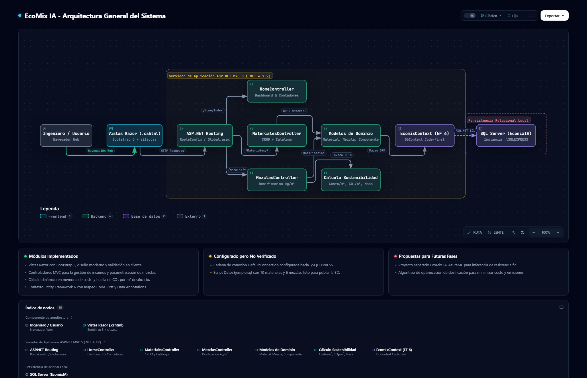
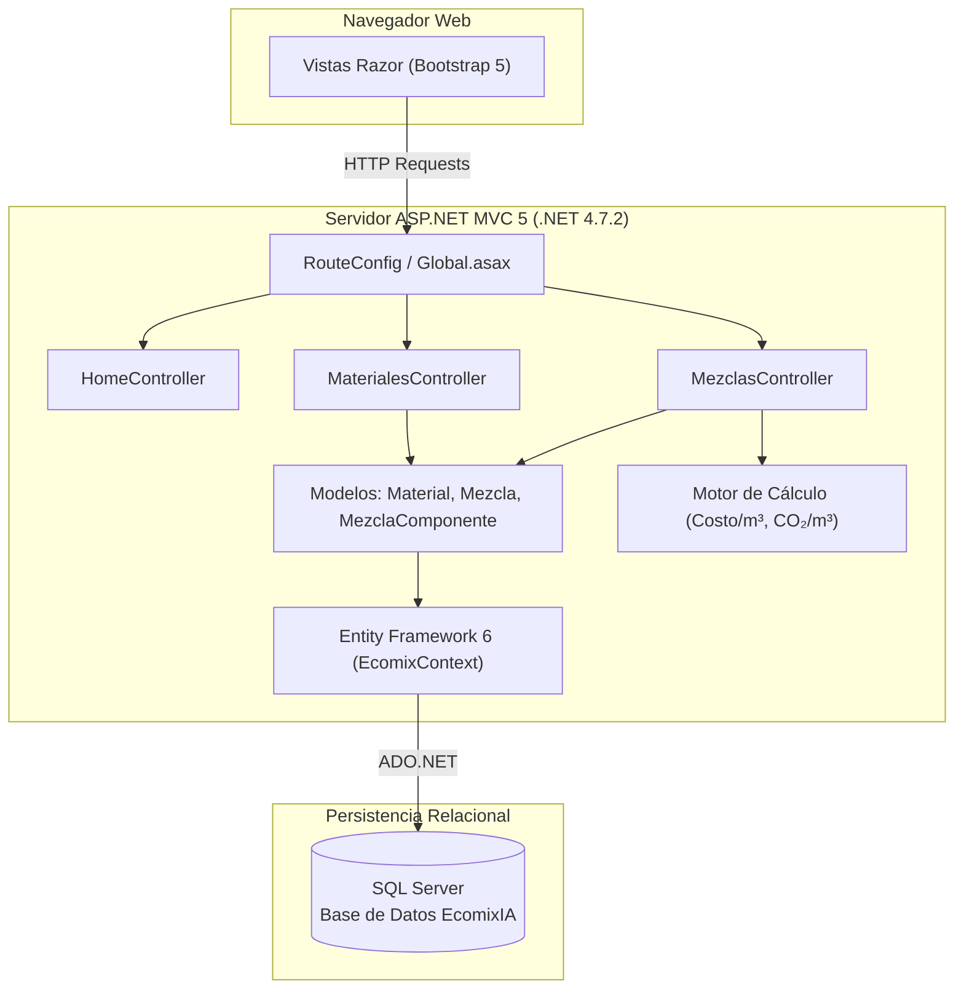

# UNIVERSIDAD PRIVADA DE TACNA
### FACULTAD DE INGENIERÍA
#### Escuela Profesional de Ingeniería de Sistemas

---

# Proyecto: Sistema de EcoMix IA
**Diseño y Optimización de Mezclas de Concreto Ecológico con Indicadores de Sostenibilidad y Costos**

* **Curso:** Programación Web II  
* **Docente:** Mtro. Enrique Félix LANCHIPA VALENCIA  
* **Integrantes:**  
  * Guillén Laveriano, Joel Adrián &nbsp;&nbsp;&nbsp;&nbsp;&nbsp;&nbsp;&nbsp;&nbsp; *(Código: 0098018499)*  
  * Medina Quispe, Joan Cristian &nbsp;&nbsp;&nbsp;&nbsp;&nbsp;&nbsp;&nbsp;&nbsp;&nbsp; *(Código: 2022074255)*  
* **Lugar y Fecha:** Tacna – Perú, 2026  

---


---

## 1. Descripción del Proyecto

**EcoMix IA** es una plataforma web desarrollada en **ASP.NET MVC 5** sobre **.NET Framework 4.7.2**, orientada a la ingeniería civil y de materiales. Su propósito central es facilitar la **formulación, gestión y análisis ambiental-económico de mezclas de concreto estructural y ecológico**.

Tradicionalmente, la producción de concreto convencional genera un alto impacto ambiental debido a las emisiones de $\text{CO}_2$ del clínker en el cemento Portland. **EcoMix IA** permite a ingenieros y formuladores incorporar materiales suplementarios y adiciones (como cenizas volantes, escorias de alto horno y microsílice), evaluando al instante la relación entre la resistencia mecánica objetivo ($f'c$), el costo por metro cúbico ($\text{S/./m}^3$) y la huella de carbono ($\text{kg CO}_2/\text{m}^3$).

---

## 2. Estado de Avance del Proyecto

A la fecha, el proyecto presenta un avance consolidado en sus componentes centrales de software web y persistencia:

### A. Módulo de Catálogo de Materiales (`MaterialesController`)
- **Gestión Integral CRUD:** Registro, edición, detalle y eliminación de insumos de concreto.
- **Parametrización Técnica y Ecológica:**
  - Categorización normalizada (`TiposMaterial`): *Cemento, Adición, Agregado fino, Agregado grueso, Agua y Aditivo*.
  - Parámetros físicos: Densidad relativa ($\text{g/cm}^3$).
  - Parámetros económicos: Costo unitario por kilogramo ($\text{S/./kg}$).
  - Parámetros ambientales: Factor de emisión de $\text{CO}_2$ por kilogramo ($\text{kg CO}_2/\text{kg}$).
- **Validaciones de Integridad:** Bloqueo de eliminación si un material ya forma parte de una fórmula dosificada en el sistema.

### B. Módulo de Diseño de Mezclas y Dosificación (`MezclasController`)
- **Especificaciones de Diseño Estructural:**
  - Resistencia a la compresión requerida ($f'c$ en $\text{MPa}$).
  - Edad de diseño (curado estándar a 28 días).
  - Relación agua/cemento ($a/c$).
  - Asentamiento (*slump* en $\text{cm}$).
- **Dosificación por Metro Cúbico ($1\text{ m}^3$):**
  - Incorporación dinámica de componentes mediante formulario reactivo.
  - Validación de unicidad de insumo por mezcla (evita registros duplicados).
  - Control de cantidades en $\text{kg/m}^3$.

### C. Motor de Cálculo de Sostenibilidad en Tiempo Real
- Implementado a nivel de entidad de dominio ([`Models/Mezcla.cs`](Models/Mezcla.cs)) mediante propiedades no mapeadas (`[NotMapped]`):
  - **Costo Total:** $\text{Costo/m}^3 = \sum (\text{Cantidad}_i \times \text{CostoPorKg}_i)$
  - **Huella de Carbono:** $\text{CO}_2/\text{m}^3 = \sum (\text{Cantidad}_i \times \text{Co2PorKg}_i)$
  - **Masa Total Fresca:** $\text{Masa Total/m}^3 = \sum \text{Cantidad}_i$
- Actualización inmediata de indicadores en la vista de detalle de cada mezcla.

### D. Interfaz Gráfica y Experiencia de Usuario (UI/UX)
- Vistas Razor (`.cshtml`) diseñadas con **Bootstrap 5.3.3**, fuentes tipográficas Inter y **Bootstrap Icons**.
- Panel de inicio (`Home/Index`) con tarjetas métricas de inventario de materiales y dosificaciones activas.
- Hojas de estilo personalizadas ([`Content/site.css`](Content/site.css)) orientadas a un diseño sobrio de ingeniería y sostenibilidad.

### E. Persistencia y Base de Datos
- **Entity Framework 6.5.1 (Code-First):** Contexto [`EcomixContext`](Models/EcomixContext.cs) con mapeo relacional de entidades `Materials`, `Mezclas` y `MezclaComponentes`.
- **Script de Poblamiento Idempotente ([`DatosEjemplo.sql`](DatosEjemplo.sql)):** Incluye 10 materiales calibrados y 6 formulaciones de referencia (concretos estructurales $f'c\text{ 210, 280, 350}$, mezclas ecológicas con 20% ceniza y 35% escoria, y concreto de alta resistencia de 50 MPa).

### F. Portal de Documentación Técnica Interactiva (`docs-interactive/`)
- Portal interactivo independiente desarrollado con **Archify 3.2**, con visor integrado y modo oscuro predeterminado.
- 4 diagramas visuales con zoom, trazado de dependencias e inspección autónoma:
  1. *Arquitectura General del Sistema*
  2. *Flujo de Registro de Materiales y Creación de Mezclas*
  3. *Arquitectura Propuesta de Integración con Azure Machine Learning*
  4. *Modelo Entidad-Relación de Base de Datos*

---

## 3. Arquitectura del Sistema



> **Figura 1:** *Diagrama de Arquitectura General de EcoMix IA generado con Archify 3.2. Mapea la interacción entre la interfaz Razor con Bootstrap 5, enrutamiento ASP.NET, controladores MVC, motor de cálculo de sostenibilidad y persistencia con Entity Framework 6 / SQL Server.*
>
> 🔗 **Exploración Interactiva:** Puedes abrir y explorar este diagrama con zoom dinámico y trazado de rutas en [`docs-interactive/arquitectura-general.html`](docs-interactive/arquitectura-general.html) o acceder al portal completo en [`docs-interactive/index.html`](docs-interactive/index.html).

<details>
<summary>Ver diagrama textual en formato Mermaid</summary>



</details>

---

## 4. Estructura del Repositorio

```text
ML EcomixIA Sistema/
├── App_Start/
│   └── RouteConfig.cs             # Configuración de enrutamiento ASP.NET
├── Content/
│   └── site.css                   # Estilos personalizados de la plataforma
├── Controllers/
│   ├── HomeController.cs          # Panel principal y resumen de indicadores
│   ├── MaterialesController.cs    # Lógica CRUD y validación de materiales
│   └── MezclasController.cs       # Lógica de dosificación y mezcla por m³
├── Models/
│   ├── EcomixContext.cs           # DbContext de Entity Framework 6
│   ├── Material.cs                # Entidad de material con costo y CO₂
│   ├── Mezcla.cs                  # Entidad de mezcla y fórmulas de KPIs
│   ├── MezclaComponente.cs        # Tabla intermedia (dosificación kg/m³)
│   └── TiposMaterial.cs           # Catálogo maestro de tipos de insumo
├── Views/
│   ├── Home/                      # Vista principal de inicio
│   ├── Materiales/                # Formularios y listado de insumos
│   ├── Mezclas/                   # Vistas de dosificación y visualización de KPIs
│   └── Shared/                    # Plantilla base (_Layout.cshtml)
├── docs-interactive/              # Documentación técnica interactiva con Archify
│   ├── index.html                 # Portal interactivo con visor integrado
│   ├── README.md                  # Guía de despliegue y GitHub Pages
│   ├── img/                       # Capturas en alta resolución de diagramas
│   │   ├── arquitectura-general.png
│   │   ├── flujo-registro-mezclas.png
│   │   ├── integracion-azure-ml.png
│   │   └── modelo-erd.png
│   ├── arquitectura-general.html  # Diagrama de arquitectura general
│   ├── flujo-registro-mezclas.html# Diagrama de flujo de dosificación
│   ├── integracion-azure-ml.html  # Diagrama de integración con Azure ML
│   └── modelo-erd.html            # Diagrama Entidad-Relación
├── DatosEjemplo.sql               # Script SQL con datos semilla
├── EcomixIA.csproj                # Archivo de proyecto Visual Studio
├── EcomixIA.sln                   # Solución principal
├── packages.config                # Dependencias NuGet del proyecto
└── Web.config                     # Configuración y cadena de conexión SQL
```

---

## 5. Próximos Pasos y Roadmap (Integración con Azure ML)

Como segunda fase del sistema, se proyecta la integración con el proyecto complementario **`EcoMix-IA-AzureML`**:

- **Modelos Predictivos Supervisados:** Entrenamiento de algoritmos de Machine Learning (XGBoost / LightGBM) para predecir con precisión la resistencia a compresión ($f'c$) a los 7, 28 y 90 días a partir de las proporciones dosificadas.
- **Inferencia en la Nube:** Despliegue de un *Managed Online Endpoint* en **Azure Machine Learning**.
- **Consumo Asíncrono en ASP.NET:** Implementación de un servicio cliente en C# (`Services/AzureMLPredictionService.cs`) para consultar predicciones en tiempo real desde la aplicación web.
- **Optimización Multiobjetivo:** Sugerencia automatizada de dosificaciones óptimas para una resistencia objetivo dada, minimizando simultáneamente el costo económico y la huella de carbono.

> *Nota:* La arquitectura conceptual de esta integración se encuentra detallada en el diagrama interactivo [`docs-interactive/integracion-azure-ml.html`](docs-interactive/integracion-azure-ml.html).

---

## 6. Guía de Instalación y Ejecución Local

### Requisitos Previos
* Windows 10 / 11
* Visual Studio 2019 o 2022 (con carga de trabajo de desarrollo web ASP.NET)
* .NET Framework 4.7.2 Developer Pack
* SQL Server 2017+ o SQL Server Express (`.\SQLEXPRESS`)

### Pasos de Puesta en Marcha

1. **Clonar el repositorio:**
   ```bash
   git clone https://github.com/joeguillenl/EcomixIA.git
   ```

2. **Abrir la solución:**
   - Abre el archivo `EcomixIA.sln` con Visual Studio.

3. **Restaurar paquetes NuGet:**
   - En Visual Studio: clic derecho sobre la solución > *Restaurar paquetes NuGet*.

4. **Configurar la base de datos:**
   - Revisa la cadena de conexión en [`Web.config`](Web.config):
     ```xml
     <connectionStrings>
       <add name="DefaultConnection" 
            connectionString="Data Source=.\SQLEXPRESS;Initial Catalog=EcomixIA;Integrated Security=True;MultipleActiveResultSets=True" 
            providerName="System.Data.SqlClient" />
     </connectionStrings>
     ```
   - Abre SQL Server Management Studio (SSMS) y ejecuta el script [`DatosEjemplo.sql`](DatosEjemplo.sql) sobre tu servidor para crear la base de datos `EcomixIA` y cargar los datos semilla de prueba.

5. **Compilar y Ejecutar:**
   - Presiona `F5` o *Ctrl + F5* en Visual Studio para compilar y ejecutar la aplicación en IIS Express.

6. **Explorar la Documentación Interactiva:**
   - Abre directamente en cualquier navegador el archivo [`docs-interactive/index.html`](docs-interactive/index.html) para explorar los diagramas interactivos de arquitectura sin requerir base de datos ni servidor activo.
