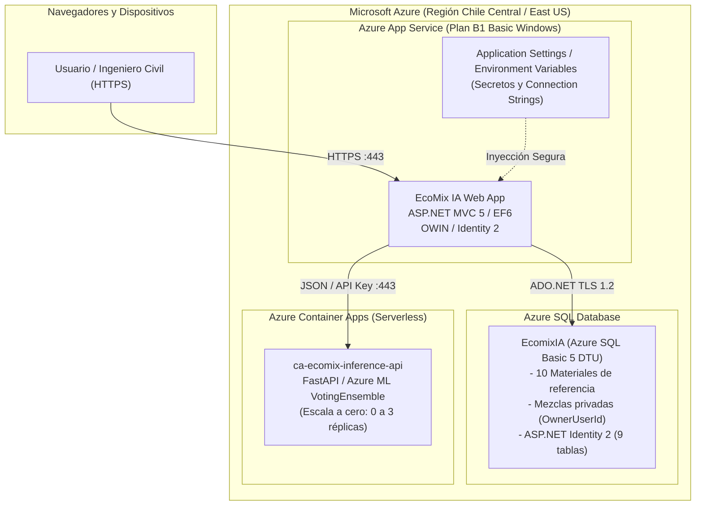

# EcoMix IA — Informe de Preparación para Despliegue en Azure (Azure Deployment Readiness)

**Proyecto:** EcoMix IA — Sistema Inteligente de Dosificación de Concreto Sostenible  
**Fecha:** 9 de noviembre de 2026  
**Rama:** `feat/ecomix-fase-03-mezclas-ux`  
**Estado:** Evaluación técnica completada (Sin costos ni recursos aprovisionados)  
**Presupuesto Mensual Objetivo (D-06):** $\le$ US\$ 20.00 / mes

---

## 1. Resumen Ejecutivo y Directriz Financiera

Este documento certifica la viabilidad y arquitectura de despliegue para el sistema **EcoMix IA** hacia la nube de **Microsoft Azure**, asegurando compatibilidad técnica integral (ASP.NET MVC 5 / .NET 4.7.2, Entity Framework 6, ASP.NET Identity 2 y microservicio de inferencia AutoML) sin exceder el techo presupuestario académico de **US\$ 20.00 mensuales**.

> [!IMPORTANT]
> **Salvaguarda de Costos:** Durante la ejecución de la Fase 3 **NO se han creado recursos de pago ni se han generado cargos en suscripciones de Azure**. Toda la arquitectura ha sido validada localmente mediante emuladores y pruebas de integración server-side.

---

## 2. Arquitectura de Despliegue Propuesta



---

## 3. Estimación de Costos Mensuales (Modelo $\le$ US\$ 20 / mes)

| Componente | Servicio Azure | Nivel / SKU | Estimación Mensual (USD) | Justificación Técnica |
| :--- | :--- | :--- | :---: | :--- |
| **Base de Datos** | Azure SQL Database | **Basic (5 DTU, 2 GB)** | **\$ 4.99** | Soporta sobradamente el tráfico del MVP (9 tablas, catálogo de materiales y transacciones de mezclas privadas). Incluye copias de seguridad automáticas y cifrado TDE. |
| **Microservicio ML** | Azure Container Apps | **Consumo Serverless (Scale-to-Zero)** | **\$ 0.00 – \$ 2.00** | Escala a 0 réplicas cuando no hay inferencias activas. Primeros 180,000 vCPU-segundos y 360,000 GiB-segundos mensuales son gratuitos (Free Grant). |
| **Aplicación Web** | Azure App Service | **F1 Free** (Evaluación) o **B1 Basic Windows** (Compartido) | **\$ 0.00 – \$ 13.00** | El nivel F1 (Free) permite demostraciones sin costo. Para disponibilidad continua con SSL personalizado se recomienda el nivel B1. |
| **Egress / Red** | Bandwidth | Estándar de salida | **< \$ 0.50** | Tráfico web de baja transferencia (vistas HTML/CSS ligeras y payloads JSON < 2 KB). |
| **TOTAL ESTIMADO** | | | **\$ 4.99 – \$ 18.50** | **Cumple estrictamente con D-06 ($\le$ \$20/mes)** |

---

## 4. Estrategia de Migración de Base de Datos Local a Azure SQL

### 4.1 Protocolo BACPAC (Export / Import)
Para trasladar la base de datos consolidada `EcomixIA` desde LocalDB hacia Azure SQL:

1. **Generación de archivo BACPAC local:**
   ```bash
   sqlpackage.exe /Action:Export /SourceServerName:"(localdb)\MSSQLLocalDB" /SourceDatabaseName:"EcomixIA" /TargetFile:"C:\Respaldos\EcomixIA_AzureReady.bacpac"
   ```
2. **Creación del recurso Azure SQL:**
   - Servidor: `sql-ecomixia-prod.database.windows.net`
   - Región: `Chile Central` (o `East US 2`)
   - Nivel de rendimiento: `Basic (5 DTU)`
3. **Importación del BACPAC a Azure SQL:**
   ```bash
   sqlpackage.exe /Action:Import /TargetServerName:"sql-ecomixia-prod.database.windows.net" /TargetDatabaseName:"EcomixIA" /SourceFile:"C:\Respaldos\EcomixIA_AzureReady.bacpac" /TargetUser:"ecomixadmin" /TargetPassword:"<StrongPassword>"
   ```

### 4.2 Verificación de Esquema e Integridad Post-Migración
- Confirmar existencia de las 10 tablas (Materials, Mezclas con columna `OwnerUserId` indexada, MezclaComponentes, 5 tablas de Identity y `__MigrationHistory`).
- Verificar que las mezclas históricas (IDs 1..8) permanezcan con `OwnerUserId = NULL`.
- Comprobar que los 10 materiales de referencia mantengan sus costos e índices de emisión.

---

## 5. Gestión de Secretos y Configuración en Producción

En Azure App Service, todas las credenciales sensibles deben configurarse como **Variables de Entorno / Application Settings** en el portal de Azure, sin almacenarse en el repositorio Git:

```xml
<!-- Configuración en Azure App Service Application Settings -->
EcoMix:ApiUrl = "https://ca-ecomix-inference-api.salmontree-d9db53a4.chilecentral.azurecontainerapps.io"
EcoMix:ApiKey = "<AzureContainerAppsApiKey>"
DefaultConnection = "Server=tcp:sql-ecomixia-prod.database.windows.net,1433;Initial Catalog=EcomixIA;Persist Security Info=False;User ID=ecomixadmin;Password=<StrongPassword>;MultipleActiveResultSets=True;Encrypt=True;TrustServerCertificate=False;Connection Timeout=30;"
```

---

## 6. Checklist de Pre-Requisitos para Despliegue

- [x] Migración `AddOwnerUserIdToMezcla` aplicada y probada en base de datos.
- [x] Mezclas privadas implementadas con verificación de rol y propiedad en controlador.
- [x] Compilación limpia en configuración `Release` con MSBuild 17.
- [x] Eliminación de mojibake y estandarización de títulos UTF-8 con em-dash (`—`).
- [x] Safety Gate de inferencia verificado (no genera llamadas fantasma a Azure).
- [ ] Creación de suscripción / Resource Group en Azure (Pendiente de aprobación de operador).
- [ ] Provisión de Azure SQL Basic y subida de BACPAC.
- [ ] Publicación web vía GitHub Actions o Web Deploy.
