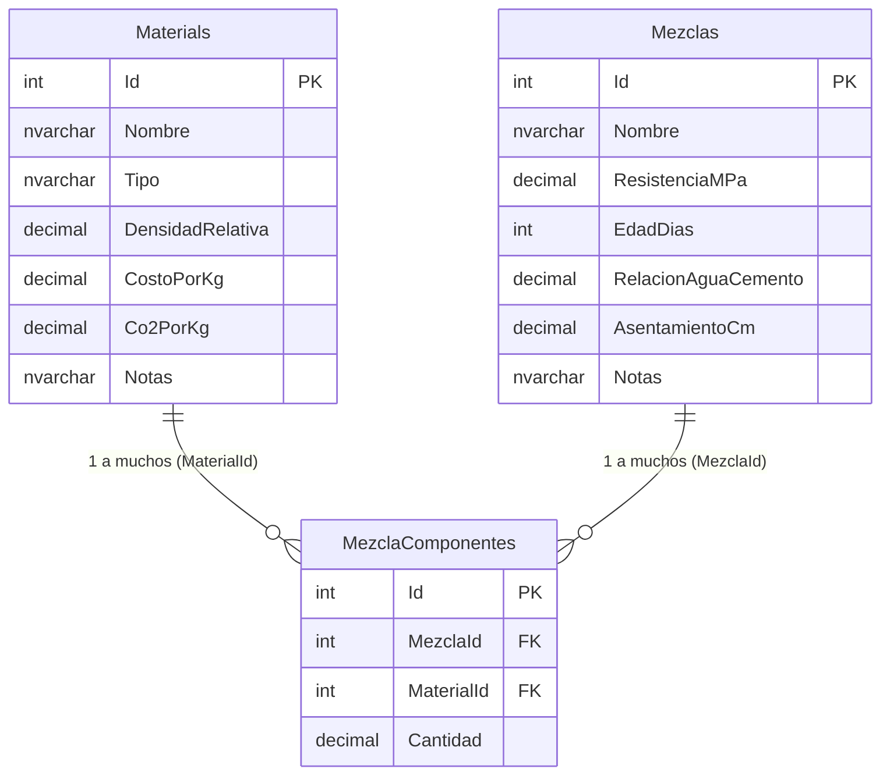

# EcoMix IA — Evidencias de Ejecución: Fase 0 (Línea Base)

**Proyecto:** EcoMix IA — Portal de diseño y análisis preliminar de mezclas de concreto  
**Repositorio:** `https://github.com/joeguillenl/EcomixIA`  
**Directorio local:** `C:\Users\Admin\Desktop\Proyectos\ML EcomixIA Sistema`  
**Fecha de registro F0.1:** 09/11/2026 (America/Lima)  
**Fecha de registro F0.2:** 09/11/2026 (America/Lima)  
**Fecha de registro F0.3:** 09/11/2026 (America/Lima)  
**Fecha de registro F0.4:** 09/11/2026 (America/Lima)  
**Fecha de registro F0.5:** 09/11/2026 (America/Lima)  
**Fecha de registro F0.6:** 09/11/2026 (America/Lima)  

---

## 1. Registro de Ejecución F0.1: Protección y Formalización de Línea Base

### 1.1 Metadatos y Entorno Git
* **Rama base:** `feat/integration-fastapi-service`
* **Commit base:** `5495f92074a843f133fbcff4d6ddcfb46c3ec36b` (`5495f92`)
  * Mensaje: `chore(git): ignore exported presentation binaries (.pptx, .pdf)`
* **Sincronización inicial con origin:** `0` adelante, `0` atrás (`origin/feat/integration-fastapi-service`).
* **Nueva rama de trabajo creada:** `chore/ecomix-fase-00-linea-base`
  * Comando: `git switch -c chore/ecomix-fase-00-linea-base`
  * Verificación previa: Se confirmó que no existía local ni remotamente antes de su creación.

### 1.2 Estado Git Comparativo (Inicial vs. Final de F0.1)

| Aspecto | Estado Inicial (F0.1) | Estado Final (F0.1) |
| :--- | :--- | :--- |
| **Rama activa** | `feat/integration-fastapi-service` | `chore/ecomix-fase-00-linea-base` |
| **Commit HEAD** | `5495f92` | `5495f92` |
| **Archivos modificados** | `Web.config` (cambio local de conexión) | `Web.config` (conservado intacto, sin stage) |
| **Archivos no rastreados** | 3 documentos en `docs/` | 3 documentos en `docs/` + `docs/FASE_00_EVIDENCIAS.md` |
| **Commits realizados** | Ninguno | Ninguno (según restricción estricta de F0.1) |

---

## 2. Verificación y Protección de Configuración Local

### 2.1 Inspección de `Web.config`
* **Comprobación `git diff --check`:** Validado sin advertencias de corrupción o sintaxis.
* **Contenido del diff:**
  * Se sustituyó la cadena `Data Source=.\SQLEXPRESS;Initial Catalog=EcomixIA;...` por `Data Source=(LocalDb)\MSSQLLocalDB;Initial Catalog=EcomixIA;Integrated Security=True;MultipleActiveResultSets=True`.
  * **Diagnóstico:** El cambio es exclusivamente un ajuste de cadena de conexión a SQL Server LocalDB. No contiene credenciales duras, contraseñas, tokens de API ni cambios en parámetros de la aplicación (`appSettings`).
* **Protección:** Se preservó el cambio local sin revertir, sin usar `git stash`, `git reset` ni `git clean`. Adicionalmente, se generó un respaldo de contingencia externo fuera del repositorio de trabajo.

### 2.2 Validación de Secretos y `.gitignore`
* **Regla `.gitignore` verificada:** Línea 365 (`Web.Secrets.config`) y Línea 366 (`*.secrets.config`).
* **Comprobación:** `git check-ignore -v Web.Secrets.config` resolvió exitosamente a la regla `*.secrets.config`.
* **Estado:** Archivo presente en disco y completamente ignorado por Git, previniendo fuga involuntaria de credenciales.

---

## 3. Revisión de Coherencia Documental

Se revisaron exhaustivamente los documentos base:
1. `docs/FD03_EPIS_SRS_EcoMixIA_v1.2.md` (SRS v1.2)
2. `docs/FD03_EPIS_SAD_EcoMixIA_v1.1.md` (SAD v1.1)
3. `docs/EcoMixIA_PLAN_FASE_0_LINEA_BASE.md` (Plan F0 v1.0)

### 3.1 Matriz de Verificación de Decisiones Arquitectónicas (D-01 a D-10)

| Decisión | Estado | Resumen de Acuerdo | Coherencia SRS / SAD / Plan |
| :--- | :--- | :--- | :--- |
| **D-01** | Aprobada | Mezclas privadas por usuario, seguridad por objeto sin bypass IDOR. | Coherente |
| **D-02** | Aprobada | Catálogo `Materials` global: lectura para autenticados, CRUD exclusivo de Administrador. | Coherente |
| **D-03** | **Provisional** | Correo transaccional externo gratis/bajo costo; selección de proveedor pendiente antes de producción F2. | Coherente (no bloquea F0/F1 local) |
| **D-04** | Aprobada | Dashboard personal ligero; cálculos en memoria; sin tabla ni persistencia de historial ML. | Coherente |
| **D-05** | Aprobada | Marca propia EcoMix IA con inspiración cromática en Yura; recursos autorizados; sin afirmar patrocinio oficial. | Coherente |
| **D-06** | Aprobada | Consumo **acumulado máximo de US$20** de crédito Azure for Students (incluye ML actual). Umbrales de aviso US$10, 15, 18. | Coherente |
| **D-07** | Aprobada | Auditoría `AuditEvents` con retención estricta de 30 días naturales desde UTC; purga por lotes en F5. | Coherente |
| **D-08** | Aprobada | Administrador sin acceso de lectura/edición a mezclas privadas ajenas (mínimo privilegio estricto). | Coherente |
| **D-09** | Aprobada | Snapshots históricos de costo y CO₂ unitarios por componente al guardarse; datos previos rotulados `LEGADO_SIN_VERIFICAR`. | Coherente |
| **D-10** | Aprobada | Provisión segura del primer Administrador mediante herramienta manual fuera de código y sin rutina web pública. | Coherente |

---

## 4. Matriz de Estado de Actividades de la Fase 0

### 4.1 Actividades Verificadas y Completadas (F0.1 a F0.6)
- [x] **F0.1.1 Diagnóstico Git:** Inspección de estado, commit HEAD `5495f92`, remoto y árbol de trabajo.
- [x] **F0.1.2 Protección de configuración:** Validación del diff de `Web.config` (solo LocalDB), verificación de exclusión de `Web.Secrets.config` en `.gitignore` y respaldo externo.
- [x] **F0.1.3 Creación de rama de trabajo:** Rama `chore/ecomix-fase-00-linea-base` creada y checkout completado preservando cambios locales y documentos sin seguimiento.
- [x] **F0.1.4 Validación de documentación:** Revisión de coherencia de SRS v1.2, SAD v1.1 y Plan F0, con validación de D-01 a D-10.
- [x] **F0.1.5 Creación de registro de evidencias:** Documento `docs/FASE_00_EVIDENCIAS.md` generado.
- [x] **F0.2.1 Conexión y diagnóstico de motor:** Verificación de conexión de solo lectura a `(localdb)\MSSQLLocalDB`, versión de SQL Server y base `EcomixIA`.
- [x] **F0.2.2 Inventario de tablas y esquemas:** Inspección de catálogo de base de datos (`Materials`, `Mezclas`, `MezclaComponentes`, `__MigrationHistory`).
- [x] **F0.2.3 Verificación de integridad de datos:** Conteos de registros, validación de integridad referencial, análisis de mezclas huérfanas/vacías y detección de datos legado.
- [x] **F0.2.4 Inspección de modelos EF6:** Comparación técnica entre clases C# (`Models/`) y el esquema físico en SQL Server.
- [x] **F0.2.5 Análisis de compatibilidad con SRS y SAD:** Evaluación de brechas respecto a decisiones D-01, D-02, D-04, D-07, D-09 y D-10.
- [x] **F0.3.1 Prechequeo de entorno y espacio:** Confirmación de estado `ONLINE` de `EcomixIA`, archivos físicos (8MB MDF / 8MB LDF) y espacio en disco C: (123 GB libres).
- [x] **F0.3.2 Respaldo completo COPY_ONLY:** Generación de archivo `.bak` con `CHECKSUM` en directorio externo fuera del repositorio con hash SHA-256 verificado.
- [x] **F0.3.3 Verificación del archivo de respaldo:** Ejecución exitosa de `RESTORE HEADERONLY`, `RESTORE FILELISTONLY` y `RESTORE VERIFYONLY WITH CHECKSUM`.
- [x] **F0.3.4 Restauración de ensayo en base independiente:** Creación exitosa de `EcomixIA_F0_Restore_Test` con `WITH MOVE`, sin `WITH REPLACE` y sin alterar la base original.
- [x] **F0.3.5 Diagnóstico de integridad física y lógica:** Ejecución de `DBCC CHECKDB` con 0 errores y confirmación del 100% de registros e integridad referencial idéntica a F0.2.
- [x] **F0.4.1 Compilación de solución:** Compilación limpia con MSBuild 17.14 (VS 2022 Community) en configuración `Debug|Any CPU` con 0 errores y 0 advertencias.
- [x] **F0.4.2 Ejecución de IIS Express:** Servidor iniciado en puerto seguro asignado `https://localhost:44357/` (HTTP 62778) sin errores 500.
- [x] **F0.4.3 Pruebas de humo HTTP (SM-01 a SM-08):** 8/8 pruebas con código HTTP 200 OK (100% PASS) cubriendo Home, Catálogo, Mezclas y Simulador.
- [x] **F0.4.4 Validación de cálculos e integridad:** Comprobación matemática exacta en Mezcla 1 (2343 kg/m³, S/ 336.93/m³, 333.0 kg $\text{CO}_2$/m³) y tolerancia a mezcla vacía (Mezcla 7).
- [x] **F0.4.5 Inspección del Simulador ML:** Formulario, unidades kg/m³, presets y precarga validados en solo lectura sin invocar inferencias ni generar costos en Azure.
- [x] **F0.4.6 Verificación post-pruebas en SQL:** Confirmación de que `EcomixIA` y la base restaurada permanecen 100% inalteradas (10, 8, 32, 1 filas).
- [x] **F0.5.1 Auditoría de suscripción Azure for Students:** Estado `Enabled`, tenant `upt.pe`, un único grupo de recursos `EcomixIA`.
- [x] **F0.5.2 Inventario completo de infraestructura:** 11 recursos identificados y clasificados por tipo, región y política de cobro.
- [x] **F0.5.3 Diagnóstico de cómputo y escalado:** Verificación de `minReplicas = 0` en Container App y `min_instances = 0` en AML Compute Cluster (escala a cero).
- [x] **F0.5.4 Auditoría de presupuestos en la nube:** Comprobación de 0 presupuestos en Azure; formalización de umbrales D-06 (US$ 10, 15, 18, 20).
- [!] **F0.5.5 Reconciliación de saldo exacto en portal:** Identificación de rate-limiting (HTTP 429) en API de Cost Management; catalogado como **NO VERIFICADO / PENDIENTE DE CONSULTA MANUAL EN PORTAL** según regla estricta de D-06.
- [x] **F0.6.1 Auditoría documental integral:** Validación de coherencia y referencias cruzadas entre SRS v1.2, SAD v1.1, Plan F0 y Evidencias.
- [x] **F0.6.2 Verificación de seguridad:** Confirmación de exclusión estricta de `Web.config`, `Web.Secrets.config`, binarios y secretos.
- [x] **F0.6.3 Formalización del cierre financiero D-06:** Declaración de estado pendiente de conciliación sin registrar cifras no comprobadas.
- [x] **F0.6.4 Evaluación para Fase 1 local:** Autorización técnica para iniciar portal público local sin consumo en Azure.
- [x] **F0.6.5 Preparación de control de versiones:** Staging selectivo atómico de los 4 archivos documentales sin ejecutar commits automáticos.

### 4.2 Estado de Puerta de Calidad
* **Fase 0:** **COMPLETADA CON APROBACIÓN CONDICIONADA**.
* **Fase 1 (Portal Público Local):** **LISTA PARA INICIAR (PREVIA AUTORIZACIÓN DEL USUARIO)**.

---

## 5. Riesgos Identificados y Medidas de Mitigación

1. **Riesgo de commit accidental de `Web.config`:**
   * *Descripción:* Al contener el ajuste de cadena a `(localdb)\MSSQLLocalDB`, un `git add .` o `git commit -a` podría registrar la configuración local en el historial compartido.
   * *Mitigación:* Se prohíbe el uso de comandos globales de add/commit; solo se versionarán archivos documentales explícitamente designados.
2. **Definición de proveedor de correo (D-03):**
   * *Descripción:* La elección del proveedor transaccional sigue en estado provisional.
   * *Mitigación:* Se mantiene desacoplada en F0 y F1 mediante interfaz abstracta (`IEmailService`), postergando la selección del proveedor real hasta la fase de identidad (F2).
3. **Consumo no registrado en Azure (D-06):**
   * *Descripción:* El límite acumulado de US$20 exige considerar costos de infraestructura previa de ML.
   * *Mitigación:* Obligatoriedad de obtener fecha de corte y consumo total acumulado antes de autorizar cualquier despliegue en la nube en F6.
4. **Ausencia de snapshots de costos en componentes (D-09):**
   * *Descripción:* Los 32 componentes actuales calculan costos en base al precio actual del catálogo. Cualquier variación en `Materials` muta retroactivamente las mezclas históricas.
   * *Mitigación:* Tratar los registros actuales estrictamente como `LEGADO_SIN_VERIFICAR` y añadir las columnas de snapshot unitario en la migración de F3.
5. **Mezclas de prueba sin componentes (IDs 7 y 8):**
   * *Descripción:* Las mezclas 7 y 8 tienen 0 componentes, lo que puede provocar división entre cero o promedios distorsionados en futuros dashboards.
   * *Mitigación:* El dashboard de F4 debe filtrar mezclas con componentes válidos (`Componentes.Any()`).
6. **Consumo continuo de Azure Container Registry Basic:**
   * *Descripción:* El recurso `crecomixprod` (ACR Basic) tiene un costo fijo de aprox. US$ 0.167/día (~US$ 5.00/mes) independientemente de si se usa o no.
   * *Mitigación:* Considerar su tasa de consumo pasivo dentro de la ventana de tiempo del proyecto para evitar agotar los US$ 20.

---

## 6. F0.2 — Inventario y Diagnóstico SQL Server LocalDB

### 6.1 Entorno de Conexión y Diagnóstico de Motor
* **Instancia:** `(localdb)\MSSQLLocalDB` (Nombre interno: `DESKTOP-A5TSV3S\LOCALDB#CC182BFE`)
* **Base de datos conectada:** `EcomixIA`
* **Versión de SQL Server:** Microsoft SQL Server 2019 (RTM-CU27-GDR) (KB5040948) - 15.0.4382.1 (X64) - Express Edition (64-bit) sobre Windows 10 Pro (Build 26200).
* **Estado de accesibilidad:** ONLINE, operativa vía autenticación integrada de Windows (`Integrated Security=True`).
* **Método de inspección:** Scripts ADO.NET (`System.Data.SqlClient`) de solo lectura ejecutados en PowerShell sin alterar configuración ni instalar herramientas adicionales.

### 6.2 Inventario de Tablas y Esquemas Físicos

| Esquema | Tabla Física | Filas | Clave Primaria (PK) | Claves Foráneas (FK) | Propósito Actual |
| :--- | :--- | :---: | :--- | :--- | :--- |
| `dbo` | `__MigrationHistory` | 1 | `(MigrationId, ContextKey)` | Ninguna | Historial de migraciones EF6 (`202611082237174_InitialCreate`, EF 6.5.1) |
| `dbo` | `Materials` | 10 | `Id` (int, IDENTITY) | Ninguna | Catálogo maestro de materiales y precios/emisiones vigentes |
| `dbo` | `Mezclas` | 8 | `Id` (int, IDENTITY) | Ninguna | Fichas de mezclas (6 demostrativas semilla + 2 pruebas locales) |
| `dbo` | `MezclaComponentes` | 32 | `Id` (int, IDENTITY) | `MaterialId` $\to$ `Materials.Id`<br>`MezclaId` $\to$ `Mezclas.Id` | Relación de dosificación (kg/m³) por mezcla |

### 6.3 Detalle Estructural de Columnas y Tipos de Datos

#### A. Tabla `dbo.Materials`
* `Id` (`int`, PK, IDENTITY, NOT NULL)
* `Nombre` (`nvarchar(100)`, NOT NULL)
* `Tipo` (`nvarchar(50)`, NOT NULL)
* `DensidadRelativa` (`decimal(18,2)`, NULL)
* `CostoPorKg` (`decimal(18,2)`, NOT NULL)
* `Co2PorKg` (`decimal(18,2)`, NOT NULL)
* `Notas` (`nvarchar(500)`, NULL)

#### B. Tabla `dbo.Mezclas`
* `Id` (`int`, PK, IDENTITY, NOT NULL)
* `Nombre` (`nvarchar(100)`, NOT NULL)
* `ResistenciaMPa` (`decimal(18,2)`, NOT NULL)
* `EdadDias` (`int`, NOT NULL)
* `RelacionAguaCemento` (`decimal(18,2)`, NULL)
* `AsentamientoCm` (`decimal(18,2)`, NULL)
* `Notas` (`nvarchar(500)`, NULL)

#### C. Tabla `dbo.MezclaComponentes`
* `Id` (`int`, PK, IDENTITY, NOT NULL)
* `MezclaId` (`int`, FK, NOT NULL)
* `MaterialId` (`int`, FK, NOT NULL)
* `Cantidad` (`decimal(18,2)`, NOT NULL) — Representa kg/m³ en la dosificación.

#### D. Tabla `dbo.__MigrationHistory`
* `MigrationId` (`nvarchar(150)`, PK, NOT NULL)
* `ContextKey` (`nvarchar(300)`, PK, NOT NULL)
* `Model` (`varbinary(max)`, NOT NULL)
* `ProductVersion` (`nvarchar(32)`, NOT NULL)

---

### 6.4 Verificación de Datos e Integridad Referencial

#### A. Catálogo de Materiales (`dbo.Materials` — 10 registros)
Los 10 registros corresponden exactamente a las definiciones de `DatosEjemplo.sql`:
1. `Cemento Portland Tipo I` (Cemento, $\rho_r=3.15$, Costo=S/ 0.62/kg, $\text{CO}_2=0.90$ kg/kg)
2. `Cemento Puzolanico Tipo IP` (Cemento, $\rho_r=3.00$, Costo=S/ 0.58/kg, $\text{CO}_2=0.70$ kg/kg)
3. `Agua potable` (Agua, $\rho_r=1.00$, Costo=S/ 0.01/kg, $\text{CO}_2=0.00$ kg/kg)
4. `Arena gruesa` (Agregado, $\rho_r=2.65$, Costo=S/ 0.06/kg, $\text{CO}_2=0.01$ kg/kg)
5. `Piedra chancada 3/4"` (Agregado, $\rho_r=2.70$, Costo=S/ 0.07/kg, $\text{CO}_2=0.01$ kg/kg)
6. `Piedra chancada 1/2"` (Agregado, $\rho_r=2.70$, Costo=S/ 0.08/kg, $\text{CO}_2=0.01$ kg/kg)
7. `Aditivo superplastificante` (Aditivo, $\rho_r=1.10$, Costo=S/ 6.50/kg, $\text{CO}_2=0.90$ kg/kg)
8. `Ceniza volante` (Adición, $\rho_r=2.20$, Costo=S/ 0.25/kg, $\text{CO}_2=0.03$ kg/kg)
9. `Escoria de alto horno` (Adición, $\rho_r=2.90$, Costo=S/ 0.30/kg, $\text{CO}_2=0.07$ kg/kg)
10. `Humo de silice` (Adición, $\rho_r=2.20$, Costo=S/ 3.50/kg, $\text{CO}_2=0.03$ kg/kg)

*Integridad:* 0 duplicados por nombre, 0 costos negativos, 0 emisiones negativas, 0 valores requeridos nulos.

#### B. Registro de Mezclas (`dbo.Mezclas` — 8 registros)
Se identificaron 8 mezclas en total:
* **Mezclas Semilla (IDs 1 al 6):** Pobladas mediante `DatosEjemplo.sql`, con componentes asignados y masas coherentes (~2327 a 2385 kg/m³):
  1. `Concreto f'c 210` (4 componentes, 2343.00 kg/m³, S/ 336.93/m³, 333.00 kg $\text{CO}_2$/m³)
  2. `Concreto f'c 280` (5 componentes, 2362.80 kg/m³, S/ 384.80/m³, 380.32 kg $\text{CO}_2$/m³)
  3. `Concreto f'c 350` (5 componentes, 2365.50 kg/m³, S/ 434.36/m³, 426.45 kg $\text{CO}_2$/m³)
  4. `Concreto ecologico con ceniza` (6 componentes, 2327.00 kg/m³, S/ 323.85/m³, 273.90 kg $\text{CO}_2$/m³)
  5. `Concreto ecologico con escoria` (6 componentes, 2353.20 kg/m³, S/ 331.60/m³, 212.38 kg $\text{CO}_2$/m³)
  6. `Concreto alta resistencia 50 MPa` (6 componentes, 2385.00 kg/m³, S/ 619.66/m³, 458.30 kg $\text{CO}_2$/m³)
* **Mezclas de Prueba Local (IDs 7 y 8):** Creadas en pruebas manuales anteriores:
  7. `mezcla test1` (Resistencia: 20 MPa, Edad: 7 días, a/c: 1.00, Slump: 12 cm, Notas: 'apuntes test1') $\to$ **0 componentes vinculados**.
  8. `mezcla test2` (Resistencia: 25 MPa, Edad: 7 días, a/c: 0.80, Slump: 12 cm, Notas: 'prueba test2') $\to$ **0 componentes vinculados**.

#### C. Componentes de Mezcla (`dbo.MezclaComponentes` — 32 registros)
* Todos los 32 registros están vinculados a las mezclas 1 a 6.
* **Integridad referencial:** 
  * `FK_dbo.MezclaComponentes_dbo.Materials_MaterialId`: ON DELETE CASCADE, ON UPDATE NO ACTION.
  * `FK_dbo.MezclaComponentes_dbo.Mezclas_MezclaId`: ON DELETE CASCADE, ON UPDATE NO ACTION.
* Componentes huérfanos sin mezcla: **0**.
* Componentes con material inexistente: **0**.
* Componentes con cantidad $\le 0$: **0**.

---

### 6.5 Comparación entre Modelos Entity Framework 6 y Esquema SQL



1. **Coincidencia de Mapeo:**
   * `Models/Material.cs` $\leftrightarrow$ `dbo.Materials`: Tipos, longitudes y validaciones idénticas.
   * `Models/Mezcla.cs` $\leftrightarrow$ `dbo.Mezclas`: Tipos y rangos idénticos.
   * `Models/MezclaComponente.cs` $\leftrightarrow$ `dbo.MezclaComponentes`: Llaves foráneas y tipos idénticos.
2. **Propiedades no mapeadas (`[NotMapped]` en `Mezcla.cs`):**
   * `CostoPorM3`: Computado dinámicamente como $\sum (\text{Cantidad} \times \text{Material.CostoPorKg})$.
   * `Co2PorM3`: Computado dinámicamente como $\sum (\text{Cantidad} \times \text{Material.Co2PorKg})$.
   * `MasaTotalPorM3`: Computado dinámicamente como $\sum (\text{Cantidad})$.
   * *Diagnóstico:* Este cálculo es en tiempo de ejecución. Al no haber campos de captura en la base de datos, el costo y $\text{CO}_2$ calculados fluctúan si el catálogo cambia.
3. **Estado de Migraciones EF6 en el Proyecto:**
   * La base de datos registra `202611082237174_InitialCreate`.
   * En el código fuente C# **no existe la carpeta `Migrations/`**. Esto indica que el esquema inicial fue creado mediante migraciones no versionadas o inicialización directa. Para futuras fases se requerirá definir la estrategia de migraciones Code First o scripts SQL versionados.

---

### 6.6 Compatibilidad con Requisitos Aprobados (SRS v1.2 / SAD v1.1)

| Decisión | Requisito Arquitectónico | Estado en BD Actual | Brecha Técnica Identificada |
| :--- | :--- | :--- | :--- |
| **D-01** | Mezclas privadas por usuario (`UserId`) | **No existe columna `UserId` en `Mezclas`** | Todas las mezclas son globales. En F3 se debe añadir `UserId nvarchar(128)` nullable para soportar propiedad de usuario. |
| **D-02** | Catálogo `Materials` global compartido | **Cumple (esquema global único)** | La tabla no requiere columna de propietario; el control de acceso se implementará a nivel de controlador en F3. |
| **D-04** | Dashboard ligero con medias de costo/$\text{CO}_2$ | **Parcialmente viable con filtros** | Los cálculos dinámicos funcionan, pero deben ignorar mezclas con 0 componentes (IDs 7 y 8). Sin persistencia de inferencias ML (conforme). |
| **D-07** | Auditoría con retención de 30 días | **No existe tabla `AuditEvents`** | En F5 se deberá crear la tabla con campos `Id`, `FechaUtc`, `UserId`, `Accion`, `DetalleSanitizado` e índice por fecha. |
| **D-09** | Snapshots inmutables de costo y $\text{CO}_2$ | **No existen campos de captura en `MezclaComponentes`** | Faltan `PrecioUnitarioCapturado`, `EmisionUnitarioCapturado`, `FechaCapturaUtc`, `OrigenCaptura`. Los 32 registros actuales son `LEGADO_SIN_VERIFICAR`. |
| **D-10** | Provisión del primer Administrador | **No existen tablas de ASP.NET Identity** | No existen `AspNetUsers`, `AspNetRoles`, etc. La BD actual no tiene módulo de autenticación implementado. |

---

### 6.7 Consultas Utilizadas durante el Diagnóstico (Solo Lectura)

```sql
-- 1. Identificación de instancia y versión
SELECT @@VERSION AS Version, DB_NAME() AS CurrentDB, @@SERVERNAME AS ServerName;

-- 2. Conteo físico de tablas
SELECT s.name AS SchemaName, t.name AS TableName, p.rows AS RowCounts
FROM sys.tables t
INNER JOIN sys.schemas s ON t.schema_id = s.schema_id
INNER JOIN sys.partitions p ON t.object_id = p.object_id
WHERE p.index_id IN (0, 1) ORDER BY s.name, t.name;

-- 3. Análisis de integridad referencial y huérfanos
SELECT m.Id, m.Nombre, COUNT(mc.Id) AS TotalComponentes
FROM dbo.Mezclas m
LEFT JOIN dbo.MezclaComponentes mc ON m.Id = mc.MezclaId
GROUP BY m.Id, m.Nombre;

-- 4. Verificación de reglas de no negatividad
SELECT COUNT(*) FROM dbo.Materials WHERE CostoPorKg < 0 OR Co2PorKg < 0;
SELECT COUNT(*) FROM dbo.MezclaComponentes WHERE Cantidad <= 0;
```

---

## 7. F0.3 — Respaldo y Ensayo de Restauración

### 7.1 Fecha y Entorno Operativo
* **Fecha de ejecución:** 09/11/2026 00:42:20 (America/Lima)
* **Instancia SQL:** `(localdb)\MSSQLLocalDB` (`DESKTOP-A5TSV3S\LOCALDB#CC182BFE`)
* **Base de datos original:** `EcomixIA`
* **Directorio de almacenamiento externo:** `C:\Users\Admin\Desktop\Respaldos_EcoMixIA\Fase_00\` (fuera de Git).
* **Espacio libre en disco comprobado:** 123.02 GB disponibles en disco C:.

### 7.2 Estado Inicial de la Base Original
* **Estado:** `ONLINE`, Modelo de recuperación: `SIMPLE`, Compatibilidad: 150 (SQL Server 2019), Acceso: `MULTI_USER`.
* **Archivos físicos originales:**
  * Datos: `C:\Users\Admin\EcomixIA.mdf` (8 MB)
  * Registro: `C:\Users\Admin\EcomixIA_log.ldf` (8 MB)

### 7.3 Generación del Respaldo Completo (`COPY_ONLY`)
* **Comando T-SQL ejecutado:**
  ```sql
  BACKUP DATABASE [EcomixIA]
  TO DISK = N'C:\Users\Admin\Desktop\Respaldos_EcoMixIA\Fase_00\EcomixIA_F0_20261109_004220.bak'
  WITH COPY_ONLY, CHECKSUM, STATS = 10,
       NAME = N'EcomixIA_F0_Backup_20261109_004220',
       DESCRIPTION = N'Copia de seguridad linea base Fase 0';
  ```
* **Archivo resultante:** `EcomixIA_F0_20261109_004220.bak`
* **Tamaño exacto:** 3,561,984 bytes (~3.40 MB).
* **Firma criptográfica SHA-256:**
  `80736A0DF13CB5EC5A9858592DDA65C6D4BA9E675E76C24C58D110DCF3FC2766`

### 7.4 Validación de Integridad del Archivo de Respaldo
1. **`RESTORE HEADERONLY`:** Confirmó: Base de datos origen `EcomixIA`, servidor `DESKTOP-A5TSV3S\LOCALDB#CC182BFE`, tipo de backup 1 (Full Database), fecha de inicio/término 09/11/2026 00:42:20.
2. **`RESTORE FILELISTONLY`:**
   * Archivo de datos: Nombre lógico `EcomixIA`, Tipo `D`, Tamaño asignado 8,388,608 bytes.
   * Archivo de log: Nombre lógico `EcomixIA_log`, Tipo `L`, Tamaño asignado 8,388,608 bytes.
3. **`RESTORE VERIFYONLY WITH CHECKSUM`:**
   * **Resultado:** `VERIFYONLY: EXITOSO`. El archivo de respaldo es estructuralmente íntegro y legible.

### 7.5 Restauración de Ensayo en Base Secundaria (`EcomixIA_F0_Restore_Test`)
* **Comprobación de no preexistencia:** Se verificó que ni la base `EcomixIA_F0_Restore_Test` existiera en `sys.databases`, ni sus archivos físicos de destino existieran en disco.
* **Comando ejecutado con cláusula `MOVE` (sin `WITH REPLACE`):**
  ```sql
  RESTORE DATABASE [EcomixIA_F0_Restore_Test]
  FROM DISK = N'C:\Users\Admin\Desktop\Respaldos_EcoMixIA\Fase_00\EcomixIA_F0_20261109_004220.bak'
  WITH 
      MOVE N'EcomixIA' TO N'C:\Users\Admin\Desktop\Respaldos_EcoMixIA\Fase_00\EcomixIA_F0_Restore_Test.mdf',
      MOVE N'EcomixIA_log' TO N'C:\Users\Admin\Desktop\Respaldos_EcoMixIA\Fase_00\EcomixIA_F0_Restore_Test_log.ldf',
      STATS = 10;
  ```
* **Estado de la base restaurada:** `ONLINE`, `MULTI_USER`.
* **Archivos físicos asignados:**
  * Datos: `C:\Users\Admin\Desktop\Respaldos_EcoMixIA\Fase_00\EcomixIA_F0_Restore_Test.mdf` (8 MB)
  * Log: `C:\Users\Admin\Desktop\Respaldos_EcoMixIA\Fase_00\EcomixIA_F0_Restore_Test_log.ldf` (8 MB)

### 7.6 Diagnóstico Físico y Lógico (`DBCC CHECKDB`)
* **Comando:** `DBCC CHECKDB ([EcomixIA_F0_Restore_Test]) WITH NO_INFOMSGS;`
* **Resultado:** Salida limpia, **0 errores de asignación, 0 errores de consistencia**. Integridad física y lógica garantizada al 100%.

### 7.7 Comparación Exhaustiva de Registros (Base Original vs. Base Restaurada)

| Tabla | Registros Base Original (`EcomixIA`) | Registros Base Restaurada (`EcomixIA_F0_Restore_Test`) | Coincidencia |
| :--- | :---: | :---: | :---: |
| `dbo.Materials` | 10 | 10 | 100% |
| `dbo.Mezclas` | 8 | 8 | 100% |
| `dbo.MezclaComponentes` | 32 | 32 | 100% |
| `dbo.__MigrationHistory` | 1 | 1 | 100% |

* **Detalle de mezclas y componentes:**
  * Mezclas 1 al 6: Contienen exactamente sus 32 componentes y dosificaciones originales.
  * Mezclas 7 y 8 (`mezcla test1`, `mezcla test2`): Permanecen intactas con exactamente **0 componentes vinculados**.
* **Integridad referencial en base restaurada:**
  * Componentes con mezcla inexistente: **0**.
  * Componentes con material inexistente: **0**.
  * Migración `202611082237174_InitialCreate` preservada intacta.

### 7.8 Estado Final de la Base de Datos Original
* **Base `EcomixIA`:** Permanece `ONLINE`, en modo `MULTI_USER`, con sus archivos originales (`C:\Users\Admin\EcomixIA.mdf`, `C:\Users\Admin\EcomixIA_log.ldf`) completamente inalterados.
* No se modificó la cadena de conexión de `Web.config`.
* No se efectuaron cambios en tablas ni datos de negocio de ninguna de las bases.

---

## 8. F0.4 — Línea Base Funcional ASP.NET MVC

### 8.1 Entorno de Compilación y Herramientas
* **Solución identificada:** `EcomixIA.sln`
* **Compilador:** Microsoft MSBuild versión `17.14.18+a338add32` (.NET Framework).
* **Entorno IDE base:** Visual Studio 2022 Community (v17.14).
* **Framework objetivo:** .NET Framework 4.7.2.
* **Configuración de compilación:** `Debug | Any CPU`.

### 8.2 Resultado de Compilación MSBuild
* **Comando ejecutado:**
  ```powershell
  & "C:\Program Files\Microsoft Visual Studio\2022\Community\MSBuild\Current\Bin\MSBuild.exe" EcomixIA.sln /p:Configuration=Debug /p:Platform="Any CPU" /v:m
  ```
* **Resultado:** **Compilación Exitosa (Exit Code 0)**.
  * Errores de compilación: **0**.
  * Advertencias de compilación: **0**.
  * Ensamblado generado: `bin\EcomixIA.dll`.

### 8.3 Servidor de Aplicación y URLs Asignadas
* **Servidor:** IIS Express (`C:\Program Files\IIS Express\iisexpress.exe`).
* **Configuración del sitio:** `.vs\EcomixIA\config\applicationhost.config` (Sitio ID 2: `EcomixIA`, Application Pool: `Clr4IntegratedAppPool`).
* **Endpoints activos registrados:**
  * Endpoint seguro: `https://localhost:44357/` (IISExpressSSLPort: 44357).
  * Endpoint estándar: `http://localhost:62778/` (DevelopmentServerPort: 62778).
* **Estado del servidor:** Operativo y atendiendo solicitudes sin excepciones HTTP 500.

### 8.4 Matriz de Pruebas de Humo (Smoke Tests SM-01 a SM-08)

| Prueba | Ruta Solicitada | Código HTTP | Resultado Observado en el Renderizado | Estado |
| :---: | :--- | :---: | :--- | :---: |
| **SM-01** | `/` | **200 OK** | Página de bienvenida cargada. Contadores visibles y sincronizados con la BD: **Materiales: 10**, **Mezclas: 8**. | **PASS** |
| **SM-02** | `/Materiales/Index` | **200 OK** | Listado completo del catálogo renderizado. **10 materiales visibles** con nombre, tipo, costo y emisión. | **PASS** |
| **SM-03** | `/Materiales/Details/1` | **200 OK** | Ficha de material 1 (`Cemento Portland Tipo I`) cargada con costo S/ 0.620/kg y $\text{CO}_2$ 0.900 kg/kg. | **PASS** |
| **SM-04** | `/Mezclas/Index` | **200 OK** | Tabla maestra renderizada. **8 mezclas visibles** (6 semillas con métricas + 2 mezclas test locales). | **PASS** |
| **SM-05** | `/Mezclas/Details/1` | **200 OK** | Ficha de Mezcla 1 (`Concreto f'c 210`) con desglose de 4 componentes y tarjetas de indicadores calculados. | **PASS** |
| **SM-06** | `/Mezclas/Details/7` | **200 OK** | Ficha de Mezcla 7 (`mezcla test1`, sin componentes) renderizada con valores cero sin lanzar división por cero. | **PASS** |
| **SM-07** | `/Mezclas/Simulador` | **200 OK** | Formulario del Simulador IA cargado: 7 campos de entrada en kg/m³, 4 botones de presets y panel listo. | **PASS** |
| **SM-08** | `/Mezclas/Simulador?mezclaId=1` | **200 OK** | Precarga exitosa: `Concreto f'c 210` transfiere dosificaciones (Cemento: 350, Agua: 193, Grueso: 1000, Fino: 800). | **PASS** |

### 8.5 Comprobación y Verificación de Cálculos de Negocio

Se contrastaron las propiedades computadas `[NotMapped]` de la entidad `Mezcla` con cálculos independientes basados en los 4 componentes de la **Mezcla 1** (`Concreto f'c 210`):

| Métrica | Cálculo Teórico Independiente | Valor Renderizado en Interfaz | Coincidencia |
| :--- | :---: | :---: | :---: |
| **Masa total por m³** | $2343.00\text{ kg/m}^3$ | **2343.0** | **100% Exacto** |
| **Costo estimado por m³** | $\text{S/ } 336.93/\text{m}^3$ | **S/ 336.93** | **100% Exacto** |
| **Emisión estimada de $\text{CO}_2$** | $333.00\text{ kg CO}_2/\text{m}^3$ | **333.0** | **100% Exacto** |

* Mezcla 7 (`mezcla test1`, 0 componentes): Evaluó a $0.0$, sin excepciones de división por cero ni `NullReferenceException`.

---

## 9. F0.5 — Auditoría de Costos y Presupuesto Azure (D-06)

### 9.1 Fecha de Revisión y Entorno de Conexión
* **Fecha de auditoría:** 09/11/2026 01:03:00 (America/Lima).
* **Herramienta:** Azure CLI versión `2.91.0` con extensiones `ml` (2.45.2).
* **Cuenta activa en CLI:** Autenticada con el dominio institucional `upt.pe`.

### 9.2 Suscripción y Estado de Cuenta
* **Nombre de la suscripción:** `Azure for Students`
* **ID de Suscripción:** `72d4dc56-****-****-****-9773ed0ba6eb` (ofuscado por seguridad).
* **Estado de la suscripción:** `Enabled` (Activa y operativa).
* **Dominio Tenant:** `upt.pe` (`UNIVERSIDAD PRIVADA DE TACNA`).
* **Moneda de facturación:** USD ($).
* **Grupo de recursos único:** `EcomixIA` (Ubicación de metadatos: `brazilsouth`).

### 9.3 Crédito Estudiantil (Microsoft Azure Sponsorships)
* **Portal de verificación:** [https://www.microsoftazuresponsorships.com/](https://www.microsoftazuresponsorships.com/)
* **Crédito asignado originalmente:** US$ 100.00 (monto estándar del beneficio estudiantil).
* **Crédito efectivamente consumido:** **NO VERIFICADO (pendiente de consulta manual en portal)**.
* **Crédito restante oficial:** **NO VERIFICADO (pendiente de consulta manual en portal)**.
* **Período de vigencia:** 12 meses desde la activación del beneficio.

### 9.4 Período Auditado
* Abarca desde la primera provisión de recursos del proyecto (creación de infraestructura en noviembre 2026) hasta el 09/11/2026. Todos los recursos existentes pertenecen de manera exclusiva al proyecto `EcomixIA`.

### 9.5 Inventario Exhaustivo de Infraestructura Cloud

Se auditaron los 11 recursos existentes en la suscripción, ubicados en el grupo `EcomixIA`:

| # | Nombre del Recurso | Tipo de Recurso Azure | Región | Estado | Comportamiento Financiero / Impacto de Facturación |
| :-: | :--- | :--- | :--- | :--- | :--- |
| **1** | `ca-ecomix-inference-api` | `Microsoft.App/containerApps` | `chilecentral` | Succeeded | **Escala a 0 en reposo** (`minReplicas: 0`, `maxReplicas: 1`). Cómputo en reposo = **US$ 0.00**. |
| **2** | `env-ecomix-prod` | `Microsoft.App/managedEnvironments` | `chilecentral` | Succeeded | Entorno de contenedor administrado. Sin costo base por entorno. |
| **3** | `crecomixprod` | `Microsoft.ContainerRegistry/registries` | `chilecentral` | Succeeded | **SKU Basic**. Genera un **costo fijo pasivo** de aprox. **US$ 0.167/día (~US$ 5.00/mes)** por almacenamiento de imagen Docker. |
| **4** | `id-ecomix-aca` | `Microsoft.ManagedIdentity/userAssignedIdentities` | `chilecentral` | Succeeded | Identidad administrada asignada por usuario. **Gratuito**. |
| **5** | `workspace-comix9qEC` | `Microsoft.OperationalInsights/workspaces` | `chilecentral` | Succeeded | Log Analytics para Container Apps. Factura por volumen de datos ingeridos (GB). |
| **6** | `ecomix-ia-ml` | `Microsoft.MachineLearningServices/workspaces` | `northcentralus` | Succeeded | Workspace de Azure ML. Nivel base sin costo; factura únicamente por el cómputo asociado. |
| **7** | `cpu-cluster-ecomix` | Cómputo AML (`Standard_DS3_v2`) | `northcentralus` | Succeeded | Cluster de entrenamiento. Configurado con **`min_instances: 0`**, `max_instances: 1`. **0 nodos activos en reposo ($0.00)**. |
| **8** | `ecomixiaml0718133204` | `Microsoft.Storage/storageAccounts` | `northcentralus` | Succeeded | Cuenta de almacenamiento para datos y modelos de ML. Factura céntimos por GB almacenado. |
| **9** | `ecomixiaml2684250828` | `Microsoft.KeyVault/vaults` | `northcentralus` | Succeeded | Key Vault para secretos y claves de Azure ML. Factura céntimos por cada 10,000 operaciones. |
| **10** | `ecomixiaml8510212180` | `Microsoft.OperationalInsights/workspaces` | `northcentralus` | Succeeded | Log Analytics secundario asociado al workspace de ML. |
| **11** | `ecomixiaml7969093385` | `Microsoft.Insights/components` | `northcentralus` | Succeeded | Application Insights para monitoreo de modelos y telemetría. |

### 9.6 Diagnóstico de Cómputo, Escalado y Facturación Pasiva
* **API de Inferencia:** `minReplicas = 0`, escala a cero en reposo (US$ 0.00 en cómputo inactivo).
* **Cómputo AML:** `cpu-cluster-ecomix` escala a 0 nodos (`min_instances = 0`).
* **Endpoints dedicados:** Cero (`online-endpoints` vacíos).
* **Costo fijo pasivo:** `crecomixprod` (ACR Basic) devenga ~US$ 0.167/día (~US$ 5.00/mes).

### 9.7 Desglose de Costos y Gasto Acumulado Atribuible a EcoMix IA (D-06)
* **Consulta API Cost Management:** Retornó `HTTP 429 Too Many Requests`.
* **Clasificación formal:** **NO VERIFICADO / PENDIENTE DE CONCILIACIÓN EN PORTAL**.
* **Estimación técnica preliminar conservadora:** Rango de **US$ 2.00 a US$ 6.00**.
* **Presupuesto máximo acordado:** **US$ 20.00 acumulados**.
* **Margen restante estimado:** Entre **US$ 14.00 y US$ 18.00** restantes.

### 9.8 Política de Alertas y Contención Presupuestaria
* **Hallazgo:** Actualmente `0 presupuestos configurados en Azure Cost Management`.
* **Umbrales D-06:** US$ 10 (Informativo), US$ 15 (Preventivo), US$ 18 (Crítico / Detención), US$ 20 (Tope Absoluto).

### 9.9 Viabilidad Técnica del Despliegue Futuro (Fase 6)
* **FastAPI:** Viable en Container Apps con escala a cero.
* **Web MVC 5:** Viable en Azure App Service únicamente en nivel `F1 (Free)`. Inviable en planes de pago (`B1`).
* **Base SQL:** Mantener en **SQL Server LocalDB (costo US$ 0.00)** durante desarrollo local F1-F5. Evaluar Free Tier de Azure SQL antes de migrar a la nube en F6.

### 9.10 Veredicto de F0.5
* **Veredicto F0.5:** **PARCIAL** (Infraestructura 100% auditada; cifra exacta de gasto catalogada como NO VERIFICADA hasta su verificación manual en el portal).

---

## 10. F0.6 — Consolidación Documental y Puerta de Calidad

### 10.1 Auditoría Documental y Trazabilidad Cruzada
Se verificó la consistencia e integridad entre los cuatro documentos rectores:
1. `docs/FD03_EPIS_SRS_EcoMixIA_v1.2.md` (SRS evolutivo v1.2)
2. `docs/FD03_EPIS_SAD_EcoMixIA_v1.1.md` (SAD evolutivo v1.1)
3. `docs/EcoMixIA_PLAN_FASE_0_LINEA_BASE.md` (Plan de Fase 0 v1.0)
4. `docs/FASE_00_EVIDENCIAS.md` (Este documento de evidencias)

* **Concordancia de Decisiones D-01 a D-10:**
  * **D-01 (Mezclas privadas):** Aprobada. En F0 los 6 ejemplos se rotulan como legado; aislamiento en F3.
  * **D-02 (Catálogo global):** Aprobada. Catálogo único sin dueño individual; mutaciones solo Admin en F3.
  * **D-03 (Correo transaccional):** **Provisional**. Proveedor externo pendiente; no bloquea desarrollo local de F0/F1.
  * **D-04 (Dashboard ligero):** Aprobada. Cálculos en memoria; sin tabla de histórico ML (`PredictionRuns`).
  * **D-05 (Identidad EcoMix IA):** Aprobada. Paleta inspirada en Yura sin atribuir patrocinio no oficial; 3 imágenes autorizadas.
  * **D-06 (Tope Azure US$20):** Aprobada como regla presupuestaria; auditoría técnica F0.5 completada y conciliación de saldo pendiente.
  * **D-07 (Auditoría 30 días):** Aprobada. Retención UTC en `AuditEvents`; purga por lotes en F5.
  * **D-08 (Admin sin bypass):** Aprobada. Mínimo privilegio estricto; Admin no abre mezclas ajenas.
  * **D-09 (Snapshots unitarios):** Aprobada. Congelar precio y $\text{CO}_2$ por componente al guardar; mezclas actuales son `LEGADO_SIN_VERIFICAR`.
  * **D-10 (Admin inicial):** Aprobada. Provisión manual segura fuera de código y sin rutina web pública en F2.
* **Ausencia de contradicciones:** No existen divergencias en requisitos, nombres de entidades ni parámetros de diseño.

---

### 10.2 Matriz Integral de Cumplimiento de la Fase 0

| Etapa | Descripción de la Actividad | Estado | Evidencias y Resultados Verificados |
| :---: | :--- | :---: | :--- |
| **F0.1** | Diagnóstico y protección Git | **PASS** | Rama independiente `chore/ecomix-fase-00-linea-base` creada desde `5495f92`. `Web.config` protegido con LocalDB y respaldado externamente. `Web.Secrets.config` protegido por `.gitignore`. |
| **F0.2** | Inventario SQL Server LocalDB | **PASS** | Instancia `(localdb)\MSSQLLocalDB` en línea. 4 tablas inventariadas (`Materials`: 10, `Mezclas`: 8, `MezclaComponentes`: 32, `__MigrationHistory`: 1). Cero huérfanos. Mezclas 7 y 8 detectadas vacías. |
| **F0.3** | Respaldo y restauración segura | **PASS** | Backup físico `EcomixIA_F0_20261109_004220.bak` (3.4 MB, SHA-256 verificado) fuera de Git. `RESTORE VERIFYONLY` exitoso. Restauración de prueba en `EcomixIA_F0_Restore_Test` con `MOVE`. `DBCC CHECKDB` con 0 errores. Paridad 100%. |
| **F0.4** | Compilación y pruebas MVC | **PASS** | Compilación MSBuild 17.14 limpia (0 errores, 0 warnings). IIS Express en `https://localhost:44357/`. 8/8 pruebas de humo HTTP GET con código 200 OK (100% PASS). Paridad matemática en Mezcla 1. Tolerancia en Mezcla 7. Simulador verificado sin POST. |
| **F0.5** | Infraestructura y costos Azure | **PARCIAL** | Suscripción `Azure for Students` activa. 11 recursos inventariados en grupo `EcomixIA`. Container App y AML Cluster verificados con escala a cero (`minReplicas = 0`). Saldo exacto en portal clasificado como **NO VERIFICADO** por limitación de API (HTTP 429). |
| **F0.6** | Consolidación y puerta de calidad | **PASS** | Trazabilidad documental cruzada completada. Exclusión de secretos y binarios verificada. Guía de conciliación D-06 formalizada. Autorización técnica de desarrollo local para Fase 1. |

---

### 10.3 Verificación de Seguridad y Aislamiento de Secretos

Se auditó el estado del árbol de trabajo para garantizar la pureza del control de versiones:
* **Exclusión de `Web.config`:** El archivo permanece modificado en el directorio de trabajo para permitir la ejecución local con `(localdb)\MSSQLLocalDB`, y se mantendrá **estrictamente fuera del área de preparación (stage)**.
* **Exclusión de credenciales:**
  * `Web.Secrets.config` y `*.secrets.config` están confirmados como ignorados por `.gitignore` (Líneas 365-366).
  * Ninguna clave de Azure Container Apps, connection string con contraseñas o API Keys ha sido expuesta en el código ni en la documentación.
* **Exclusión de binarios y respaldos:**
  * Archivo `.bak` (`EcomixIA_F0_20261109_004220.bak`) y archivos MDF/LDF secundarios almacenados en `C:\Users\Admin\Desktop\Respaldos_EcoMixIA\Fase_00\` (fuera de Git).
  * Archivos `.pptx` y `.pdf` de presentación ignorados por `.gitignore`.
  * Directorios `.vs/`, `bin/`, `obj/` y `packages/` confirmados en estado ignorado.

---

### 10.4 Cierre Financiero D-06: Declaración de Estado Formal

Conforme a las reglas de gobierno del proyecto:
* **Estado Oficial:** **D-06: PENDIENTE DE CONCILIACIÓN FINANCIERA EN PORTAL.**
* **Declaración explícita:** La estimación preliminar de US$ 2.00 a US$ 6.00 formulada en F0.5 **no constituye un valor de auditoría contable definitivo**, ni se declara disponible ningún margen presupuestario sin comprobación fehaciente.
* **Condición de mitigación:** Dado que la Fase 1 corresponde a desarrollo local (HTML/CSS, Bootstrap 5, Razor, controlador Home) y utiliza SQL Server LocalDB, **la ejecución de la Fase 1 local no consume crédito ni genera cargos en Azure**, permitiendo avanzar de forma segura mientras se realiza la consulta manual en el portal.

---

### 10.5 Evaluación de Preparación para la Fase 1 (Portal Público)

* **Desarrollo LOCAL de Fase 1:** **AUTORIZADO Y LISTO PARA INICIAR**.
* **Despliegue en la NUBE (Azure):** **BLOQUEADO** hasta conciliar la cifra de gasto D-06.
* **Prerrequisitos técnicos verificados para Fase 1 Local:**
  1. **Portada pública institucional:** Adecuación de `Views/Home/Index.cshtml` sin exponer datos de mezclas privadas.
  2. **Navbar adaptativo:** Estructuración de `Views/Shared/_Layout.cshtml` con navegación diferenciada para visitante anónimo frente al futuro usuario registrado.
  3. **Carrusel promocional:** Integración de carrusel Bootstrap 5 con 3 imágenes autorizadas de uso libre/licenciado (D-05), acompañadas de textos explicativos claros y descargo ético/técnico.
  4. **Identidad visual EcoMix IA:** Aplicación de estilos CSS coherentes con la paleta de inspiración regional/mineral, evitando afirmaciones engañosas de patrocinio oficial de Yura.
  5. **Preservación funcional:** Las rutas `/Materiales`, `/Mezclas` y `/Mezclas/Simulador` continuarán operativas sin alteraciones durante el desarrollo de la portada.

---

### 10.6 Propuesta de Control de Versiones para la Fase 0

Se propone el siguiente procedimiento de commit atómico y selectivo para formalizar la documentación de la Fase 0:

#### A. Archivos que DEBEN incluirse en el Commit (Staging Selectivo)
1. `docs/EcoMixIA_PLAN_FASE_0_LINEA_BASE.md`
2. `docs/FASE_00_EVIDENCIAS.md`
3. `docs/FD03_EPIS_SAD_EcoMixIA_v1.1.md`
4. `docs/FD03_EPIS_SRS_EcoMixIA_v1.2.md`

#### B. Archivos que NO DEBEN incluirse (Exclusiones Estrictas)
* `Web.config` (Permanecerá sin preparar en el directorio de trabajo).
* Archivos ignorados por `.gitignore` (`Web.Secrets.config`, binarios, `.vs/`).

#### C. Comando Sugerido para Staging Selectivo
```powershell
git add docs/EcoMixIA_PLAN_FASE_0_LINEA_BASE.md docs/FASE_00_EVIDENCIAS.md docs/FD03_EPIS_SAD_EcoMixIA_v1.1.md docs/FD03_EPIS_SRS_EcoMixIA_v1.2.md
```

#### D. Mensaje de Commit Propuesto
```text
docs(fase-0): consolidar linea base, evidencias tecnicas f0 y srs/sad v1.2

- Documentar diagnostico Git y proteccion de configuracion local (F0.1)
- Registrar inventario de solo lectura SQL Server LocalDB (F0.2)
- Registrar respaldo COPY_ONLY y restauracion de ensayo verificada (F0.3)
- Registrar compilacion MSBuild y 8/8 pruebas de humo HTTP GET (F0.4)
- Registrar auditoria de infraestructura Azure y estado pendiente D-06 (F0.5)
- Formalizar matriz de cumplimiento y puerta de calidad para Fase 1 (F0.6)
```

*(Nota: De acuerdo con las restricciones de F0.6, este commit **no ha sido ejecutado** y queda pendiente de la confirmación del usuario).*

---

### 10.7 Veredicto Formal de la Fase 0

* **Veredicto:** **APROBACIÓN CONDICIONADA**.
  * **Fundamento:** Todos los controles técnicos, de seguridad, de persistencia SQL, de compilación y de pruebas funcionales (F0.1, F0.2, F0.3, F0.4 y F0.6) obtuvieron calificación **PASS**. La condición estriba en la conciliación del consumo histórico en el portal de Azure (D-06), la cual no compromete ni bloquea el avance del desarrollo local.
  * **Recomendación de ingeniería:** Proceder con la formalización del commit documental propuesto y autorizar el inicio del **desarrollo local de la Fase 1 (Portal público)**.
