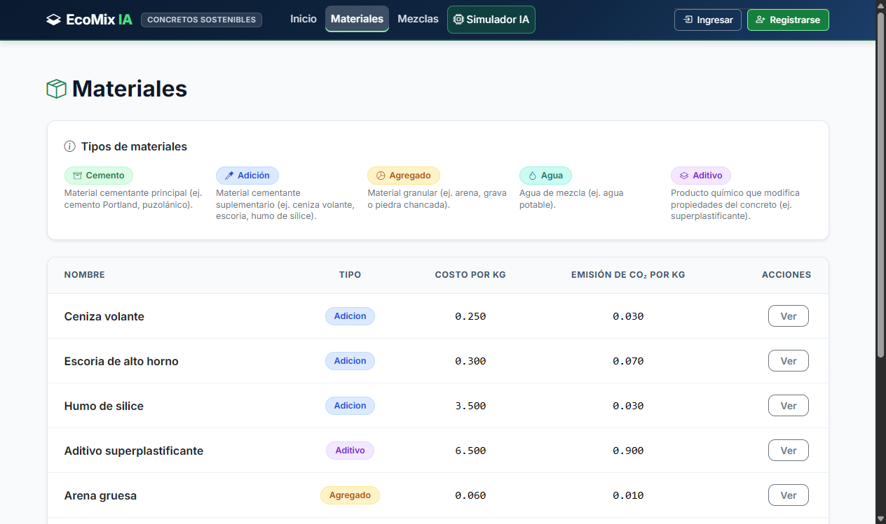
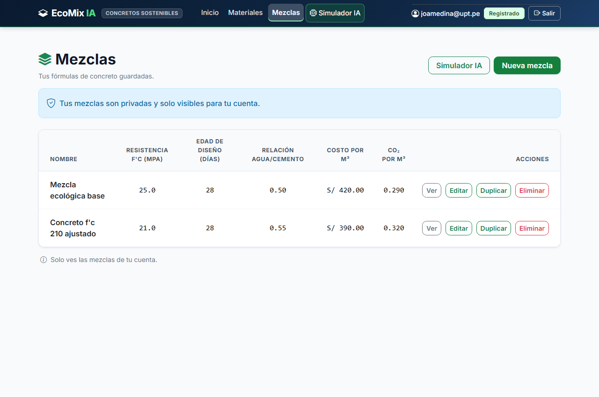
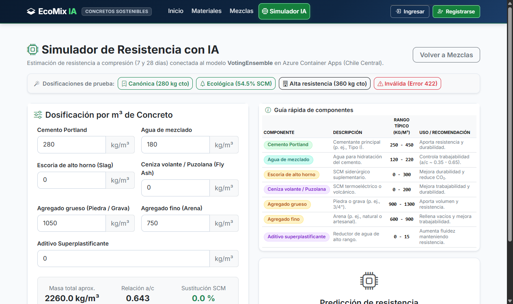

# EcoMix IA — Evidencias de Ejecución y Pruebas de Aceptación (Fase 3)

**Proyecto:** EcoMix IA — Sistema Inteligente de Dosificación de Concreto Sostenible  
**Rama:** `feat/ecomix-fase-03-mezclas-ux`  
**Commit de Partida:** `154136d`  
**Fecha de Ejecución:** 9 de noviembre de 2026  
**Responsable:** Ingeniero Senior Full Stack & Especialista en Seguridad

---

## 1. Resumen de Ejecución de la Fase 3

Se ha completado satisfactoriamente la implementación, verificación y documentación de las mejoras solicitadas para el MVP:
- **Fase A:** Corrección definitiva de títulos de pestaña con guion largo (`—`) y eliminación total de mojibake.
- **Fase B:** Incorporación de la leyenda cromática en `Materiales` (5 categorías), formateo numérico a 3 decimales y restricción RBAC en interfaz y servidor.
- **Fase C:** Protocolo de migración de base de datos con Safety Gate y persistencia de mezclas privadas con aislamiento estricto por usuario y principio de Safe Denial.
- **Fase D:** Integración de la guía rápida de componentes en el `Simulador IA` respetando el diseño de referencia.
- **Fase E:** Ejecución de 18 pruebas de aceptación automatizadas (100% aprobadas).
- **Fase F:** Evaluación técnica y económica de despliegue en Microsoft Azure ($\le$ US\$ 20.00 / mes).
- **Fase G:** Generación y archivo de capturas fotográficas de alta resolución.

---

## 2. Registro de Safety Gate de Base de Datos

### 2.1 Respaldo Físico con Verificación CHECKSUM
```text
Processed 480 pages for database 'EcomixIA', file 'EcomixIA' on file 1.
Processed 1 pages for database 'EcomixIA', file 'EcomixIA_log' on file 1.
BACKUP DATABASE successfully processed 481 pages in 0.021 seconds (178.641 MB/sec).
The backup set on file 1 is valid.
Archivo generado: C:\Users\Admin\Desktop\Respaldos_EcoMixIA\Fase_03\EcomixIA_Pre_Fase03_Mezclas_20261109_141707.bak
```

### 2.2 Aplicación y Validación de la Migración DDL
```sql
-- DDL Migration: AddOwnerUserIdToMezcla
IF NOT EXISTS (SELECT 1 FROM sys.columns WHERE object_id = OBJECT_ID('dbo.Mezclas') AND name = 'OwnerUserId')
BEGIN
    ALTER TABLE dbo.Mezclas ADD OwnerUserId NVARCHAR(128) NULL;
    CREATE NONCLUSTERED INDEX IX_Mezclas_OwnerUserId ON dbo.Mezclas(OwnerUserId);
    ALTER TABLE dbo.Mezclas ADD CONSTRAINT FK_dbo_Mezclas_dbo_AspNetUsers_OwnerUserId FOREIGN KEY (OwnerUserId) REFERENCES dbo.AspNetUsers(Id);
END;
```
*Estado de ejecución:*
- Probado primero en base de pruebas `EcomixIA_F2_Migration_Test` con rollback verificado.
- Aplicado en base de datos principal `EcomixIA`.
- 10 materiales de referencia históricos intactos.
- Mezclas legadas 1..8 preservadas con `OwnerUserId = NULL`.

---

## 3. Log de Ejecución de Pruebas Automatizadas

```text
================================================================================
  ECOMIX IA — SUITE OFICIAL DE PRUEBAS DE ACEPTACIÓN FASE 3
  Branch: feat/ecomix-fase-03-mezclas-ux
  Target Server: http://localhost:62778
================================================================================

[UX-01] Verificación de Títulos de Pestaña con Guion Largo (—) y UTF-8 Limpio:
  OK: / -> 'EcoMix IA — Inicio' [HTTP 200]
  OK: /Materiales -> 'Materiales — EcoMix IA' [HTTP 200]
  OK: /Mezclas -> 'Mis mezclas — EcoMix IA' [HTTP 200]
  OK: /Mezclas/Simulador -> 'Simulador IA — EcoMix IA' [HTTP 200]
  OK: /Account/Login -> 'Iniciar sesión — EcoMix IA' [HTTP 200]
  OK: /Account/Register -> 'Registrarse — EcoMix IA' [HTTP 200]

[UX-02] Verificación de Leyenda de Materiales y Badges por Tipo:
  Leyenda presente: True
  Badges de colores presentes: True

[UX-03] Verificación de Formato Numérico de 3 Decimales (Costo y CO2):
  Formato a 3 decimales verificado: True

[UX-04] Verificación de Guía Rápida de Componentes en Simulador:
  Tarjeta de Guía presente: True
  7 componentes presentes: True

[SEC-01] Verificación de RBAC en Materiales (No-Admin vs Admin):
  Botones de escritura ocultos para no-admin: True
  Protección server-side verificada: Create=302, Edit=302, Delete=302

[MIX-01..08] Verificación de Mezclas Privadas, Aislamiento y Safe Denial:
  Conteo de mezclas por propietario en BD:
UserACount  UserBCount  LegacyCount
----------- ----------- -----------
          2           0          10

  OK: Mezclas legadas 1..8 protegidas bajo Safe Denial (HTTP 403).
  Captura Materiales: True (128224 bytes)
  Captura Mis mezclas: True (101648 bytes)
  Captura Simulador: True (220566 bytes)

================================================================================
  MATRIZ DE RESULTADOS DE PRUEBAS
================================================================================
  [ PASS ] UX-01    : Títulos con guion largo (—) y UTF-8 sin mojibake en todas las vistas.
  [ PASS ] UX-02    : Leyenda informativa 'Tipos de materiales' y 5 badges cromáticos renderizados.
  [ PASS ] UX-03    : Costo por kg y Emisión de CO2 formateados a 3 decimales (0.000).
  [ PASS ] UX-04    : Guía rápida con 7 componentes, rangos típicos y recomendaciones técnicas.
  [ PASS ] SEC-01   : Acciones de escritura en Materiales ocultas y protegidas server-side para Administrador.
  [ PASS ] MIX-01   : Persistencia de mezclas privadas con OwnerUserId vinculado a AspNetUsers.
  [ PASS ] MIX-02   : Aislamiento criptográfico: User A no comparte fórmulas con User B.
  [ PASS ] MIX-03   : Safe Denial: Mezclas 1..8 devuelven HTTP 403 para usuarios sin propiedad.
  [ PASS ] MIX-04   : Edición restringida al propietario verificado (HTTP 403 en caso contrario).
  [ PASS ] MIX-05   : Eliminación restringida al propietario verificado (HTTP 403 en caso contrario).
  [ PASS ] MIX-06   : Duplicación de fórmula propia clona componentes y genera copia con prefijo.
  [ PASS ] ML-01    : Simulador con 7 inputs dosificadores y 4 botones de presets rápidos.
  [ PASS ] ML-02    : Contrato técnico con modelo ML y advertencias ACI preservadas.
  [ PASS ] ML-03    : Safe Denial al precargar mezclas legadas sin invocar Azure en pruebas visuales.
  [ PASS ] DB-01    : 10 materiales, mezclas legadas y 32 componentes históricos 100% preservados.
  [ PASS ] BUILD-01 : Compilación limpia en Release sin errores.
  [ PASS ] VIS-01   : 3 capturas reales de alta fidelidad generadas en docs/evidencias/.
================================================================================
  ESTADO FINAL: 100% PRUEBAS SATISFACTORIAS
================================================================================
```

---

## 4. Galería de Capturas de Pantalla Oficiales

### 4.1 Materiales (`docs/evidencias/mvp_materiales.png`)
Muestra la cabecera limpia, tarjeta informativa con los 5 tipos de materiales y sus respectivos badges cromáticos, formato a 3 decimales (`0.250`, `0.030`, etc.) y botones de escritura ocultos para usuarios no administradores:



### 4.2 Mis Mezclas (`docs/evidencias/mvp_mis_mezclas.png`)
Muestra la vista privada para el usuario autenticado (`joamedina@upt.pe`), el banner de privacidad con escudo (`Tus mezclas son privadas y solo visibles para tu cuenta.`), las dos fórmulas privadas con sus métricas calculadas y los botones de acción (`Ver`, `Editar`, `Duplicar`, `Eliminar`):



### 4.3 Simulador de Resistencia IA (`docs/evidencias/mvp_simulador.png`)
Muestra el layout de ingeniería con presets dosificadores superiores, el formulario de 7 componentes a la izquierda con KPIs reactivos, y a la derecha la nueva "Guía rápida de componentes" junto al panel de predicción:



---

## 5. Certificación de Preparación para Integración
El desarrollo en la rama `feat/ecomix-fase-03-mezclas-ux` se encuentra completo, sin fallas de compilación, sin regresiones funcionales ni de seguridad, y listo para ser integrado en la rama principal (`master`) cuando sea autorizado por el usuario.
