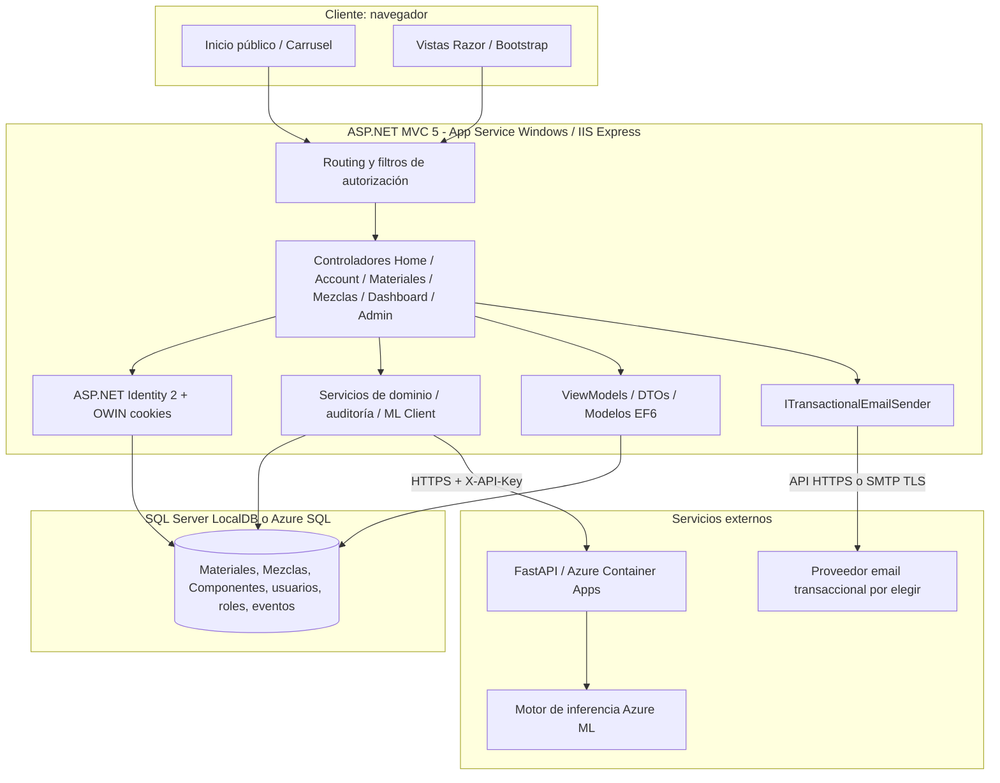
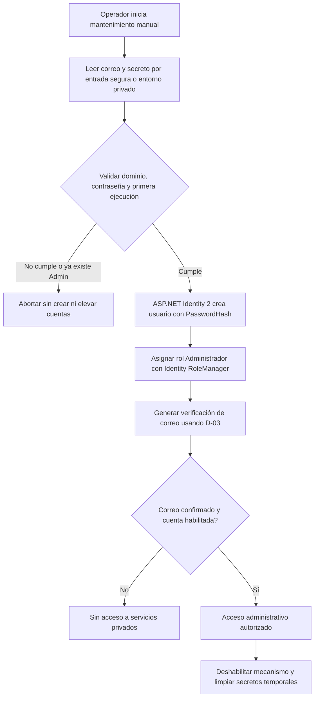
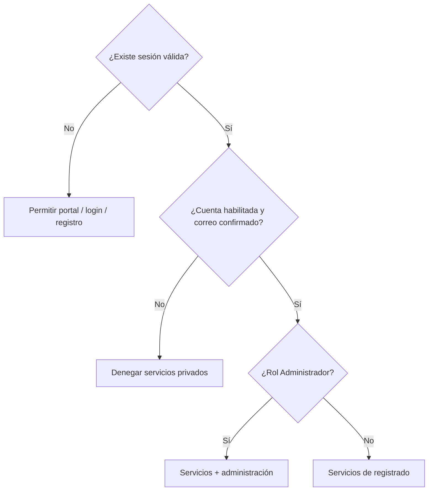
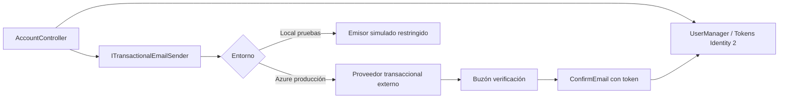
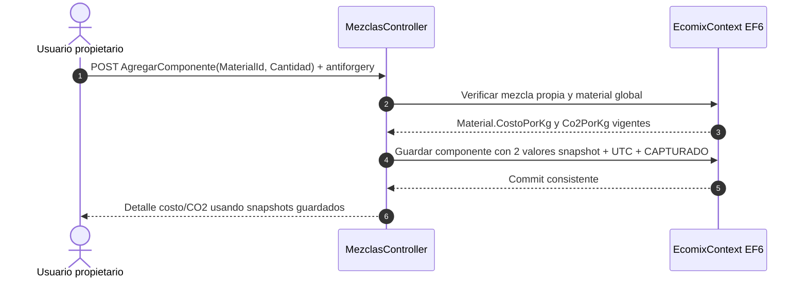
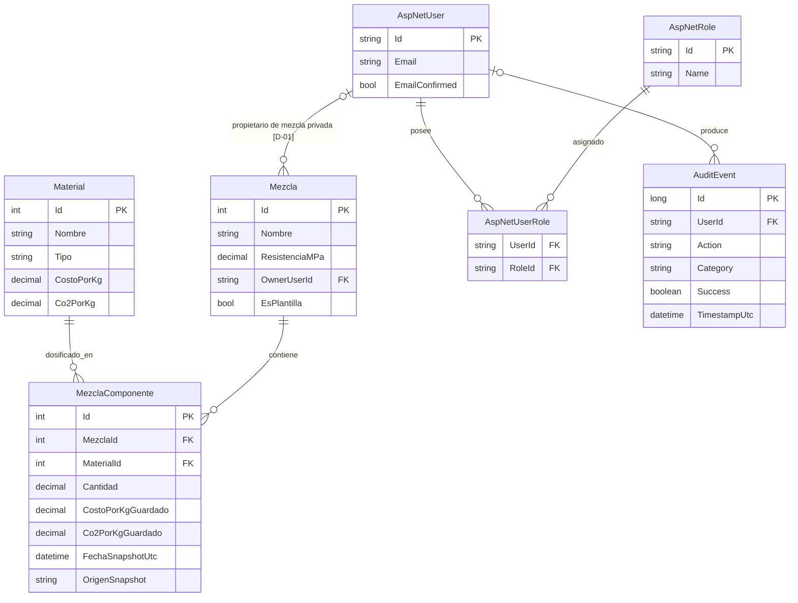
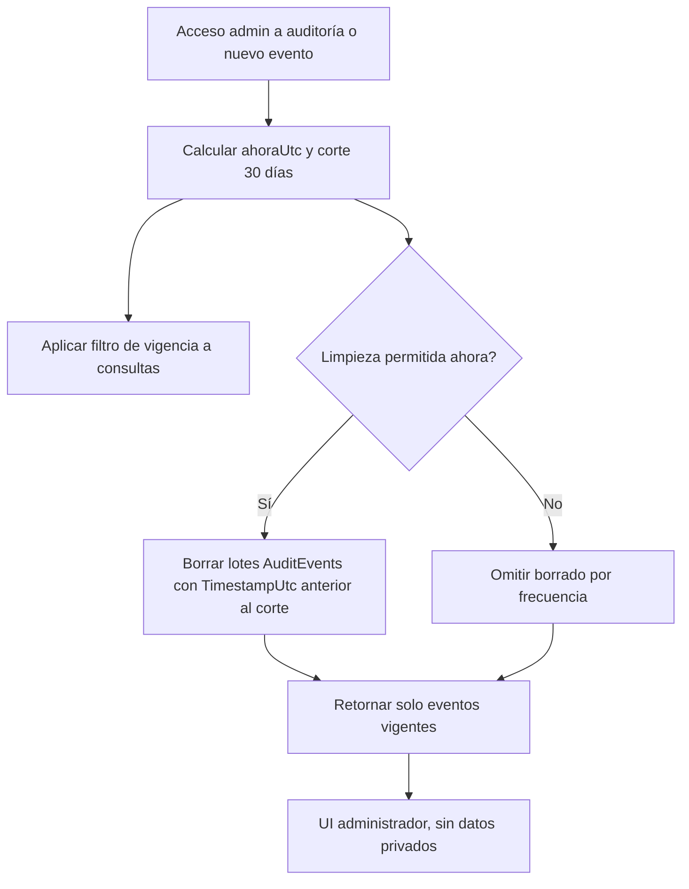
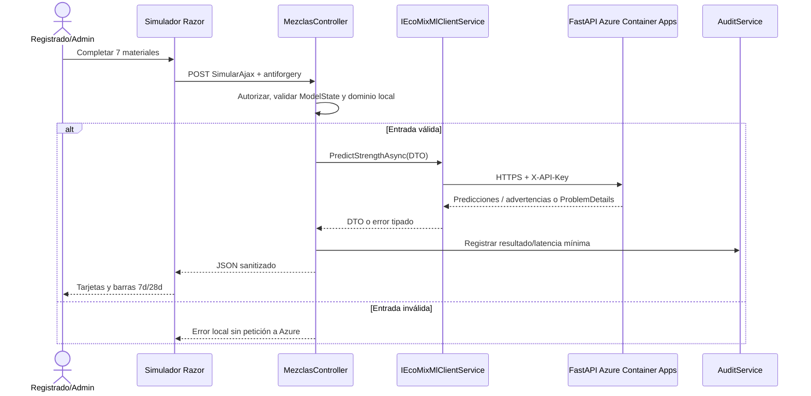
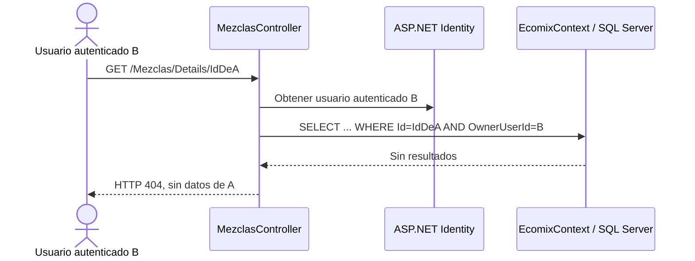
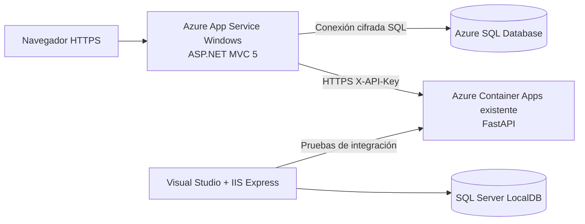

# EcoMix IA — Documento de Arquitectura de Software (SAD)

**Versión:** 1.1 — **LÍNEA BASE DE ARQUITECTURA PROPUESTA PARA F0**; D-01, D-02, D-04 a D-10 aprobadas salvo D-03 provisional (proveedor pendiente); desarrollo pendiente  
**Fecha:** 8 de noviembre de 2026 (Perú)  
**Proyecto:** EcoMix IA — ASP.NET MVC 5 / EF6 / SQL Server / FastAPI  
**Repositorio fuente:** https://github.com/joeguillenl/EcomixIA  
**Rama base:** `feat/integration-fastapi-service` (`5495f92`)  
**Contrato externo:** https://github.com/JMedina255/EcoMix-IA-AzureML  
**SRS asociado:** `FD03_EPIS_SRS_EcoMixIA_v1.2.md`  
**Aprobación:** pendiente de revisión del equipo.

> **Diferenciación:** las secciones «actual» describen el código confirmado en el repositorio o las pruebas locales comunicadas; las secciones «propuesto» son decisiones de arquitectura para futuras fases. Este documento no asegura que autenticación, administración ni despliegue de la aplicación web ya estén operativos. **D-01 (mezclas privadas), D-02 (catálogo global), D-04 (dashboard sin historial ML), D-05 (marca EcoMix IA y recursos autorizados), D-08 (admin sin acceso a mezclas privadas ajenas) y D-09 (precios/factores históricos capturados por componente) están aprobadas desde el 08/11/2026; implementación y migraciones siguen pendientes.**

## Control de versiones

| Versión | Fecha | Cambio |
|---|---|---|
| 0.1 | 08/11/2026 | Arquitectura propuesta de portal, identidad, roles, simulador, administración y Azure |
| 0.2 | 08/11/2026 | **Propiedad privada obligatoria**, consulta y escritura filtradas, seguridad contra IDOR, migración conservadora de mezclas existentes y pruebas A/B |
| 0.3 | 08/11/2026 | **D-08 aprobada:** no hay excepción administrativa para mezclas ajenas; logs sanitizados y estadísticas globales no identificables |
| 0.4 | 08/11/2026 | **D-02 aprobada:** catálogo `Materials` global, consulta para registrados y CRUD exclusivo del administrador; autorización, integridad de referencias y pruebas de regresión |
| 0.5 | 08/11/2026 | **D-03 provisional:** servicio transaccional externo con cuota gratuita/bajo costo; adaptador email, flujos de confirmación/recuperación, controles de abuso, proveedor aún no escogido |
| 0.6 | 08/11/2026 | **D-04 aprobada:** tablero personal con KPI de mezclas privadas y sin persistencia ni tabla de historial de predicciones; métricas calculadas con LINQ y estado vacío |
| 0.7 | 08/11/2026 | **D-09 aprobada:** snapshots unitarios de costo y CO₂ por componente; cálculos no retroactivos, tratamiento explícito de legado y pruebas de migración |
| 0.8 | 08/11/2026 | **D-05 aprobada:** identidad propia EcoMix IA, paleta cromática de inspiración Yura sin atribución oficial; tres imágenes licenciadas y carrusel accesible sin CMS |
| 0.9 | 08/11/2026 | **D-06 aprobada:** tope de US$20 de consumo **acumulado del crédito Azure for Students**, incluidos recursos existentes, puertas de gasto, free tiers elegibles y alertas sin corte automático |
| **1.0** | **08/11/2026** | **D-07 aprobada:** auditoría propia por 30 días, filtro UTC, purga SQL por lotes al activarse el sitio o auditar, aviso y pruebas; sin scheduler Azure adicional |
| **1.1** | **08/11/2026** | **D-10 aprobada:** provisión inicial de Admin fuera de HTTP y arranque web, con secretos externos, Identity 2, verificación y pruebas; cierre documental y arranque F0 |

## 1. Objetivo, decisiones y restricciones

### 1.1 Objetivo de arquitectura

Extender una aplicación ASP.NET MVC 5 existente con un portal público y dos roles persistentes, sin separar la interfaz en una SPA ni crear servicios internos independientes. Conservar Entity Framework 6, consultas LINQ, vistas Razor y Bootstrap, y reutilizar el servicio externo FastAPI que ya proporciona predicciones a 7 y 28 días.

### 1.2 Principios

1. **MVC monolítico:** la web mantiene capas `Controllers`, `Views`, `Models` y `Services` pequeños.
2. **Mínimas dependencias:** Bootstrap nativo para carrusel, tablas, alertas, tarjetas, badges y barras comparativas; JavaScript moderado.
3. **Seguridad nativa del ecosistema:** ASP.NET Identity **2** + OWIN Cookie Authentication para MVC 5 / .NET Framework, con hash y roles; **no usar ASP.NET Core Identity**, que pertenece a otro framework.
4. **Un servidor SQL lógico:** SQL Server LocalDB durante desarrollo y Azure SQL Database en publicación, cambiando solo configuración de conexión.
5. **Servicio ML desacoplado:** la web nunca carga el modelo Azure ML en IIS; invoca FastAPI desde el servidor con HTTP sobre TLS.
6. **Trazabilidad sin exposición de secretos:** auditar eventos mínimos, no cuerpos JSON completos, contraseñas ni claves.
7. **Liberación por fases:** cambios de estructura y base de datos mediante migraciones revisadas y pruebas de regresión.
8. **Privacidad de mezclas (D-01, D-08):** el propietario se determina en servidor; consultas LINQ y operaciones sobre componentes verifican la propiedad **también cuando el usuario tiene rol Administrador**. No hay bypass de soporte: el administrador no abre mezclas privadas ajenas. Solo ve cuentas, eventos sanitizados y totales agregados no identificables.
9. **Catálogo global de materiales (D-02):** un único `Materials`; consultas para sesiones registradas y habilitadas; mutaciones exclusivas del administrador; ninguna operación del catálogo autoriza leer mezclas de otro propietario.
10. **Correo transaccional (D-03, provisional):** envío desde servidor mediante interfaz pequeña e intercambiable; confirmar correo antes de autorizar, controlar reenvíos y no exponer secretos.
11. **Provisionamiento Admin (D-10):** herramienta de mantenimiento de primera ejecución sin endpoint web, sin seed repetible en `Application_Start` ni secretos de repositorio; la cuenta obedece la verificación de correo.
11. **Dashboard sin historial ML (D-04 aprobada):** indicadores calculados de las mezclas privadas completas; no crear tabla `PredictionRuns`, no almacenar entradas/salidas ML para alimentar el tablero y mantener la auditoría operativa (F5) separada de cualquier resultado predictivo.
12. **Valores económicos/ambientales históricos (D-09):** congelar `CostoPorKgGuardado`/`Co2PorKgGuardado` de cada componente al persistirlo; nunca recalcular mezclas guardadas con `Materials` vigente; señalar las filas anteriores sin captura como **legado no verificable**.
13. **Retención minimizada (D-07):** mostrar únicamente `AuditEvents` de los últimos 30 días UTC y eliminar físicamente los vencidos por lotes al existir actividad; sin servicio programado adicional.
13. **Identidad pública (D-05):** marca **EcoMix IA**, con lenguaje visual propio inspirado en tonos de Yura **sin presentar logotipos, fotografías corporativas ni patrocinio oficial de terceros**. Los activos externos deben disponer de licencia o autorización verificable.

### 1.3 Límites

- Mantener .NET Framework 4.7.2, MVC 5.2.9, EF 6.5.1, Bootstrap 5.3.3 y SQL Server. Evaluar actualizaciones de parches mediante pruebas separadas.
- No desplegar la app MVC 5 clásica directamente en Azure Container Apps Linux; se propone **App Service Windows**.
- No migrar a .NET 8/10, React, microservicios adicionales ni un bus de mensajes en esta etapa.
- El servicio de inferencia se conserva como aplicación externa; una caída del servicio no debe inutilizar CRUD/portal.

## 2. Arquitectura de referencia actual

El repositorio contiene `EcomixIA.sln`, `Models/EcomixContext.cs`, `Controllers/HomeController.cs`, `MaterialesController.cs`, `MezclasController.cs`, un layout `Views/Shared/_Layout.cshtml`, `Content/site.css`, `Services/EcoMixMlClientService.cs`, `Models/Dtos` y `Views/Mezclas/Simulador.cshtml`.

- `EcomixContext` se conecta mediante `DefaultConnection` y define `DbSet<Material>`, `DbSet<Mezcla>`, `DbSet<MezclaComponente>`.
- **Estado existente (antes de F3):** `Mezcla` calcula propiedades `[NotMapped]` con **valores vigentes** del catálogo: costo = Σ cantidad × `c.Material.CostoPorKg`; CO₂ = Σ cantidad × `c.Material.Co2PorKg`; masa = Σ cantidad. **D-09 modifica esa base de cálculo**, pero no está implementada todavía.
- `MezclasController` puede llamar a `IEcoMixMlClientService` y mostrar el resultado en el simulador.
- El cliente HTTP utiliza `EcoMix:ApiUrl`, `EcoMix:ApiKey`, `EcoMix:TimeoutSeconds` y el header `X-API-Key`; la URL del endpoint es `POST /api/v1/predict/concrete-strength`.
- El equipo ha confirmado funcionamiento de la web con LocalDB y carga de ejemplos. **Aún no se han verificado en esta revisión pruebas automáticas nuevas de autorización ni dashboard.**

## 3. Arquitectura objetivo — Vista lógica



### 3.1 Límites de confianza

- **Navegador (no confiable):** nunca contiene conexión SQL, clave ML ni decisiones de privilegio.
- **Web MVC (servidor confiable):** autentica, autoriza, valida, consulta SQL y llama a FastAPI.
- **SQL:** almacena hash de identidad, entidades de negocio y eventos mínimos; credenciales en configuración segura.
- **API FastAPI:** valida límites físicos y retorna predicciones/advertencias; no conoce ni administra sesiones MVC.

### 3.2 Vista de componentes y responsabilidades

| Componente | Ubicación propuesta | Responsabilidad | Estado |
|---|---|---|---|
| Portal público | `HomeController.Index`, `Views/Home/Index.cshtml` | Publicidad y CTA; **sin contar datos privados en cada request anónimo** | Cambio requerido |
| Layout/navbar | `Views/Shared/_Layout.cshtml` | Menús y acceso condicional por sesión | Existe; requiere RBAC visual |
| Autenticación | `AccountController`, `Models/Identity/*`, `App_Start/IdentityConfig.cs`, `Startup.Auth.cs` | Registro/login/confirmación/logout/recuperación | Nuevo |
| Provisión Admin inicial (D-10) | Herramienta de mantenimiento local ejecutada manualmente, integrada con ASP.NET Identity 2 | Crear primera cuenta sin endpoint web y bloquear reejecución/autopromoción | Nuevo F2; pendiente |
| Envío de correo (D-03) | `Services/ITransactionalEmailSender.cs` + implementación de proveedor o desarrollo | Confirmación y recuperación por proveedor externo configurable, sin acoplar controladores a SDK específico | Nuevo; proveedor pendiente |
| Roles y protección | `[Authorize]`, `[Authorize(Roles="Administrador")]`, filtro global con excepciones públicas | Bloquear rutas y acciones, no solo enlaces | Nuevo |
| Dashboard personal (D-04) | `DashboardController`, `Models/ViewModels/DashboardViewModel.cs`, `Views/Dashboard/Index.cshtml` | Total de mezclas propias, medias costo/CO₂ por m³ de mezclas completas y accesos rápidos; sin historial de predicciones | Nuevo, sin tabla adicional |
| Materiales | `MaterialesController` | **D-02:** `Index` y `Details` para usuarios autenticados; `Create`, `Edit`, `Delete` solo con rol Administrador; validar datos, bloquear baja con referencias y auditar mutaciones | CRUD existente; requiere filtros de autorización |
| Mezclas | `MezclasController` | CRUD de mezclas **solo del propietario**, cálculos, control de componentes y aislamiento horizontal | Existe; requiere ajuste |
| Cliente ML | `Services/IEcoMixMlClientService.cs` y `EcoMixMlClientService.cs` | Solicitudes HTTP, errores, timeout, DTO | Existente |
| Administración | `AdminController` o carpeta `Controllers/Admin/*`, vistas Razor | Usuarios, roles, **estadísticas generales agregadas** y **logs sanitizados**, sin rutas de detalle o exportación de mezclas ajenas | Nuevo |
| Auditoría (D-07) | `Models/AuditEvent.cs`, `Services/AuditService.cs` | Eventos minimizados con fecha UTC; consulta de últimos 30 días y purga SQL por lotes; sin almacenar dosificaciones ni resultados ML | Nuevo F5; 30 días aprobados |
| Persistencia EF6 | `Models/EcomixContext.cs` y `Migrations/*` | Persistencia; migraciones controladas | Existe; ampliar |

## 4. Diseño de autenticación y autorización

### 4.1 Modelo propuesto

- Autenticación: correo + contraseña, cookie OWIN, HTTPS. ASP.NET Identity 2 para MVC 5.
- Roles persistentes: `Registrado`, `Administrador`. El visitante es anónimo sin fila en `AspNetRoles`. **La autorización por rol no sustituye la verificación del propietario de cada mezcla**.
- Usuario público nuevo: asignación **forzosa** al rol `Registrado`, con `EmailConfirmed = false` hasta validación.
- **Administrador inicial (D-10 APROBADA):** provisión mediante **rutina manual de mantenimiento** con credenciales obtenidas fuera del repositorio, no por registro web ni por migración/arranque automático. Sin promoción por dominio ni valor de formulario; no permitir reejecución privilegiada. La cuenta necesita confirmar correo.
- **Confirmación de correo (D-03 provisional):** usar un **proveedor transaccional externo** con cuota gratuita/bajo costo, mediante adaptador intercambiable. Para pruebas locales utilizar emisor simulado de acceso restringido, sin publicar tokens ni eludir confirmación en producción. El proveedor específico y dominio remitente permanecen pendientes.
- Contraseñas: almacenamiento exclusivo en `PasswordHash` con implementación Identity; no crear cifrado/hash casero.
- Recuperación, limitación de intentos, tokens temporales y protección CSRF.

### 4.1.1 D-10 — Provisión segura del primer Administrador

**Implementación propuesta en F2:** una herramienta mínima de mantenimiento ejecutada por un operador confiable desde entorno local controlado (y, para Azure, desde equipo/entorno administrativo con conectividad segura a Azure SQL). **No** habrá `Admin/Bootstrap`, endpoints públicos, lógica en `Global.asax`, migraciones automáticas que creen cuentas privilegiadas ni una cuenta con contraseña por defecto.

**Flujo técnico recomendado:**



**Precondiciones y garantías:** identidad del operador autorizada; comprobación transaccional o equivalente que impida duplicidad en ejecución concurrente; roles/usuario sin colisiones; dominio exacto permitido; credencial fuerte validada por Identity; no persistir contraseña en registro de auditoría. Si existe cualquier Administrador, abortar sin modificar roles, correo o contraseñas. Si la cuenta objetivo ya existe como `Registrado`, **no elevarla automáticamente**: escalar a un procedimiento distinto y explícito. Ante fallo de confirmación o del proveedor D-03, la cuenta permanece sin acceso privado. Si la creación/rol queda parcial por fallo, registrar estado controlado y recuperar manualmente tras investigar; no repetir ciegamente.

**Gestión de secretos:** preferir entrada interactiva segura o configuración temporal no versionada protegida por ACL; nunca imprimir contraseñas, introducirlas como argumentos CLI, almacenarlas en PowerShell History o anexarlas a tickets/evidencias. Retirar secretos y facultades de provisión después de completar la operación. Para pruebas locales, usar cuenta de prueba sin credenciales reales y un emisor de correo simulado restringido; sin bypass de verificación productiva.

**Nota F0:** esta implementación no forma parte de F0 porque el repo web actual todavía no incluye Identity. F0 solo prepara respaldo, estado Git, evidencias y diseño de provisión.

### 4.2 Esquema de roles



**D-02 — Matriz del catálogo global:** `Materiales/Index` y `Materiales/Details` exigen sesión confirmada y habilitada (`Registrado` o `Administrador`); `Materiales/Create`, `Materiales/Edit` y `Materiales/Delete` (en sus acciones GET y POST) exigen además rol `Administrador`. El navbar y los botones se adaptan a los permisos, pero no sustituyen estos controles. Administrar materiales no confiere acceso a mezclas privadas de terceros.

**Regla transversal:** la autorización debe verificarse en cada acción `GET`/`POST`/AJAX; esconder botones no es suficiente. Además, cada consulta u operación sobre una mezcla privada exige `OwnerUserId == User.Identity.GetUserId()`, también para modificar componentes y precargar una mezcla en el simulador. Ante deshabilitación o cambio de rol, invalidar/revalidar la sesión mediante SecurityStamp o control equivalente. Proteger acciones administrativas del último administrador.

### 4.3 Validación de dominios

Se permite registrar exclusivamente cuentas cuyo dominio real, después de normalizar el correo, sea **exactamente** `upt.pe`, `virtual.upt.pe` o `gmail.com`. Rechazar `usuario@upt.pe.ejemplo.com`, `usuario@sub.upt.pe` y `usuario@gmail.com.otro.org`. El dominio admitido no concede privilegios ni prueba identidad institucional. Se requiere confirmar posesión del correo.

### 4.4 Envío transaccional con desacoplamiento mínimo (D-03 provisional)

El proyecto conservará **ASP.NET Identity 2** para generar/validar tokens y cambiar `EmailConfirmed`. Una interfaz ligera, por ejemplo `ITransactionalEmailSender`, solo se responsabilizará de **transportar** mensajes de verificación y recuperación. El proveedor aún **no está elegido**; su tecnología puede ser una API HTTPS o SMTP seguro. Evitar crear un microservicio adicional, una cola Azure o un sistema de correo propio para esta fase.



**Contratos y seguridad:**
- El método de envío recibirá destinatario, asunto y plantilla validada; la generación/validación de tokens queda en Identity.
- Solo se enviará a cuentas con dominios exactos permitidos (`upt.pe`, `virtual.upt.pe`, `gmail.com`), sin elevar privilegios por dominio.
- Enlaces generados con origen HTTPS confiable configurado por entorno; no construir URLs a partir de un `Host` no validado.
- Al fallar el proveedor, **no** activar al usuario. Permitir reenvío controlado y devolver respuesta genérica.
- Recuperación y reenvío con limitación de frecuencia, sin revelar la existencia de cuentas.
- API key SMTP/token del proveedor fuera de Git, solo en secretos/entorno protegido. No almacenar ni imprimir enlaces con tokens en logs compartidos.
- La dirección **remitente** necesita ser autorizada y técnicamente verificable, distinta de los **dominios destinatarios** permitidos. No suplantar UPT, Gmail ni Yura sin permiso.
- En F2: verificar cuota/precio antes de conectar proveedor, y comprobar recepción real (incluida bandeja de spam) en cada dominio permitido. Confirmar que modo producción nunca usa emisor simulado.

**Candidatos por evaluar (no seleccionados):** Resend y Brevo publican planes gratuitos, sujetos a límites y cambios. La decisión final dependerá de la posibilidad de verificar el remitente, entregabilidad, costo y facilidad para .NET Framework.

## 5. Modelo de datos propuesto

### 5.1 Mantener lo existente

| Entidad | Uso |
|---|---|
| `Materials` | **Catálogo global único** y propiedades de materiales, costo y factor CO₂; sin `OwnerUserId`, edición solo administrativa |
| `Mezclas` | Formulaciones y objetivos actuales; se extenderán para **propiedad privada sin cambios destructivos** |
| `MezclaComponentes` | Relación entre mezcla y material; cantidad kg/m³; se ampliará con snapshots unitarios D-09 |

### 5.2 Ampliaciones controladas

| Entidad | Campos centrales | Observación |
|---|---|---|
| `AspNetUsers` | Id, Email, UserName, EmailConfirmed, PasswordHash, SecurityStamp, Lockout* | Esquema normal de Identity 2; no insertar contraseñas manuales |
| `AspNetRoles` / `AspNetUserRoles` | Roles y asignaciones | Dos roles persistentes |
| `AuditEvents` | Id, UserId?, Category, Action, Success, TimestampUtc, CorrelationId, y tipo de recurso no identificante si procede | **D-07:** retención 30 días (UTC), índice `TimestampUtc`; prohibidos ID/nombre de mezcla ajena, contenido de petición, datos ML y secretos; purga física por lotes |
| **Sin entidad `PredictionRuns` (D-04)** | **No aplica** | Historial persistente de inferencias expresamente fuera del alcance aprobado; no crear tabla ni migración para ello |
| `Mezclas.OwnerUserId` (**aprobado, pendiente de implementar**) | FK string a `AspNetUsers.Id`, exigido para cada mezcla privada nueva | El identificador se asigna exclusivamente en servidor; nulos temporales permitidos solo durante auditoría/migración |
| `Mezclas.EsPlantilla` (**propuesta para legado**) | Marca que identifica una formulación de referencia | Solo después de confirmar que los seis registros semilla son ejemplos de sistema; lectura/copia, sin CRUD de usuarios |
| **`MezclaComponentes.CostoPorKgGuardado` / `Co2PorKgGuardado` (D-09)** | `decimal(18,6) NULL` de migración, ambos con unidad por kg | Se capturan al añadir un componente desde el servidor; `NULL` no equivale a valor cero; después exigir ambos no nulos en nuevas inserciones |
| **`MezclaComponentes.FechaSnapshotUtc` / `OrigenSnapshot` (D-09)** | `datetime2 NULL` + `nvarchar(24)` (`CAPTURADO`/`LEGADO_SIN_VERIFICAR`) | Distingue capturas auténticas de datos anteriores; no fingir fecha de guardado de entradas legado |

### 5.3 Estrategia de contextos EF6

**Opción base recomendada:** incorporar `ApplicationUser : IdentityUser` y extender `EcomixContext` para heredar de `IdentityDbContext<ApplicationUser>`, preservando los tres `DbSet` de negocio y **una única línea de migraciones**. Esto evita duplicar cadenas de conexión y facilita consultas básicas. Requiere probar compatibilidad del mapeo/`__MigrationHistory` actual antes de desplegar.

Alternativa si la migración resulta incompatible: mantener un contexto Identity independiente sobre la misma base, con una configuración de migraciones y `ContextKey` separados. **No elegir esta alternativa sin evidencia**, pues añade mantenimiento.

**Migración segura D-01:** copia de seguridad de LocalDB; inventario de tablas/índices y de seis mezclas semilla; migración aditiva revisada; nulos temporales de `OwnerUserId` solo para filas aún sin clasificar; comprobación de que ejemplos auténticos se convierten en plantillas de solo lectura y que los datos no identificados se retienen sin publicar; prueba de rollback/restauración. El esquema objetivo exige propietario no nulo para registros privados nuevos; **no** introducir `NOT NULL` de forma indiscriminada sobre los datos anteriores. No activar inicializadores que eliminen/recreen la BD ni ejecutar `Update-Database` ciegamente contra Azure.

**Invariante de dominio:** plantilla de sistema validada → `EsPlantilla=true`, `OwnerUserId=null`, solo lectura y clonable; mezcla privada → `EsPlantilla=false`, `OwnerUserId=<usuario autenticado>`. **D-08 aprobada: una cuenta administradora no posee un permiso excepcional para consultar o modificar mezclas privadas de terceros.**

**D-02 — Integridad del catálogo:** no crear tablas de materiales privados ni propiedad individual en `Materials`. La baja del material debe rechazarse si `MezclaComponentes` lo referencia, sin exponer los IDs/nombres o titulares de mezclas privadas. El controlador actual usa un patrón `db.Componentes.Any(c => c.MaterialId == id)` apropiado para responder sí/no; deben añadirse guardas de rol en servidor y mensajes genéricos. **D-09 APROBADA:** las ediciones de `Materials.CostoPorKg` / `Materials.Co2PorKg` **solo afectan nuevas capturas**. La fórmula de `Mezcla` y proyecciones del dashboard deberán usar snapshots del componente. Los registros preexistentes se conservan sin inventar históricos.

**Índices recomendados:** `IX_Mezclas_OwnerUserId`, y cuando proceda índices para consultas de dashboard por propietario. Mantener las FKs de `MezclaComponentes`; no confiar en el ID de componente sin resolver su mezcla padre.

### 5.3.1 Modelo de persistencia D-09 — captura económica/ambiental (aprobado; pendiente F3)

**Propósito:** conservar el costo estimado y la emisión estimada por m³ de cada mezcla frente a cambios posteriores del catálogo global, sin reimplementar el cálculo ni introducir un subsistema de versionado completo.

**Migración EF6 aditiva (diseño propuesto, NO ejecutado):** agregar en `MezclaComponentes` los campos `CostoPorKgGuardado decimal(18,6) NULL`, `Co2PorKgGuardado decimal(18,6) NULL`, `FechaSnapshotUtc datetime2 NULL` y `OrigenSnapshot nvarchar(24) NULL`; evaluar `HasPrecision(18,6)` mediante Fluent API y evitar el decimal(18,2) predeterminado de EF6. Durante transición, los campos nullable evitan destruir los registros actuales; los componentes nuevos se validan como completos y `CAPTURADO` desde servicio/controlador, no por HTML. No asignar defaults monetarios a cero. Revisar cómo se representan factores ambientales y unidades (kg CO₂e/kg) antes del despliegue.

**Secuencia propuesta:**



**Fórmulas actualizadas:**

```csharp
// Diseño para Mezcla: tras migrar y cargar componentes propios con sus snapshots.
// No invocar cálculos de histórico sobre componentes LEGADO_SIN_VERIFICAR.
CostoPorM3 = Componentes.Sum(c => c.Cantidad * c.CostoPorKgGuardado.Value);
Co2PorM3   = Componentes.Sum(c => c.Cantidad * c.Co2PorKgGuardado.Value);
MasaTotalPorM3 = Componentes.Sum(c => c.Cantidad);
```

El pseudocódigo anterior presupone que todos los componentes tienen snapshots válidos; antes de calcular, el ViewModel/servicio verifica `OrigenSnapshot == "CAPTURADO"` y `HasValue` para ambos. No usar el operador `.Value` sobre valores legacy nulos.

**Política de edición:** `Cantidad` puede cambiar, sin reemplazar factores capturados de ese registro; agregar un componente nuevo o borrarlo y volverlo a agregar toma el valor actual del catálogo en la nueva inserción. Eliminar componente lo excluye de los KPIs. La fecha snapshot señala captura unitaria, **no** última fecha de edición de la mezcla. Copiar plantillas crea componentes nuevos con valores vigentes, sin alterar la plantilla de referencia. No hay histórico de versiones anteriores de una mezcla editada, ni historial ML (D-04).

**Migración y legado:**
1. Respaldar y contar `Materials`, `Mezclas`, `MezclaComponentes` antes de cualquier migración y ensayar restauración.
2. Añadir columnas nullable y comprobar que cada fila y su FK se conservan.
3. Marcar filas anteriores `OrigenSnapshot = LEGADO_SIN_VERIFICAR` (longitud 20) y dejar campos históricos `NULL`; no reconstruir precios de fechas pasadas que no constan en los datos.
4. Para UI, ofrecer una **estimación referencial separada** con valores de catálogo actuales, identificada como tal, sin tratarla como snapshot ni incluirla en promedios históricos.
5. Validar migración y regresión con nuevas mezclas, plantillas y cuentas. Antes de requerir NOT NULL físicamente, resolver filas legado sin perder información; mientras, validar nuevos registros en servidor.

**Concurrencia y transacciones:** capturar ambos valores de la misma lectura/versión lógica del material antes de insertar, dentro de operación consistente EF6/SQL. Si falla guardado, no dejar datos parciales. La autorización de mezcla privada (D-01/D-08) precede siempre a toda escritura. Ninguna pantalla administrativa recibe la lista de mezclas afectadas por un cambio de material.

### 5.4 Diagrama entidad-relación (esquema conceptual)



*La privacidad **está aprobada** pero `OwnerUserId`/`EsPlantilla` todavía no están implementados. **D-04 excluye la entidad `PredictionRun` y cualquier tabla de historial de predicciones**; el diagrama representa el diseño objetivo, no la base de datos actual.*

### 5.5 D-07 — Retención de auditoría y limpieza SQL (aprobada; pendiente F5)

**Alcance:** únicamente eventos de auditoría mínimos **propios de la aplicación**, en la tabla SQL `AuditEvents`. No conservará entradas, salidas o historial de predicción del modelo (D-04), ni identificadores/recetas privadas de mezclas (D-01, D-08). Se utilizará `TimestampUtc datetime2` no nulo, creado por el servidor, e índice `IX_AuditEvents_TimestampUtc`.

**Consulta obligatoria (diseño, aún no implementado):** calcular **una sola vez por operación** `cutoffUtc = DateTime.UtcNow.AddDays(-30)`. Todo listado, filtro, exportación autorizada o estadística de auditoría usa `TimestampUtc >= cutoffUtc`. Si un evento es anterior al umbral, no se muestra aunque siga almacenado. No confiar en el control de fecha del cliente.

**Depuración:** `AuditService.PurgeExpiredEventsAsync()` (nombre propuesto) eliminará por lotes limitados registros con `TimestampUtc < cutoffUtc`, con comando SQL parametrizado/EF6, número de filas borradas como métrica operacional y sin borrar otras tablas. Dos disparadores sencillos, sin infraestructura nueva: (a) tras acceder a la vista admin de logs; (b) con frecuencia controlada (p. ej. máximo una vez por día y por instancia) durante la generación de eventos. También se puede ofrecer una acción POST administrativa, con `[Authorize(Roles="Administrador")]`, antiforgery y confirmación, para ejecutar la purga manualmente si se requiere. Limitar el trabajo por petición y permitir completar lotes siguientes en accesos posteriores; probar idempotencia y concurrencia.

**Transparencia:** el filtro hace que el vencimiento **lógico** sea inmediato, pero el borrado **físico** no se produce necesariamente en el minuto exacto de cumplir 30 días si la app no recibe tráfico. No se introducen Azure Functions, Elastic Jobs, SQL Server Agent ni tareas facturables para este MVP. Si se exigiera borrado físico puntual aun sin tráfico, sería otra decisión de arquitectura. El administrador visualizará únicamente eventos dentro de ventana y métricas globales no individualizantes.



**Azure F6:** inspeccionar y ajustar por separado retenciones de IIS/App Service, Azure Monitor/Container Apps y backups SQL. Las copias de seguridad pueden retener versiones anteriores de la tabla hasta cumplir su propio periodo; no asegurar una eliminación global en 30 días sin verificar esos servicios y la normativa aplicable. Documentar aviso de privacidad y política de acceso con el equipo académico.

**Pruebas:** fechas UTC de 29/30/31 días y frontera exacta; intento de acceso no admin; evento nuevo durante limpieza; ejecución repetida; comprobación de no borrar filas de usuarios/mezclas y de que el panel admin excluye los caducados de sus agregados.

## 6. Vista de interacción y secuencias

### 6.1 Registro y autenticación

```mermaid
sequenceDiagram
  actor V as Visitante
  participant MVC as AccountController
  participant ID as Identity UserManager
  participant DB as SQL Server
  participant MAIL as Adaptador correo transaccional
  V->>MVC: POST Registrar(correo, contraseña)
  MVC->>MVC: Validar correo y dominio exacto
  MVC->>ID: Crear usuario Registrado/no confirmado
  ID->>DB: Guardar hash y usuario
  MVC->>MAIL: Enviar enlace token temporal (SMTP/API)
  alt Entrega falla / cuota agotada
    MAIL-->>MVC: Error controlado
    MVC-->>V: Cuenta pendiente; reenvío limitado, sin bypass
  else Entrega aceptada por proveedor
    MAIL-->>MVC: Aceptación de envío (no equivale a confirmación)
  end
  V->>MVC: Abrir enlace confirmación
  MVC->>ID: Validar token y confirmar correo
  ID->>DB: Actualizar EmailConfirmed
  V->>MVC: POST Login
  MVC->>ID: Validar credenciales + estado
  ID->>DB: Buscar usuario/rol
  MVC-->>V: Cookie OWIN protegida
```

### 6.2 Solicitud de predicción



**Reglas:** no publicar credencial API en HTML/JS; no llamar el servicio desde navegador; no reconstruir predicciones inventadas. Controlar tiempo de espera y fallo de red. El servicio actual lee claves `EcoMix:ApiUrl`, `EcoMix:ApiKey`, `EcoMix:TimeoutSeconds`; estandarizar la documentación que menciona otros nombres.

### 6.3 Dashboard y auditoría

- **Dashboard registrado (D-04 y D-09 aprobadas):** filtrar en SQL por `OwnerUserId` del usuario autenticado y `EsPlantilla=false`; mostrar total de mezclas privadas, media de costo por m³ y media de CO₂ por m³ **solo de mezclas con componentes y capturas completas verificables**. La media es por formulación completa, no suma de costos/emisiones de distintas mezclas; ante cero mezclas elegibles, mostrar «Sin datos» y aviso de registros legado, si corresponde.
- **Sin historial predictivo:** el dashboard no invoca FastAPI ni guarda o consulta resultados ML. No agregar `PredictionRuns`, caché de resultados privados ni almacenamiento de JSON de solicitudes/respuestas. El simulador muestra la predicción en la petición actual, sin persistirla.
- **Dashboard administrador:** `AspNetUsers.Count` y agregados no identificables de `AuditEvents` por fecha/acción; un futuro conteo global de llamadas ML se calculará exclusivamente de eventos mínimos de ejecución, sin guardar entradas/salidas predictivas. Nunca consultar y enviar al panel filas de mezclas ajenas. Agrupar del lado SQL con LINQ; no segmentar por usuario ni por intervalos/grupos pequeños que puedan revelar resultados individuales.
- Auditoría: guardar `UserId` (o `null` si evento anónimo relevante), `TimestampUtc`, `Category`, `Action`, `Success`, `CorrelationId`; no guardar ni exponer nombre/ID de mezcla ajena, dosificaciones, proporciones, resistencia predicha, cuerpos de petición/respuesta, contraseñas, tokens o `X-API-Key`. El panel admin puede mostrar la identidad necesaria para seguridad de cuentas, no el contenido privado vinculado.

### 6.3.1 Diseño concreto del dashboard personal (D-04 aprobada)

**Componentes mínimos:** `DashboardController` con `[Authorize]` y política de usuario confirmado/habilitado, `DashboardViewModel` tipado, una vista Razor Bootstrap con 3 tarjetas y enlaces a «Mis mezclas», «Nueva mezcla» y «Simulador IA». Sin librería de gráficos adicional ni dependencia directa de la API ML.

**Consultas recomendadas:** usar `User.Identity.GetUserId()` del servidor y filtrar `Mezclas` por `OwnerUserId == currentUserId && !EsPlantilla` **antes** de proyectar datos. Para valores `CostoPorM3` y `Co2PorM3`, que hoy son propiedades `[NotMapped]`, proyectar agregados de componentes en la consulta LINQ traducible a SQL (o cargar únicamente los componentes propios de las mezclas filtradas y agregarlos en memoria); **nunca usar las propiedades `[NotMapped]` dentro de un `IQueryable` que EF6 debe traducir** ni descargar la tabla global para filtrar después. Ejemplo conceptual de proyección, a ajustar tras la migración:

```csharp
var userId = User.Identity.GetUserId();
var propias = db.Mezclas
    .Where(m => m.OwnerUserId == userId && !m.EsPlantilla);
var resumen = propias.Select(m => new
{
    TieneComponentes = m.Componentes.Any(),
    TieneCapturaIncompleta = m.Componentes.Any(c =>
        c.OrigenSnapshot != "CAPTURADO" ||
        !c.CostoPorKgGuardado.HasValue || !c.Co2PorKgGuardado.HasValue),
    Costo = m.Componentes.Sum(c => (decimal?)(c.Cantidad * c.CostoPorKgGuardado)),
    Co2 = m.Componentes.Sum(c => (decimal?)(c.Cantidad * c.Co2PorKgGuardado))
}).ToList();
var completas = resumen.Where(m => m.TieneComponentes &&
    !m.TieneCapturaIncompleta && m.Costo.HasValue && m.Co2.HasValue).ToList();
var total = resumen.Count;
decimal? costoMedio = completas.Count > 0 ? completas.Average(m => m.Costo) : (decimal?)null;
decimal? co2Medio = completas.Count > 0 ? completas.Average(m => m.Co2) : (decimal?)null;
```

La proyección solo cubre mezclas privadas del propietario y **NO depende del precio/factor vigente del catálogo**, sino de capturas históricas D-09. La implementación final deberá comprobar la traducción real en EF6 (incluido `HasValue` y `Any`) y los índices. Las mezclas con algún componente `LEGADO_SIN_VERIFICAR` o snapshot `NULL` **no entran en los promedios**; reportarlas como «Pendiente de validar» sin mostrarlas como costo histórico certificado. `null` se representa «Sin datos».

**Confinamiento:** administrador autenticado recibe los KPIs de **sus propias** mezclas en este dashboard; su dashboard administrativo independiente solo recibe estadísticas globales no identificables y logs mínimos. Una cuenta sin sesión o sin confirmar no accede. Ningún resultado de predicción reciente se expone en esta vista.

### 6.3.2 Administración del catálogo global (D-02 aprobada)

El catálogo es **global**, pero sus operaciones no son públicas. No se crea ningún vínculo de propiedad por usuario; los registrados consultan y utilizan materiales en sus mezclas, mientras que solo `Administrador` realiza escrituras. En `MaterialesController`, exigir autorización en el controlador para las operaciones de lectura y de rol específico en **cada acción** de escritura:

```csharp
// Ejemplo conceptual: adaptar a las firmas actuales de MaterialesController.
[Authorize] // junto con política transversal: correo confirmado + cuenta habilitada
public class MaterialesController : Controller
{
    public ActionResult Index() { /* listado global; lectura */ return View(); }
    public ActionResult Details(int? id) { /* detalle global; lectura */ return View(); }

    [HttpGet, Authorize(Roles = "Administrador")]
    public ActionResult Create() { /* formulario */ return View(); }

    [HttpPost, Authorize(Roles = "Administrador"), ValidateAntiForgeryToken]
    public ActionResult Create(Material material) { /* validar + persistir + auditar */ return View(); }

    // Aplicar la misma restricción de rol a los GET/POST de Edit y Delete.
}
```

*Este bloque ilustra la regla de autorización y **no** sustituye la implementación completa existente; mantener los `[Bind]`, validaciones, respuestas y `Dispose` del controlador actual.* La cuenta `Registrado` puede seleccionar `MaterialId` desde un formulario de mezcla propia, pero no modificar los atributos del material global. Para impedir borrados con referencias, usar únicamente `db.Componentes.Any(c => c.MaterialId == id)` y un mensaje no identificante. No presentar listados de mezclas afectadas por esta comprobación, pues D-08 sigue vigente.

**Impacto económico D-09 aprobado:** el administrador modifica precios y emisiones **del catálogo para nuevas capturas**, sin cambiar los totales guardados de las mezclas privadas que ya tengan snapshots. No es necesario consultar las mezclas afectadas, respetando D-08; mostrar una nota de que los nuevos valores aplican a futuros componentes guardados.

### 6.4 Acceso a mezclas privadas — patrón de consulta obligatorio

El identificador de propietario proviene del **principal autenticado**, no de un parámetro `userId` recibido del cliente. Para cada operación se filtra en la base antes de obtener información sensible:

```csharp
// Esquema de autorización por objeto: adaptar a la entidad EF6 migrada.
[Authorize]
public ActionResult Details(int id)
{
    var ownerId = User.Identity.GetUserId(); // Microsoft.AspNet.Identity
    var mezcla = db.Mezclas
        .Include(m => m.Componentes.Select(c => c.Material))
        .SingleOrDefault(m => m.Id == id && !m.EsPlantilla && m.OwnerUserId == ownerId);

    if (mezcla == null) return HttpNotFound();
    return View(mezcla);
}
```

`Create`: ignorar cualquier campo de propietario recibido por POST y asignar `OwnerUserId = User.Identity.GetUserId()` y `EsPlantilla=false`. `Index`, `Edit`, `Delete`, consultas del dashboard y precarga `Simulador(mezclaId)` deben aplicar el mismo predicado. `AgregarComponente` y `EliminarComponente` deberán localizar **primero la mezcla padre filtrada por propietario** y solo entonces modificar; no basta con localizar el componente por ID. Preferir `HttpNotFound()` ante ID de otro usuario para no revelar existencia del recurso.

**D-08 APROBADA — Regla sobre administradores:** pueden crear y usar **sus propias** mezclas, administrar cuentas y consultar agregados no identificables. No se implementarán rutas, servicios, vistas, exportaciones o filtros con bypass del propietario para leer, editar, eliminar, duplicar o precargar mezclas privadas ajenas. La denegación debe valer también en solicitudes POST y AJAX.

### 6.5 Secuencia de consulta privada



### 6.6 Frontera de acceso del módulo Administración (D-08 aprobada)

**Permitido:** `Admin/Users` (cuentas, correo, rol, estado), `Admin/Logs` (eventos mínimos de autenticación/uso) y `Admin/Stats` (conteos y series agregadas globales). No se entregarán listas de mezclas privadas de otros usuarios, ni en el HTML ni en JSON, CSV u otras exportaciones.

**Prohibido:** acciones tipo `Admin/Mezclas/{id}`, consultas de detalle de mezcla ajena, descarga de parámetros o resultados privados y acceso a recursos de otro usuario por ID. Los controladores normales de `Mezclas` aplican el filtro de propietario incluso cuando `[Authorize(Roles="Administrador")]` sea válido para el módulo administrativo.

```csharp
// Ejemplo conceptual para un KPI global seguro: consulta escalar en SQL.
[Authorize(Roles = "Administrador")]
public ActionResult Stats()
{
    // No se materializan mezclas privadas ni se proyectan sus atributos.
    var totalUsuarios = dbUsuarios.Users.Count();
    var totalMezclasPrivadas = db.Mezclas.Count(m => !m.EsPlantilla && m.OwnerUserId != null);
    return View(new AdminStatsViewModel { TotalUsuarios = totalUsuarios, TotalMezclas = totalMezclasPrivadas });
}
```

*Ejemplo de diseño, no código existente. `dbUsuarios` y `AdminStatsViewModel` son nombres conceptuales que se definirán al implementar Identity.* Para series de auditoría, agregar por ventanas de tiempo adecuadas y omitir grupos que expongan resultados individuales. No almacenar parámetros de mezclas en logs administrativos.

**Matriz de privilegios de mezcla:** propietario registrado → CRUD de su propia mezcla; propietario administrador → CRUD de su propia mezcla; administrador no propietario → **404 y ninguna modificación**; plantilla verificada → lectura y copia bajo el flujo explícito de plantillas, sin editar el original.

## 7. Arquitectura de interfaz y diseño visual

### 7.1 Diseño de vistas

```text
Views/
├── Home/
│   └── Index.cshtml                  # NUEVO contenido público con carousel
├── Account/                          # NUEVO
│   ├── Login.cshtml
│   ├── Register.cshtml
│   ├── ConfirmEmail.cshtml
│   └── ForgotPassword.cshtml
├── Dashboard/                        # NUEVO
│   └── Index.cshtml
├── Admin/                            # NUEVO (o carpetas por controlador)
│   ├── Users.cshtml
│   ├── Logs.cshtml
│   └── Index.cshtml
├── Materiales/                       # EXISTENTE
├── Mezclas/                          # EXISTENTE (incluye Simulador.cshtml)
└── Shared/
    └── _Layout.cshtml               # EXISTENTE, adaptar navbar/sesión
Content/
├── site.css                          # EXISTENTE
└── img/portal/                       # NUEVO: imágenes optimizadas y autorizadas
```

### 7.2 Carrusel público — D-05 aprobada

- La portada se presenta exclusivamente como **EcoMix IA**, no como página, campaña o servicio oficial de Yura.
- Tres diapositivas estáticas: (1) **¿Qué es EcoMix IA?**, (2) **Costos y CO₂ estimados de mezclas**, (3) **Predicción preliminar de resistencia 7/28 días**. Cada promesa debe describir una función existente o estar claramente marcada como prevista.
- Implementar el componente `carousel` de Bootstrap 5.3.3 con **controles**, indicadores, títulos y descripciones legibles, alternativa textual de imágenes, foco visible y respeto a `prefers-reduced-motion`. Mantener CTA visible hacia `Account/Login` o `Account/Register` cuando existan las rutas de F2.
- Mantener contenido estático en `Views/Home/Index.cshtml`, sin tabla SQL de banners, CMS, SPA ni librería de carrusel adicional. Evitar que `HomeController.Index` consulte estadísticas SQL que no corresponden al visitante.
- Guardar recursos visuales optimizados en `Content/img/portal/`. Para cada uno, registrar archivo, autor/fuente, licencia o permiso, fecha de consulta y atribución requerida en `docs/RECURSOS_VISUALES.md`. Preferir fotos propias o assets libres con condiciones compatibles; si no hay prueba de derechos, no publicar el recurso.
- No incorporar el logotipo, eslóganes, imágenes corporativas, distintivos u otros activos de Yura salvo autorización específica verificable. Inspiración cromática **no** autoriza uso de marca ni implica relación institucional.

### 7.3 Sistema visual — D-05 aprobada

- Mantener paleta **propia** EcoMix IA, de inspiración azul/blanco y neutros sobrios, sin afirmar que sus valores son colores oficiales de Yura. Elegir los valores finales tras revisión visual local en F1, centralizados como variables CSS de `Content/site.css`, por ejemplo `--ecomix-primary`, `--ecomix-surface`, `--ecomix-text` y `--ecomix-accent`. No introducir una dependencia de tema externo.
- Verde (`success`): condición favorable calculada; amarillo (`warning`): atención técnica; rojo (`danger`): error o incumplimiento de validación. Acompañar siempre con texto/icono.
- `bootstrap` para `navbar`, `cards`, `alerts`, `table`, `forms`, `badges`, `progress`, `carousel`.
- Mini gráfico de resistencias 7/28 días usando dos barras CSS/Bootstrap con escala explícita, cantidades MPa visibles, textos alternativos y alturas/anchos proporcionales a un máximo definido. No es necesario instalar una librería grande de gráficos.
- Distinguir visualmente **f'c objetivo**, **f'c predicha** y *advertencias*. La «recomendación» inicial será una **orientación explicativa determinística** de la aplicación basada en valores y warnings reales; FastAPI actualmente predice resistencias y no genera una nueva dosificación optimizada. No colorear verde una estimación como «aprobación estructural».

### 7.4 Navbar por sesión

- Sin sesión: `Inicio`, `Sobre EcoMix IA` (ancla en Home), `Ingresar`, `Registrarse`.
- Registrado: `Dashboard`, `Materiales` (**lista/detalle, sin crear, editar o eliminar**), `Mezclas`, `Simulador IA`, menú de cuenta y `Salir`.
- Administrador: todo lo anterior, más opciones de **alta/edición/baja de materiales** y `Administración` (`Usuarios`, `Auditoría`, `Estadísticas`).
- Mantener layout único y parciales opcionales `_LoginPartial.cshtml` / `_NavPartial.cshtml` si mejora legibilidad.

## 8. Seguridad, errores y rendimiento

### 8.1 Controles obligatorios

- ASP.NET Identity 2 + OWIN; Cookies de autenticación con HTTPS/`Secure`, `HttpOnly`, `SameSite` cuando corresponda; caducidad y invalidación.
- `[Authorize]` y roles en endpoints, incluidos POST, AJAX, CRUD y administración; `ValidateAntiForgeryToken` para acciones mutantes.
- **D-02:** aplicar rol `Administrador` en ambas variantes GET/POST de alta, edición y baja de `MaterialesController`; mantener `Index`/`Details` disponibles para cuentas autenticadas y habilitadas. La eliminación de material referenciado será bloqueada de forma segura; una referencia no autoriza detalles de mezclas ajenas.
- Validar `ReturnUrl` contra redirecciones externas; normalizar correos; imponer bloqueo de intentos fallidos y política de contraseñas robustas.
- CSRF/XSS: Razor escapa salida por defecto; evitar `Html.Raw` con datos de usuario. Validar longitud de entradas y usar EF/LINQ parametrizado.
- Secretos: no incluir SQL Azure ni claves ML en Git; en Azure usar configuración de App Service y/o secretos del servicio; restringir permisos.
- Manejo de fallos del ML: respuesta genérica al usuario y detalle interno sanitizado; no enviar `ex.Message` arbitrario al cliente.
- Privacidad: aviso de tratamiento de correo y auditoría de aplicación **durante 30 días (D-07 aprobada)**; no usar la auditoría como seguimiento invasivo; diferenciar registros de App Service/Azure Monitor y backups con políticas propias.

### 8.2 Fallos y tolerancia

| Condición | Respuesta prevista |
|---|---|
| BD no accesible | Mostrar página de error de servicio para áreas privadas; registrar mínimo técnico |
| FastAPI 422 | Mostrar campos/restricciones rechazadas sin alterar predicciones |
| FastAPI 401/403 | Registrar problema de configuración de servicio sin revelar claves |
| FastAPI 429/500/503, timeout | Banner informativo y opción de reintentar; CRUD local sigue disponible |
| Usuario sin rol | HTTP 403 o página de acceso denegado |
| Sin autenticación | Redirección a `/Account/Login` para páginas privadas; público intacto |

### 8.3 Rendimiento / costos

Evitar consultas al servidor SQL en cada carga de portada pública; no cargar activos pesados en un carrusel; paginar tablas admin; **filtrar por propietario antes de materializar consultas LINQ**; consultar agregados con LINQ en SQL en lugar de descargar todos los eventos. No conservar réplicas ML encendidas innecesariamente. La escala a cero puede provocar latencia de arranque en frío: mostrar estado de carga y timeout adecuado.

## 9. Vista de despliegue (futura)



### 9.1 Arquitectura de bajo consumo (D-06 aprobada; recursos sin desplegar)

| Recurso | Recomendación | Condición y precaución |
|---|---|---|
| Web ASP.NET MVC | **App Service Windows F1** como primera opción | Cuota publicada aprox. **60 min CPU/día**, **1 GB de almacenamiento**, sin SLA productivo; confirmar soporte y cuota real en portal antes de desplegar |
| SQL | **Azure SQL Database free tier** solo si el programa permite crearlo | Cuota publicada: **100.000 vCore-segundos/mes**, **32 GB datos + 32 GB backup**; configurar **auto-pause hasta el mes siguiente**, sin sobrecostos; requiere **base nueva** y migración de esquema/datos, no restauración directa a Free |
| Inferencia | Reusar `ca-ecomix-inference-api` existente en Consumption | Comprobar `minReplicas=0`, cotas gratuitas mensuales publicadas (**180.000 vCPU-s, 360.000 GiB-s, 2 millones de solicitudes**) y posibles cargos de logs, almacenamiento, redes, etc. |
| Correo | Proveedor transaccional D-03 con plan gratuito verificable | Proveedor y dominio remitente aún no seleccionados; sin pago extra ni suscripción adicional autorizados |
| Monitorización | Logs esenciales y presupuestos con alertas | Las alertas **no** constituyen tope rígido de gasto |

**D-06 — REGLA APROBADA:** **US$20 de consumo total y acumulado del crédito Azure for Students**, incluidos recursos creados antes de esta etapa. No es monto mensual, no equivale a US$20 adicionales del bolsillo y no se autoriza usar íntegramente el crédito de US$100. Si el saldo autorizado es insuficiente, permanecer en local. El valor ya consumido está **pendiente de consultar al portal**; no se presume que sea cero. App Service F1 es para pruebas/demos y no para carga comercial.

**Puerta de costo:** `saldo_autorizado = max(0, US$20 − consumo acumulado real desde inicio del proyecto)`. A la medición real añadir estimaciones de gasto aún no reflejado y costo incremental previsto, sin sumar dos veces los mismos cargos. Revisión obligatoria antes de crear, cambiar SKU, habilitar logs o desplegar servicios. Registrar fecha, captura, importe, nombre de recurso y aprobación.

**Monitoreo:** establecer avisos acumulados de referencia US$10/15/18, cuando la modalidad de presupuesto disponible lo permita. **Cost Management no apaga recursos al alcanzar un umbral**; presupuesto periódico puede reiniciarse, por lo que habrá además un registro acumulativo desde el inicio. Datos de costo suelen demorarse, de modo que **US$18 se adopta como punto de contención operativo**, sin promesa de que sea imposible exceder US$20. Pausar o eliminar recursos facturables no esenciales tras revisar impacto; no borrar datos ni el contenedor ML sin respaldo.

**Controles específicos:** en Azure SQL Free marcar pausa al agotarse cuota y no pago por excedentes; si la opción Free no está disponible para la suscripción, no crear una base de datos de pago sin autorización. En Container Apps, comprobar plan Consumption, réplicas mínimas cero y cargos auxiliares. Evitar planes Standard/Premium, máquinas virtuales nuevas, Azure SQL pago, Log Analytics ampliado o backups no esenciales. No automatizar compras ni aprovisionamiento durante desarrollo documental.

### 9.2 Promoción de entornos

- **Local:** IIS Express y SQL Server LocalDB; `DefaultConnection` local; secreto de API fuera de control de versiones.
- **Pruebas en Azure:** App Service Windows con configuración de aplicación y cadena de conexión por entorno; Azure SQL con esquema migrado y datos de prueba no sensibles.
- **Publicación:** TLS, registro real y políticas de privacidad; verificación de correo operativa; permisos por rol y límites de gasto comprobados.

## 10. Riesgos técnicos y mitigación

| Riesgo | Severidad | Mitigación |
|---|---|---|
| Cambio a Identity 2 afecta esquema EF existente | Alta | Backup, migración aditiva, revisión de SQL y restauración ensayada |
| Mezclas existentes sin propietario | Alta | **D-01 resuelta**; auditar registros; conservar seis ejemplos verificados como plantillas de sistema, sin reasignación arbitraria |
| Acceso horizontal por `id`, `mezclaId` o `componenteId` | Alta | Filtrar en SQL por dueño y comprobar la mezcla padre también en GET, POST, AJAX y precarga ML |
| Autorización incompleta en edición del catálogo global | Alta | **D-02 aprobada:** validar sesión/rol en GET/POST/AJAX, CSRF, pruebas de denegación para registrados |
| Eliminación o modificación de materiales usados | Alta | Evitar baja si hay referencias; modificaciones afectan nuevas capturas y **no** indicadores guardados D-09; probar consistencia de snapshots |
| Migración de mezclas anteriores sin valores originales verificables | Alta | No asignarles retrospectivamente precio/factor actual como histórico; preservar `NULL` y `LEGADO_SIN_VERIFICAR`, inventario y backup |
| Verificación de correo sin proveedor operativo | Alta | D-03: proveedor transaccional configurable, pendiente de seleccionar y validar; no omitir verificación en producción |
| Documentación ML usa nombres de claves diferentes | Media | Usar nombres reales del servicio y pruebas de configuración |
| Cliente simulador rellena valores ausentes con defaults | Alta | Corregir mapeo y usar cero o validación explícita para componentes faltantes |
| Azure sobrepasa US$20 de crédito acumulado (D-06) | Alta | Auditar consumo desde el inicio, umbral operativo US$18, alertas y contención, margen por retrasos; no desplegar si no hay saldo |
| Uso de marca Yura sin permisos | Media | **D-05:** identidad EcoMix IA; no copiar marcas/activos ajenos sin licencia específica; registrar origen de imágenes y revisar textos promocionales antes de publicar |
| Fuga de logs o claves | Alta | Sanitización, autorización, minimización y revisión de seguridad |
| D-07: logs vencidos en BD por falta de tráfico | Media | Filtrado inmediato en consultas; purga por evento/acceso admin y manual; no confundir con borrado físico puntual ni con backup Azure |

## 11. Plan de desarrollo por fases y puertas de calidad

| Fase | Entregables de código/documentación | Criterio de cierre |
|---|---|---|
| **F0 — Congelar línea base** | Rama derivada de `feat/integration-fastapi-service`, export/backup BD, **inventario y clasificación de mezclas existentes**, smoke test | Código compila, app corre, restauración ensayada, datos preservados |
| **F1 — Portal público** | Home promocional con **identidad propia D-05**, carrusel 3 imágenes licenciadas, navbar y estilo base Bootstrap | Funciona anónimo/móvil/teclado; no consultas privadas en Home; licencia de cada recurso registrada y sin falsa afiliación; fase **solo local** hasta completar F2 |
| **F2 — Identidad y permisos** | ASP.NET Identity 2 / OWIN, AccountController, migración, adaptador D-03 con entrega real, recuperación, roles, **provisión manual D-10**, tests de autorización | Registro exacto de dominios, confirmación, segunda ejecución segura, ausencia de autopromoción, sesión y 403/401 probados |
| **F3 — Servicios privados y catálogo** | Migración aditiva de propietario y **capturas D-09**, filtros por objeto/componentes, plantillas verificadas, dashboard D-04 con tres KPIs propios y guardas de rol sobre `MaterialesController` | CRUD y legado preservados; snapshots no retroactivos; KPI solo del propietario con capturas válidas, sin persistencia ML; registrado solo lectura del catálogo, admin CRUD |
| **F4 — Resultado gráfico ML** | Ajustes simulador, precarga `mezclaId` autorizada, mini gráfico, warnings, pruebas negativas FastAPI | Mezcla ajena no se precarga; JSON real; sin resultados sintéticos ni claves cliente |
| **F5 — Administración** | Usuarios, estados/roles, logs sanitizados por **30 días D-07**, depuración por lotes y estadísticas globales no identificables | Solo admin; ni mezclas privadas ni parámetros; eventos caducados invisibles; purga idempotente y aviso de privacidad verificados |
| **F6 — Azure** | App Service Windows F1 y Azure SQL Free solo si son elegibles; reusar ACA; registrar créditos/alertas D-06 | URL pública con HTTPS, auth, BD y API; costo acumulado y recursos dentro de US$20, sin prometer techo automático |

**Proceso para cada fase:** diagnóstico → rama/tarea → cambios pequeños → pruebas locales → evidencias → actualización SRS/SAD → revisión → commit/PR. Sin cambios en `master` ni publicación automática sin aprobación.

## 12. Decisiones de arquitectura (ADR preliminares)

| ADR | Propuesta | Justificación | Estado |
|---|---|---|---|
| ADR-001 | Conservar MVC 5 / Razor / Bootstrap | Minimizar cambios sobre código probado | Propuesto |
| ADR-002 | ASP.NET Identity 2 + OWIN | No implementar autenticación manual; seguridad nativa MVC 5 | Propuesto |
| ADR-003 | Visitor = anónimo; dos roles en BD | Evita un tercer perfil/rol redundante | Propuesto |
| ADR-004 | Una base SQL y EF6 con migraciones aditivas | Menor complejidad operativa | Propuesto |
| ADR-005 | Gráficos livianos CSS/Bootstrap | Evita sobrecargar frontend | Propuesto |
| ADR-006 | Mantener FastAPI como dependencia externa | Preserva desacoplamiento existente | Existente |
| ADR-007 | Deploy Windows App Service + Azure SQL elegibles | Compatibilidad con .NET Framework y **techo D-06 de crédito US$20 acumulado** | Propuesto, sujeto a elegibilidad y gasto real |
| ADR-008 | **Mezclas privadas por propietario (D-01)** y **catálogo global de materiales con CRUD exclusivo de Administrador (D-02)** | Evita acceso cruzado y mantiene una sola fuente de parámetros materiales compartidos | **Aprobadas 08/11/2026; implementación pendiente** |
| ADR-009 | Semillas históricas como plantillas solo tras verificar procedencia | Conserva datos sin atribuirlos incorrectamente | Diseño propuesto; requiere auditoría de BD |
| **ADR-010** | **Administrador sin privilegio de lectura/edición de mezclas privadas ajenas (D-08)**; solo cuentas, logs sanitizados y agregados no identificables | Garantiza privacidad por propietario incluso frente al rol administrativo | **Aprobado 08/11/2026; implementación pendiente** |
| **ADR-011** | **Lectura global y CRUD administrativo de `Materials` (D-02)** | No requiere tablas nuevas ni duplicación de materiales; concentra mantenimiento de valores comunes | **Aprobado 08/11/2026; implementación pendiente** |
| **ADR-012** | **D-03: adaptador transaccional `ITransactionalEmailSender`** y proveedor de cuota gratuita/bajo costo por elegir | Evita acoplar Identity MVC al proveedor, permite pruebas locales y conserva bajo costo | **Modalidad aprobada provisionalmente 08/11/2026; proveedor pendiente** |
| **ADR-013 (D-04)** | **Dashboard personal con consultas LINQ filtradas, 3 KPIs propios, sin `PredictionRuns`** | Evita persistencia de predicciones, tablas y dependencias de infraestructura adicionales | **Aprobado 08/11/2026; implementación pendiente** |
| **ADR-014 (D-09)** | **Snapshot en `MezclaComponentes` de precio/factor CO₂ (decimal), fecha UTC y origen de valores** | Mantiene indicadores guardados sin tabla de precios versionada; distingue registros anteriores de capturas auténticas | **Aprobado 08/11/2026; implementación pendiente F3** |
| **ADR-015 (D-05)** | **Identidad EcoMix IA independiente + carrusel Bootstrap estático con recursos autorizados** | No requiere CMS ni dependencia visual; reduce riesgo de propiedad intelectual y falsas afirmaciones de respaldo | **Aprobado 08/11/2026; implementación pendiente F1** |
| **ADR-016 (D-06)** | **Tope US$20 de consumo acumulado del crédito estudiantil, incluidos recursos ML existentes**, sin infraestructura de pago automático | Control operacional: inventario, saldo real, elegibilidad, advertencias, contención y no despliegue si no cabe en límite | **Aprobado 08/11/2026; auditoría y despliegue pendientes** |
| **ADR-017 (D-07)** | **Retención de 30 días de auditoría propia** por fecha UTC; filtro obligatorio de consultas y limpieza SQL por lotes en F5 | Minimización y simplicidad: sin tabla de historial ML, servicio planificador ni costo Azure adicional; borrado físico se activa con tráfico/mantenimiento, no a minuto fijo en inactividad | **Aprobado 08/11/2026; implementación pendiente** |
| **ADR-018 (D-10)** | **Herramienta administrativa manual de primer arranque**, sin endpoint/seed de aplicación, integrada con Identity 2 y credenciales externas | Evita contraseñas fijas, autoregistro privilegiado y dependencia de infraestructura extra; permite pruebas de arranque y revocación | **Aprobado 08/11/2026; implementación pendiente F2** |

## 13. Matriz de verificación de arquitectura

| Prueba | Tipo | Requisitos |
|---|---|---|
| Inicio público sin sesión y navegación del carrusel | UI | RF-01..03 |
| **D-05: identidad EcoMix IA, tres imágenes con derechos, responsividad/teclado y ausencia de afiliación simulada** | **UI/licencias/accesibilidad** | **RF-44..45; RN-36..39; RNF-21..22** |
| Registro con los 3 dominios; rechazo de variantes falsas | Unitario/integración | RF-04..06; RN-01 |
| Envío D-03: confirmación, rechazo/expiración, reenvío limitado, fallo de proveedor, recuperación sin enumeración | Integración/seguridad | RF-36..40; RN-22..27; RNF-16..18 |
| Sin sesión: acceso a CRUD/Simulador/Admin bloqueado | Seguridad | RF-09, RN-05 |
| Usuario registrado: acceso a Admin bloqueado incluso por URL directa | Seguridad | RF-09, RF-21..25 |
| Visitante: no puede leer listado/detalle de materiales | Seguridad RBAC | RF-12, RF-33, RN-18 |
| Registrado: puede leer catálogo y elegir material para su mezcla propia | Funcional/seguridad | RF-12, RF-33, RN-18 |
| Registrado: GET y POST forjados de Create/Edit/Delete materiales se deniegan | Seguridad RBAC/CSRF | RF-34, RN-19, RNF-15 |
| Admin: crea/edita material válido, auditoría sin detalles de mezclas ajenas | Funcional/seguridad | RF-34, RN-21 |
| Admin: intenta borrar material referenciado por mezcla propia, ajena o plantilla | Integridad/confidencialidad | RF-35, RN-20, D-08 |
| Alta pública no obtiene rol Admin | Seguridad | RF-10..11 |
| D-10: primera provisión Admin, correo pendiente, cuenta preexistente, segunda ejecución, ausencia de secretos y de bootstrap HTTP | Seguridad/identidad | RF-11, RF-52..55; RN-50..55; RNF-28..30 |
| Todas las mezclas de ejemplo intactas tras migración | Regresión BD | RF-12..14, RF-31 |
| Usuario A/B: lectura de detalles y listado filtrados | Seguridad IDOR | RF-13, RF-15, RF-29, RF-30, RN-13..15 |
| Usuario B: edita/borra/agrega/quita componente de A por ID | Seguridad IDOR/CSRF | RF-13, RF-30 |
| Usuario B: precarga `Simulador?mezclaId` de A | Seguridad horizontal | RF-30 |
| Administrador: métricas sin contenido privado ajeno | Privacidad | RN-15, RN-17, RNF-13, RNF-14 |
| Administrador no propietario intenta GET/POST/AJAX/descarga/precarga sobre mezcla ajena | Privacidad / IDOR | RF-30, RF-32, RN-15 |
| Logs y estadísticas administrativas no revelan mezclas o resultados individuales | Privacidad / auditoría | RF-24, RF-25, RN-17, RNF-14 |
| D-07: límite 30 días UTC, consulta filtrada, borrado por lotes, rol admin y aviso | Retención / seguridad / operación | RF-49..51; RN-45..49; RNF-26..27 |
| Plantilla verificada: copia a cuenta A sin cambiar original | Regresión + privacidad | RF-31, RN-16 |
| Predicción 7d/28d + advertencias remotas reales | Integración | RF-16..20 |
| ML en timeout: app y datos SQL siguen funcionando | Resiliencia | RF-20, RF-26 |
| Dashboard D-04: usuario A/B/admin y plantillas; total propio + medias de mezclas completas | Funcional/privacidad | RF-15, RN-28..30, RNF-19 |
| Dashboard D-04: cero mezclas o cero mezclas completas | Funcional | RF-15, RN-29 |
| Dashboard D-04 después de simular ML: ausencia de filas de historial y tabla `PredictionRuns` | Regresión/no persistencia | RF-15..18, RN-28 |
| **D-09: admin cambia valores del material después de que A guardó mezcla; indicadores propios A invariantes** | Regresión/privacidad | RF-14, RF-41..43; RN-31..35 |
| **D-09: un componente nuevo captura nuevos valores; editar cantidad mantiene snapshots previos; borrado recalcula** | Integración dominio/EF6 | RF-41..43; RN-32 |
| **D-09: legado conserva `NULL`/marca no verificable; excluido de promedio histórico; recuperación de backup** | Migración/integridad | RF-42; RN-33..34; RNF-20 |
| **D-09: POST manipulado no puede fijar factor/precio; error transaccional no deja datos parciales** | Seguridad/integridad | RF-41; RN-35; RNF-20 |
| Auditoría sin secretos y dashboard con agregados reales | Auditoría | RF-23..25 |
| Despliegue local/Windows Azure con cadena de conexión externa | Smoke E2E | RF-28 |
| **D-06: inventario de crédito consumido, free tiers y alertas; no se sobrepasa presupuesto planificado** | **Auditoría financiera y despliegue** | **RF-46..48; RN-40..44; RNF-23..25** |

## 13.1 Puerta de calidad de F0: línea base y evidencias

La fase F0 queda **habilitada documentalmente**, no ejecutada. Debe preservar la copia local de `Web.config` ajustada a LocalDB y `Web.Secrets.config` no versionado; comprobar `git status`, `git diff`, rama y remotos antes de operar. No iniciar con `git reset --hard`, `git clean -fd` ni comandos que descarten cambios de trabajo. No ejecutar seeds de Admin ni migraciones en F0.

Requisitos de salida de F0: (1) commit y rama base registrados; (2) inventario SQL de tablas y recuentos, seis mezclas de ejemplo clasificadas sin reasignar; (3) backup `.bak` cifrado/protegido conforme al entorno y **restauración de prueba a BD diferente**; (4) compilación MVC y smoke test Home/Materiales/Mezclas/Simulador sin exponer claves; (5) auditoría del consumo Azure **real** para D-06, sin desplegar recursos; (6) evidencia y plan de ejecución F1; (7) SRS/SAD y registro de decisiones versionados en rama documental/de trabajo con revisión del equipo.

**Bloqueos:** D-03 proveedor de correo queda pendiente para finalizar F2 y publicar; no impide F0 o F1 local. Coste real Azure, identidad del primer Administrador y selección del correo/remitente se recogen más adelante en un canal seguro; no deben aparecer en esta documentación.

## 14. Puntos pendientes antes de implementar F2–F5

1. **D-01 — RESUELTA:** mezclas privadas por usuario (08/11/2026). **Pendiente de ejecución:** inventario y clasificación de registros históricos antes de migrar.
2. **D-02 — RESUELTA (08/11/2026):** catálogo global; `Registrado` solo lee, `Administrador` realiza CRUD; visitante sin acceso. Guardas pendientes de F3.
3. **D-03 — PROVISIONAL (08/11/2026):** servicio externo transaccional gratis o de bajo costo. Pendiente **seleccionar proveedor, verificar dominio remitente autorizado, cuota y coste**, y ejecutar pruebas reales.
4. **D-04 — RESUELTA (08/11/2026):** dashboard registrado simple con total de mezclas propias, medias de costo y CO₂ por m³ de mezclas con **capturas completas D-09**, más accesos rápidos. **Sin historial persistente de predicciones**, sin `PredictionRuns`.
5. **D-05 — RESUELTA (08/11/2026):** identidad propia **EcoMix IA**, inspiración cromática en Yura y recursos de uso autorizado; sin logotipo, eslogan, fotografías corporativas ni afirmación de respaldo de Yura sin permiso. Pendiente F1: elegir y documentar tres imágenes, fijar paleta propia y probar el carrusel.
6. **D-06 — RESUELTA (08/11/2026):** máximo **US$20 de consumo acumulado de crédito Azure for Students**, incluidos recursos ML existentes; **pendiente** verificar el gasto histórico/saldo, Free F1/SQL elegibles, presupuestos, monitoreo y plan de detención sin cargo nuevo.
7. **D-07 — RESUELTA (08/11/2026):** eventos `AuditEvents` 30 días desde UTC; consulta de eventos vigentes y limpieza física simple en F5; los logs externos de Azure/IIS/backups requieren configuración diferenciada.
8. **D-08 — RESUELTA (08/11/2026):** el administrador **no puede consultar, editar, eliminar, exportar ni precargar mezclas privadas ajenas**; solo gestiona cuentas y consulta logs sanitizados y agregados globales no identificables. **Implementación pendiente de F3 y F5.**
9. **D-09 — RESUELTA (08/11/2026):** capturar precio por kg y factor CO₂ por kg en cada componente cuando se guarda; cambios posteriores en `Materials` no alteran mezclas existentes. Migración aditiva y pruebas pendientes F3; datos anteriores se marcan `LEGADO_SIN_VERIFICAR`.
10. **D-10 — RESUELTA (08/11/2026):** primer Administrador creado por herramienta manual de mantenimiento, secretos fuera del código y sin rutina web; exige confirmación, sin privilegios por formulario, con segunda ejecución segura y revocación de facultades de provisión.

## 14.1 Criterios adicionales de aceptación D-03

| Prueba | Cierre exigido |
|---|---|
| Selección del proveedor | Tarifas, límites, remitente y credenciales verificados; no declarar una marca aprobada antes de esto |
| Registro permitido y enlace válido | Cuenta creada sin permiso de uso hasta que Identity confirme el token |
| Correo externo no entregado | Cuenta permanece pendiente, sin saltarse validación, con mensaje seguro |
| Token vencido, reusado o inválido | Denegación; reenvío sujeto a límites |
| Recuperación de cuenta | Respuesta genérica y enlace temporal, sin revelar si existe el correo |
| Secretos y logs | Ninguna API key, contraseña ni token expuesto por commit, HTML o logs administrativos |
| Azure | Proveedor real configurado desde secretos y control de gastos verificado |

### 14.2 Criterios adicionales de aceptación D-04

| Prueba | Cierre exigido |
|---|---|
| Usuario A con mezclas completas e incompletas | Cuenta todas sus mezclas privadas; promedia solo mezclas con componentes y muestra unidades por m³ |
| Usuario B con mezclas distintas | Los agregados de A son invariantes frente a registros de B, incluidos los accesibles a un administrador |
| Cero mezclas completas | Muestra «Sin datos» para promedios, contador real y accesos rápidos; no errores de división por cero |
| Plantillas del sistema | Excluidas de total y promedios personales |
| Consulta ML y recarga del dashboard | No persiste entrada/salida predictiva ni existe tabla de historial `PredictionRuns` |
| Dashboard admin personal y analítica global | Privacidad de ambos respetada, sin mezclar resultados, nombres ni contenido ajeno |
| Cambio de factor o precio de material | El dashboard y detalle de mezclas con capturas conservan los indicadores previos; nuevas capturas usan material actualizado; legado sin precio original verificable no entra en promedio histórico |

### 14.3 Criterios adicionales de aceptación D-05

| Prueba | Cierre exigido |
|---|---|
| Identidad de portada | EcoMix IA en navbar, sección principal y footer; ninguna afirmación de patrocinio Yura |
| Derechos de imágenes | `docs/RECURSOS_VISUALES.md` contiene origen, licencia o permiso de cada asset de `Content/img/portal/` |
| Carrusel 3 piezas | Legible, estable y utilizable en móvil y escritorio con teclado, controles, indicadores y texto alternativo |
| Carga pública | `HomeController` no muestra indicadores privados ni requiere sesión; recursos optimizados y sin dependencia CMS |
| Paleta y estados | Tokens propios centralizados en `site.css`; `success/warning/danger` siempre con información textual; no colores oficiales atribuidos sin evidencia |

### 14.4 Criterios adicionales de aceptación D-06

| Comprobación | Resultado esperado |
|---|---|
| Inventario de Azure | Fecha de corte y cuenta/subscripción, listado de recursos ML preexistentes y dependencias, crédito total consumido y saldo autorizado restantes; ningún importe supuesto como real |
| Coste de un despliegue propuesto | Estimación de SKU, región, recursos vinculados, plan gratuito elegible y margen por cargos pendientes; rechazar si excede crédito autorizado |
| App Service F1 | Comprobar disponibilidad de Windows F1 y límites de CPU/almacenamiento; si no es elegible, continuar en local |
| Azure SQL Free | Crear solamente si disponible con cuota gratuita y opción de **auto-pausa al agotar límite**; migración desde LocalDB por esquema/datos, no restauración a Free |
| Container Apps | Mantener/reutilizar app existente y comprobar escala a cero, uso real y costes auxiliares |
| Alertas 10/15/18 y mitigación | Generación de avisos cuando corresponda y runbook de contención; **no** declarar que el presupuesto bloquea cargos automáticamente |
| Límite US$18 | Suspender nuevas acciones facturables y revisar/pausar componentes no esenciales tras conservar evidencia/respaldos |
| Límite US$20 | No autorizar cargas facturables adicionales; actuar sobre recursos y registrar posibles desfases de facturación |

### 14.5 Criterios adicionales de aceptación D-07

| Prueba | Resultado exigido |
|---|---|
| Eventos con edad 29 / 30 exactos / 31 días UTC | Se presentan solo eventos vigentes; vencimiento exacto sin dependencia del huso de navegador |
| Consulta/estadística antes de depurar físicamente | Filtra `TimestampUtc >= cutoffUtc` y no revela eventos vencidos |
| Purga admin y por actividad, repetida | Borra únicamente `AuditEvents` vencidos, en lotes y sin excepciones o borrados de negocio |
| Aplicación sin tráfico | Documenta que el borrado físico será al próximo acceso; no promete cronómetro externo |
| Account no admin | No consulta ni ejecuta la purga; protegida por sesión y rol en el servidor |
| Azure despliegue | Retención de logs y backups de plataforma revisada por separado, sin alterar el tope D-06 |


### 14.6 Criterios de aceptación D-10

| Verificación | Resultado |
|---|---|
| Bootstrap inicial desde mantenimiento seguro | Solo primer Admin; hash Identity 2; correo permitido; sin ruta web pública |
| Repetir bootstrap o encontrar cuenta existente | No crea ni eleva ni cambia contraseñas; salida segura |
| Cuenta nueva sin confirmación | No puede iniciar servicios privados o administración |
| Registro público intenta enviar rol `Administrador` | Se fuerza rol `Registrado`; 403 en controles administrativos |
| Auditoría e inspección Git | No se filtran secretos, contraseñas, tokens o parámetros de consola |
| Reiniciar IIS/ASP.NET MVC | No se reejecuta provisión ni se actualizan roles |

## 15. Referencias técnicas

- Repositorio web: https://github.com/joeguillenl/EcomixIA
- Repositorio ML: https://github.com/JMedina255/EcoMix-IA-AzureML
- ASP.NET MVC 5 Security: https://learn.microsoft.com/en-us/aspnet/mvc/overview/security/
- Bootstrap Carousel: https://getbootstrap.com/docs/5.3/components/carousel/
- Azure App Service Windows: https://azure.microsoft.com/en-us/pricing/details/app-service/windows/
- Azure SQL Free: https://learn.microsoft.com/en-us/azure/azure-sql/database/free-tier
- Azure for Students: https://learn.microsoft.com/en-us/azure/education-hub/find-ids
- Control de crédito y presupuestos de estudiantes: https://learn.microsoft.com/en-us/azure/education-hub/navigate-costs
- Cost Management (las alertas no interrumpen recursos): https://learn.microsoft.com/en-us/azure/cost-management-billing/costs/tutorial-acm-create-budgets
- Cobro de Container Apps: https://learn.microsoft.com/en-us/azure/container-apps/billing
- Resend, precios (candidato no seleccionado): https://resend.com/pricing
- Brevo, planes (candidato no seleccionado): https://help.brevo.com/hc/es/articles/208589409-Informaci%C3%B3n-sobre-los-planes-de-precios-de-Brevo
