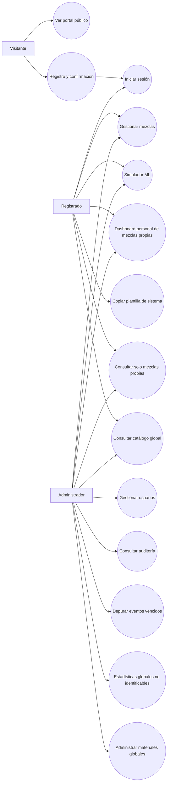

# FD03-EPIS — Especificación de Requerimientos de Software (SRS)

**Proyecto:** EcoMix IA — Portal de diseño y análisis preliminar de mezclas de concreto  
**Tipo de documento:** SRS evolutivo (complementa y actualiza el alcance funcional del SRS v0.1)  
**Versión:** 1.2 — **LÍNEA BASE FUNCIONAL PROPUESTA PARA F0**; D-01, D-02, D-04 a D-10 aprobadas (excepto D-03: modalidad provisional; proveedor pendiente). Implementación no iniciada.  
**Fecha:** 8 de noviembre de 2026 (Perú)  
**Contexto académico:** Universidad Privada de Tacna, Programación Web II  
**Repositorio web:** https://github.com/joeguillenl/EcomixIA — rama de referencia `feat/integration-fastapi-service`, commit `5495f92`  
**Repositorio ML:** https://github.com/JMedina255/EcoMix-IA-AzureML  
**Documentos base:** `docs/FD03-EPIS-Informe_SRS_EcoMixIA_v0.1.md` y el informe de visión FD02 del repositorio ML.  
**Responsable de aprobación funcional:** Equipo EcoMix IA (pendiente de validación).

> **Criterio documental:** «Existente» significa constatado en el código del repositorio web; «Verificado localmente» procede de las pruebas comunicadas por el equipo (MVC y LocalDB conectados); «Propuesto» no equivale a implementado. Las alternativas de optimización multiobjetivo, un asistente generativo o una certificación ACI **no** se consideran prestaciones terminadas en esta versión.

## Registro de cambios

| Versión | Fecha | Cambio | Estado |
|---|---|---|---|
| 0.1 | 26/10/2026 | SRS académico inicial: visión y requisitos preliminares | Documento de referencia |
| 0.2 | 08/11/2026 | Portal público, autenticación, tres perfiles, dashboards, logs, visualización ML y despliegue económico | Borrador previo |
| 0.3 | 08/11/2026 | **D-01 aprobada:** mezclas privadas por usuario; seguridad por objeto; tratamiento conservador de ejemplos preexistentes; pruebas de aislamiento | Privacidad de mezclas aprobada; SRS general aún en revisión |
| 0.4 | 08/11/2026 | **D-08 aprobada:** administración sin lectura de mezclas ajenas y auditoría minimizada | D-01 y D-08 aprobadas |
| 0.5 | 08/11/2026 | **D-02 aprobada:** catálogo global, consulta para registrados, CRUD exclusivo de administrador; reglas de integridad, seguridad y trazabilidad | D-01, D-02 y D-08 aprobadas |
| 0.6 | 08/11/2026 | **D-03 provisional:** envío transaccional externo gratuito o de bajo costo; proveedor por seleccionar, contratos de envío y verificación robusta | Modalidad aprobada provisionalmente; implementación pendiente |
| 0.7 | 08/11/2026 | **D-04 aprobada:** dashboard ligero de mezclas propias; indicadores de costo/CO₂; exclusión de historial persistente de predicciones | Alcance funcional aprobado; implementación pendiente |
| 0.8 | 08/11/2026 | **D-09 aprobada:** congelar precio y factor CO₂ unitarios de cada componente al guardarlo; reglas para edición, dashboard y migración de datos anteriores | Diseño aprobado; código y BD sin cambios |
| 0.9 | 08/11/2026 | **D-05 aprobada:** identidad propia EcoMix IA con paleta inspirada en Yura; recursos gráficos autorizados, atribución y ausencia de afirmaciones de patrocinio | Diseño visual aprobado; implementación pendiente F1 |
| 1.0 | 08/11/2026 | **D-06 aprobada:** consumo **acumulado** máximo de US$20 del crédito Azure for Students, incluida la infraestructura ML y servicios ya existentes; condiciones de presupuesto, alertas y aprobación por fases | Regla presupuestaria aprobada; saldo real y elegibilidad pendientes |
| **1.1** | **08/11/2026** | **D-07 aprobada:** retención de 30 días para `AuditEvents`, filtrado al consultar, depuración física por actividad/administración, pruebas y aviso de privacidad | **Política aprobada; desarrollo F5 pendiente; D-03 sigue provisional** |
| **1.2** | **08/11/2026** | **D-10 aprobada:** cuenta inicial Administrador mediante provisión manual segura y credenciales fuera del código; controles antiautopromoción y pruebas; cierre de decisiones y criterios F0 | **Línea base candidata a aprobación antes de F0; D-03 proveedor pendiente** |

## 1. Introducción

### 1.1 Propósito

Definir funciones, restricciones, reglas de negocio, atributos de calidad, casos de uso y criterios de aceptación para convertir EcoMix IA en una plataforma web pública de presentación con servicios de análisis de concreto reservados a cuentas registradas y capacidad administrativa de supervisión.

### 1.2 Problema y alcance

El sistema actual permite trabajar con materiales, mezclas, cálculos de costo/emisiones y un simulador de resistencia integrado con FastAPI, pero **no** dispone aún de una capa de acceso público/privado con registro de usuarios, administración de cuentas y trazabilidad de uso. La ampliación debe conservar el estilo MVC monolítico y evitar herramientas innecesarias.

**Incluido en esta iteración del producto:**

- Página pública de bienvenida y promoción con carrusel Bootstrap y descripción de capacidades, usando **marca propia EcoMix IA y recursos visuales de uso autorizado (D-05)**.
- Autenticación con correo y contraseña, verificación de correo y control de roles.
- Consulta de **materiales del catálogo global** y funciones de **mezclas propias**, cálculo, predicción y tablero para registrados; **solo el administrador administra materiales**, y las mezclas privadas no se comparten entre cuentas.
- Panel administrativo con usuarios, estadísticas y eventos de auditoría.
- Gráficos pequeños, legibles y etiquetados con indicadores de resistencia, costo y CO₂; **dashboard personal simple (D-04) sin persistencia de predicciones**.
- **D-09:** mantener históricos por mezcla usando los precios y factores CO₂ que se capturaron al guardar sus componentes; una edición del catálogo no modifica indicadores previos.
- **D-10:** alta del primer Administrador mediante herramienta de provisión explícita, sin contraseña ni token incrustados, sin endpoint web o elevación automática al arrancar.
- Preparación progresiva para hosting Windows y Azure SQL, **sujeta a D-06: máximo US$20 de consumo acumulado del crédito Azure for Students para todos los recursos del proyecto, incluidos los preexistentes**; no es un límite mensual ni un presupuesto adicional de dinero propio.

**Fuera del alcance comprometido de esta entrega:** experimentación física, aprobación estructural/certificación normativa, entrenamiento de un modelo nuevo dentro del MVC, optimización matemática multiobjetivo automática y asistentes de IA generativa. Se podrán proponer como ampliaciones futuras, con sus propios requerimientos y validación.

### 1.3 Tecnologías y condiciones de contorno

- ASP.NET MVC 5 / .NET Framework 4.7.2, vistas Razor `.cshtml` y layout compartido.
- Entity Framework 6.5.1 + LINQ + SQL Server LocalDB en desarrollo.
- Bootstrap 5.3.3 + Bootstrap Icons y una hoja `Content/site.css`.
- API FastAPI externa para predicciones de resistencia a 7 y 28 días (JSON; `X-API-Key`).
- Azure App Service **Windows**, Azure SQL Database y Azure Container Apps existente como destino previsto, sujeto a verificación de disponibilidad, elegibilidad y precio.

### 1.4 Terminología

| Término | Definición |
|---|---|
| Visitante | Persona no autenticada; no requiere ni representa un registro en la base de datos. |
| Registrado | Cuenta autenticada, con correo permitido y confirmado, autorizada a utilizar servicios de análisis. |
| Administrador | Cuenta asignada por procedimiento seguro con capacidad de administrar usuarios y consultar auditoría. |
| SCM | Material cementante suplementario, como ceniza volante o escoria. |
| f'c objetivo | Resistencia de diseño declarada por el usuario; no equivale a la predicción del modelo. |
| Predicción ML | Resultado numérico estimado por el modelo, **no** ensayo certificado de laboratorio. |
| Evento de auditoría | Registro controlado de una acción de seguridad, administración o uso funcional. |

## 2. Situación actual verificada

| Componente | Estado base | Evidencia/observación |
|---|---|---|
| Materiales, mezclas y componentes | Existente | `Controllers/MaterialesController.cs`, `Controllers/MezclasController.cs`, `Models/*` |
| Indicadores costo/CO₂/masa | Existente | Propiedades calculadas de `Models/Mezcla.cs` |
| Simulador ML con siete entradas | Existente en rama de integración | `Views/Mezclas/Simulador.cshtml`, `Services/EcoMixMlClientService.cs` |
| Base `EcomixIA` y tablas | Verificado localmente por el equipo | SQL Server LocalDB; tablas `Materials`, `Mezclas`, `MezclaComponentes` |
| Inicio con contadores de BD | Existente | `HomeController.Index`; se adaptará para no filtrar datos al público |
| Portal promocional | Propuesto | Nuevo contenido público de inicio |
| Login, registro, roles | Propuesto | No identificados como implementados en la rama revisada |
| Administración de usuarios y auditoría | Propuesto | Entidades y vistas nuevas |
| Despliegue web y SQL en Azure | Futuro | No ejecutar hasta completar pruebas locales |

## 3. Usuarios, actores y permisos

**Actores:** Visitante, Registrado, Administrador y Servicio de inferencia ML (actor externo). La categoría «Visitante» no se almacena como rol. La administración implica todos los permisos de Registrado.

| Capacidad | Visitante | Registrado | Administrador |
|---|:---:|:---:|:---:|
| Leer presentación pública y carrusel | Sí | Sí | Sí |
| Acceder a registro/inicio de sesión | Sí | Sí (salir/gestionar sesión) | Sí (salir/gestionar sesión) |
| Consultar el catálogo global de materiales | No | **Sí, solo lectura** | Sí |
| Crear, editar o eliminar materiales del catálogo global | No | **No** | **Sí** |
| Calcular dosificaciones propias | No | Sí | Sí |
| Crear, consultar y modificar **sus propias** mezclas | No | Sí | Sí |
| Consultar mezclas privadas **de otra cuenta** | No | No | **No (D-08 aprobada)** |
| Ejecutar inferencia ML | No | Sí | Sí |
| Ver dashboard personal | No | Sí | Sí |
| Gestión de usuarios, roles y estado | No | No | Sí |
| Consultar logs y estadísticas globales | No | No | Sí |

**Decisiones D-01 y D-08 APROBADAS (08/11/2026):** cada mezcla privada creada por una persona autenticada pertenece exclusivamente a su cuenta, y solo esa cuenta puede listarla, consultarla, editarla, eliminarla, asociarle componentes o precargarla en el simulador. **El administrador no puede abrir, modificar, borrar, duplicar, exportar ni precargar mezclas privadas ajenas, incluso por URL directa, POST o AJAX.** Su visibilidad se limita a la gestión de cuentas, a logs con metadatos mínimos y a estadísticas generales agregadas que no revelen dosificaciones, nombres ni resultados individuales. Los administradores pueden gestionar **sus propias** mezclas como cualquier usuario registrado. Cualquier futura excepción requeriría una nueva decisión formal y una revisión de seguridad; no está autorizada en este alcance. 

**Decisión D-02 APROBADA (08/11/2026):** el catálogo `Materials` es **único y compartido**. Todos los usuarios autenticados y habilitados pueden consultar los materiales y seleccionarlos para sus mezclas, sin poder crear, editar o eliminar registros del catálogo. Solo el rol `Administrador` puede efectuar altas, cambios y bajas de materiales, siempre por acciones protegidas en servidor. Los visitantes no consultan el catálogo. El administrador **no adquiere por ello acceso al contenido de mezclas privadas ajenas** (D-08). Para impedir la eliminación de materiales utilizados, el servidor puede verificar **solamente** la existencia de referencias, sin exponer qué mezclas o usuarios los emplean. Los cambios posteriores de costos/factores del catálogo **no cambian los indicadores de componentes ya guardados**, conforme a D-09; las nuevas dosificaciones capturan los valores vigentes en el momento de guardarlas.

**Registros preexistentes:** antes de migrar, inventariar la base local y comprobar la naturaleza de las seis mezclas de `DatosEjemplo.sql`. Si corresponden a ejemplos demostrativos, se conservarán como **plantillas de sistema de solo lectura** para usuarios autenticados, diferenciadas de «Mis mezclas»; al utilizarlas se creará una copia privada del usuario. No se reasignarán ni eliminarán registros sin verificar su procedencia y aprobar la migración.

## 4. Requerimientos funcionales

**Prioridad:** P1 = esencial; P2 = importante; P3 = mejorable. **Fase:** F0–F6, definidas en §9.

| ID | Requerimiento («El sistema deberá…») | Prioridad | Fase | Criterio de aceptación verificable |
|---|---|---|---|---|
| RF-01 | Mostrar una portada pública con descripción de EcoMix IA y llamada a iniciar sesión | P1 | F1 | Acceso anónimo a `/` sin errores de autorización ni consulta privada |
| RF-02 | Mostrar un carrusel de 3 diapositivas promocionales con títulos, texto alternativo y navegación | P1 | F1 | Flechas/indicadores funcionales en escritorio y móvil; imágenes optimizadas |
| RF-03 | Adaptar navbar y footer a sesión anónima o autenticada mediante `_Layout.cshtml` | P1 | F1-F2 | Anónimo ve «Ingresar/Registrarse»; autenticado ve servicios y «Salir» |
| RF-04 | Registrar cuentas mediante correo permitido y contraseña | P1 | F2 | Correo aceptado solo si dominio final es `upt.pe`, `virtual.upt.pe` o `gmail.com` |
| RF-05 | Rechazar correos no permitidos, inválidos o ya registrados | P1 | F2 | Casos positivos/negativos automatizados; no aceptar subdominios o sufijos falsos |
| RF-06 | Confirmar posesión del correo antes de habilitar el uso de servicios | P1 | F2 | Token de un solo uso, con caducidad; cuentas no confirmadas no acceden a servicios |
| RF-07 | Permitir iniciar/cerrar sesión con cookies protegidas | P1 | F2 | Clave incorrecta no crea sesión; logout la invalida |
| RF-08 | Permitir restablecimiento de contraseña mediante enlace temporal seguro | P2 | F2 | El enlace caduca y no revela si el correo existe |
| RF-09 | Proteger todas las rutas y operaciones privadas con autorización del servidor | P1 | F2 | Visitante obtiene redirección a login/401; cuenta sin rol obtiene 403 |
| RF-10 | Asignar «Registrado» como único rol a un alta pública; impedir autoasignación de Administrador | P1 | F2 | Prueba de modificación del POST de registro no concede permisos privilegiados |
| RF-11 | Crear/promover administradores solo por mecanismo controlado | P1 | F2 | Sin promoción por dominio o solicitud de usuario; acción de provisión auditada |
| RF-12 | Mantener el catálogo global de materiales con **lectura para registrados y CRUD exclusivo de administrador (D-02)** | P1 | F2-F3 | Listado/detalle para sesiones autorizadas; Create/Edit/Delete únicamente administradores; los usuarios registrados no modifican materiales por GET, POST o AJAX |
| RF-13 | Mantener CRUD de mezclas **privadas** y componentes vinculados a su propietario | P1 | F3 | Todo GET/POST/AJAX de listado, detalle, edición, eliminación y componentes exige propiedad real; una cuenta B no puede modificar mezcla de A |
| RF-14 | Calcular costo, CO₂ estimado y masa de mezclas con unidades explícitas **a partir de los valores unitarios capturados al guardar sus componentes (D-09)** | P1 | F3 | Costo = Σ(Cantidad × PrecioCapturado); CO₂ = Σ(Cantidad × FactorCapturado); masa = ΣCantidad; cambios posteriores en `Materials` no alteran los resultados |
| **RF-15 (D-04/D-09)** | **Mostrar dashboard personal sencillo:** total de mezclas privadas, costo promedio por m³ y CO₂ promedio por m³ de mezclas con componentes **y capturas completas**, más accesos rápidos | **P1** | **F3** | LINQ filtrado por `OwnerUserId` y `EsPlantilla=false`; usar snapshots, excluir valores de origen histórico desconocido de promedios oficiales; avisar «Datos históricos pendientes de validar»; sin historial de inferencias |
| RF-16 | Ejecutar predicción ML con siete cantidades en kg/m³ | P1 | F4 | Envío desde servidor MVC hacia API con `X-API-Key`; nunca exponer clave al navegador |
| RF-17 | Mostrar resistencia predicha a 7/28 días, w/c, w/b, advertencias y fuente/versión del modelo | P1 | F4 | Valores coherentes con JSON real de la API; sin sustituir con resultados ficticios |
| RF-18 | Representar el resultado en un gráfico pequeño accesible y presentar una orientación interpretativa basada en la predicción y advertencias reales | P1 | F4 | Etiquetas 7d/28d, MPa, escala, texto alternativo y orientación sin certificar mezcla |
| RF-19 | Diferenciar con colores y texto los resultados favorables, advertencias y errores | P1 | F4 | Verde/amarillo/rojo con etiqueta, icono y texto; nunca solo color |
| RF-20 | Informar fallos de validación, servicio ML no disponible o timeout sin tumbar la interfaz | P1 | F4 | Manejo controlado de 401/403/422/429/5xx y fallo de red; mensaje seguro |
| RF-21 | Mostrar administración de usuarios: listado, búsqueda, rol y estado **sin revelar sus mezclas privadas** | P1 | F5 | Solo admin; no muestra hashes, secretos, nombres, contenidos ni enlaces de mezclas privadas; paginación básica |
| RF-22 | Permitir al administrador habilitar/deshabilitar usuarios y cambiar roles por acción auditada | P1 | F5 | Protección de último administrador; cambios persistidos y registrados |
| RF-23 | Registrar eventos de seguridad y acciones críticas de aplicación | P1 | F5 | Datos mínimos: usuario, acción, recurso, resultado, fecha UTC, correlación |
| RF-24 | Mostrar al administrador un historial filtrable de eventos de uso **sin datos de dosificaciones privadas** | P1 | F5 | Filtros por fecha, categoría y resultado; metadatos mínimos; sin nombres/IDs de mezclas ajenas, cantidades, resultados individuales, contraseñas ni claves API |
| RF-25 | Mostrar dashboard administrativo con conteo global de usuarios, simulaciones y errores | P1 | F5 | Consultas agregadas LINQ; sin filas de mezclas ni métricas individualizadas por usuario; periodos suficientemente amplios para no inferir datos privados |
| RF-26 | Presentar estado de indisponibilidad del ML y operación no predictiva sin dependencia de su disponibilidad | P2 | F4 | Catálogo y cálculo local funcionan aunque FastAPI no responda |
| RF-27 | Facilitar una política informativa de privacidad y limitaciones del modelo | P1 | F2-F4 | Enlaces públicos y aclaración explícita de que el predictor no certifica mezclas |
| RF-28 | Preparar publicación de MVC y SQL en Azure sin cambiar la arquitectura | P1 | F6 | Despliegue y pruebas en cuenta estudiantil dentro del presupuesto aprobado |
| RF-29 | Asociar cada nueva mezcla privada al usuario autenticado **desde el servidor**, no desde el formulario | P1 | F3 | `OwnerUserId` coincide con identidad de sesión aun cuando se manipule la solicitud HTTP |
| RF-30 | Impedir lectura y modificación de mezclas ajenas por identificador directo, componentes y precarga del simulador | P1 | F3-F4 | GET `/Mezclas/Details/{id}`, editar, borrar, agregar/quitar componentes y `/Mezclas/Simulador?mezclaId=...` bloquean intentos de otra cuenta, sin filtrar datos |
| RF-31 | Conservar mezclas de ejemplo como plantillas de sistema de solo lectura, sin mezclarlas con datos personales, **si la auditoría de datos confirma que son ejemplos** | P1 | F0-F3 | Seis registros de demostración preservados; copia explícita crea mezcla privada; ningún usuario edita la plantilla global |
| **RF-32** | **Bloquear cualquier acceso administrativo transversal a mezclas privadas ajenas, incluidas vistas, endpoints, consultas, descargas y precarga del simulador** | **P1** | **F3-F5** | Administrador A obtiene 404/sin datos ante cualquier ID privado de B; no existe exportación privilegiada ni endpoint de detalle global |
| **RF-33** | Permitir a todo usuario registrado y habilitado consultar/buscar materiales globales sin modificarlos | **P1** | **F3** | Index/Details muestran datos globales; no se muestran controles de escritura; las peticiones de modificación no alteran la BD |
| **RF-34** | Permitir **exclusivamente al Administrador** registrar, editar y eliminar materiales globales con validación y antifalsificación | **P1** | **F3** | `[Authorize(Roles="Administrador")]` u autorización equivalente cubre GET y POST de escritura; pruebas de rol negativo, errores y auditoría |
| **RF-35** | Impedir la eliminación de materiales asociados a cualquier mezcla, sin revelar mezclas privadas ni su propietario al administrador | **P1** | **F3-F5** | Consulta `Any()` de referencias bloquea baja; UI muestra mensaje genérico; ni endpoint ni logs exponen IDs, nombres o dosificaciones ajenas |
| **RF-36 (D-03)** | Enviar por un **proveedor transaccional externo** el enlace de confirmación de alta, sin credenciales en el código | **P1** | **F2** | El proveedor se configura por entorno; correo de prueba recibido; ningún secreto o enlace de un solo uso aparece en Git, logs públicos o navegador ajeno |
| **RF-37 (D-03)** | Reenviar confirmaciones a cuentas pendientes con control de frecuencia, sin revelar existencia de cuentas | **P1** | **F2** | La respuesta pública es genérica; no permite envío masivo; cada enlace usa un token temporal validado por Identity |
| **RF-38 (D-03)** | Notificar errores temporales de entrega sin habilitar automáticamente la cuenta | **P1** | **F2** | Ante fallo/cuota del proveedor, `EmailConfirmed` permanece falso; el usuario puede solicitar reenvío tras esperar |
| **RF-39 (D-03)** | Enviar restablecimiento de contraseña a través del mismo adaptador transaccional | **P2** | **F2** | Enlace temporal de un solo uso; respuestas no enumerables y caducidad verificada |
| **RF-40 (D-03)** | Permitir sustituir el proveedor sin reescribir controladores ni alterar el esquema de identidad | **P2** | **F2-F6** | Implementación real y emisor simulado de desarrollo cumplen el mismo contrato; smoke test en Azure |
| **RF-41 (D-09)** | Capturar al guardar cada **componente de mezcla** el precio por kg y factor CO₂ por kg aplicables, con fecha UTC y procedencia, independientemente del catálogo global | **P1** | **F3** | Valores y metadatos persistidos del lado servidor; no aceptar precios/factores inyectados en POST; catálogo modificado no altera snapshots anteriores |
| **RF-42 (D-09)** | Presentar costos y emisiones de mezclas privadas y dashboard usando exclusivamente capturas válidas; indicar explícitamente cuando un legado carece de valores originales verificables | **P1** | **F3** | Fórmulas reproducibles con snapshot, control de valores `null`/legacy y leyenda de procedencia; jamás presentar backfill como precio histórico auténtico |
| **RF-43 (D-09)** | Mantener la consistencia de snapshots al agregar, editar o eliminar componentes de una mezcla propia | **P1** | **F3** | Nuevo componente/reinserción captura precio/factor vigentes; cambios de cantidad conservan factores capturados de ese componente; eliminar recalcula suma; no se almacena historial de versiones de mezcla |
| **RF-44 (D-05)** | Identificar la aplicación y el portal promocional como **EcoMix IA**, con identidad visual propia inspirada cromáticamente en Yura, sin aparentar vinculación oficial | **P1** | **F1** | Logo/nombre EcoMix IA, navbar, títulos y footer coherentes; no se usan logos, eslóganes ni distintivos protegidos de Yura sin permiso; no se afirma asociación ni patrocinio |
| **RF-45 (D-05)** | Presentar tres piezas de carrusel con imágenes de uso autorizado, accesibles, responsivas y documentadas en cuanto a procedencia | **P1** | **F1** | Tres piezas visibles y navegables en móvil/teclado, `alt` adecuado, controles e indicadores, tamaños optimizados; licencia o permiso registrado para cada recurso |
| **RF-46 (D-06)** | Registrar el **consumo real acumulado** de crédito Azure del proyecto desde el inicio y conciliado con el portal de facturación, incluyendo recursos ML preexistentes | **P1** | **F0-F6** | Inventario y reporte con fecha, suscripción, costos por recurso, costos auxiliares, crédito consumido y remanente hasta US$20; no sustituir los valores reales por estimaciones |
| **RF-47 (D-06)** | Impedir nuevos despliegues o ampliaciones de costo no autorizadas cuando la proyección de gasto exceda el saldo permitido | **P1** | **F0-F6** | Antes de crear/actualizar un SKU de Azure, comprobar elegibilidad, cuota, coste incremental y autorización; si no cabe en el saldo, no desplegar y continuar local |
| **RF-48 (D-06)** | Monitorizar el consumo de crédito de toda la suscripción involucrada con alertas y procedimiento operativo de contención | **P1** | **F6** | Seguimiento acumulado y alertas de referencia US$10/15/18; al llegar al umbral operativo US$18, suspender despliegues facturables y revisar servicios; nunca asumir que una alerta detiene cobros |
| **RF-49 (D-07)** | Conservar los eventos de auditoría de la aplicación durante **30 días desde `TimestampUtc`**, y no mostrar eventos vencidos en las consultas administrativas ni estadísticas | **P1** | **F5** | `TimestampUtc` se registra en UTC; todos los filtros usan `TimestampUtc >= UtcNow - 30 días`; registros más antiguos quedan fuera de HTML, JSON, búsquedas y agregados |
| **RF-50 (D-07)** | Depurar físicamente eventos de auditoría vencidos de SQL Server con una operación sencilla e idempotente, sin crear servicios cloud adicionales | **P1** | **F5** | Depuración por lotes de `AuditEvents` al usar la auditoría y al escribir eventos (controlada); alternativa manual de mantenimiento solo para admin; no borra tablas de negocio/usuarios |
| **RF-51 (D-07)** | Mostrar aviso de privacidad explicando propósito, contenido mínimo y plazo de 30 días de los eventos de auditoría | **P1** | **F1-F5** | Aviso accesible en el portal/registro; no promete eliminación instantánea de copias de seguridad o logs de Azure que tienen políticas aparte |
| **RF-52 (D-10)** | Proveer una **rutina explícita de uso controlado** para crear únicamente el **primer** Administrador, con correo y contraseña obtenidos fuera del código, de Git y de los argumentos de línea de comandos | **P1** | **F2** | No existe endpoint público; no se ejecuta automáticamente en `Application_Start`; secretos leídos mediante entrada segura o entorno protegido; Identity guarda solo `PasswordHash` |
| **RF-53 (D-10)** | Evitar duplicación, reejecución insegura o sobrescritura silenciosa durante la provisión | **P1** | **F2** | Si ya existe administrador, el proceso no crea otro ni modifica roles/contraseñas; si el correo ya existe, aborta sin elevarlo automáticamente; devuelve resultado no sensible |
| **RF-54 (D-10)** | Verificar la identidad del administrador inicial antes de otorgarle acceso a servicios privados, y bloquear autopromoción por el registro público | **P1** | **F2** | Alta se crea sin bypass de `EmailConfirmed`; confirmación por mecanismo D-03 o procedimiento validado y documentado; un POST de registro manipulado nunca asigna el rol administrador |
| **RF-55 (D-10)** | Registrar de manera restringida la operación de provisión y permitir revocar sus permisos operativos después de completar el arranque | **P1** | **F2-F5** | Evidencia de fecha UTC, resultado, operador y cuenta objetivo sin contraseña/token; cuenta de mantenimiento sin privilegios persistentes innecesarios; registro visible solo a personal autorizado |

## 5. Reglas de negocio

| Código | Regla | Validación |
|---|---|---|
| RN-01 | Los únicos dominios autorizados para **alta pública** son `upt.pe`, `virtual.upt.pe`, `gmail.com` | Extraer dominio real tras `@`, normalizar minúsculas y comparar igualdad exacta |
| RN-02 | Se permite un único usuario por dirección de correo normalizada | Índice único y validación al alta; gestionar concurrencia |
| RN-03 | Toda cuenta registrada nace exclusivamente con rol `Registrado` | La API/formulario no admite seleccionar rol |
| RN-04 | `Administrador` solo se asigna por provisión segura o administrador autorizado | Registrar quién hizo el cambio y proteger el último administrador |
| RN-05 | Visitante solo puede consumir contenido público y operaciones de registro/acceso | `[Authorize]` y controles de rol en acciones; proteger POST y endpoints AJAX |
| RN-06 | Correo no verificado no puede utilizar los servicios privados | Confirmación mediante token; proveedor de correo por seleccionar |
| RN-07 | Predicciones a 7 y 28 días son estimaciones y no certifican cumplimiento estructural | Mostrar alcance/advertencia técnica junto a resultados |
| RN-08 | Validaciones locales no reemplazan las validaciones de dominio del motor FastAPI | Mostrar errores HTTP 422 y advertencias del servicio sin modificar resultados |
| RN-09 | Solo personal autorizado puede consultar auditoría general y datos personales de cuentas | Control de rol y minimización de contenido de logs |
| RN-10 | No se guardarán claves, contraseñas, tokens ni entradas confidenciales completas en logs | Pruebas de sanitización y revisión del esquema |
| RN-11 | Todo material y mezcla mostrará unidades de comparación (`kg/m³`, `MPa`, `S/m³`, `kg CO₂/m³`) | Inspección de UI y pruebas de cálculo |
| RN-12 | No se declarará «optimización óptima» sin un algoritmo validado y evidencias | En esta versión se muestran estimaciones y comparaciones exploratorias |
| RN-13 | Toda mezcla privada tendrá un propietario autenticado inequívoco | Asignación de `OwnerUserId` desde identidad del servidor; no aceptar propiedad en datos enviados por cliente |
| RN-14 | La propiedad privada se aplicará en consultas, acciones individuales y operaciones sobre componentes | Filtrado en SQL por `Id` y `OwnerUserId`; sin acceso cruzado por URL o POST manipulado |
| RN-15 | **D-08: el administrador no tiene acceso al contenido de mezclas privadas ajenas, sin excepción de soporte en el alcance aprobado** | Puede administrar cuentas y consultar agregados globales autorizados; mismas verificaciones `OwnerUserId` que el registrado para CRUD y simulador |
| RN-16 | Las mezclas históricas sin propietario no se asignarán arbitrariamente a usuarios | Migración aditiva precedida de inventario y respaldo; únicamente ejemplos identificados podrán ser plantillas del sistema |
| **RN-17** | **La auditoría y los agregados globales no deben permitir reconstruir mezclas privadas o predicciones individuales** | No publicar nombre, ID de mezcla, componentes, cantidades, resultados por mezcla ni detalles en logs o reportes admin; limitar desgloses por intervalos o grupos demasiado pequeños |
| **RN-18 (D-02)** | `Materials` será un catálogo global compartido de solo lectura para `Registrado` y lectura/escritura para `Administrador` | Autorizar cada acción de controlador; visitantes sin acceso al catálogo |
| **RN-19 (D-02)** | Solo el administrador puede crear, editar o intentar eliminar materiales globales | Bloquear GET de formularios mutantes y POST/AJAX para no administradores; no basarse solo en ocultar botones |
| **RN-20 (D-02)** | No se permite borrar un material usado en al menos una mezcla privada o plantilla, aunque el actor sea administrador | Comprobar `db.Componentes.Any(...)` y devolver error genérico sin mostrar las referencias privadas |
| **RN-21 (D-02)** | Las modificaciones del catálogo son auditadas sin incluir información de mezclas privadas ajenas | Registrar actor, operación, material afectado, resultado y fecha; no enumerar usuarios/mezclas que lo utilicen |
| **RN-22 (D-03)** | La modalidad de envío será **servicio transaccional externo**, preferentemente con plan gratuito o costo controlado, sin proveedor adjudicado | El proveedor final requiere revisión de precio, cuota, dominio remitente y elegibilidad antes de F2 real |
| **RN-23 (D-03)** | Registro público solo con `upt.pe`, `virtual.upt.pe` o `gmail.com`, validación exacta, y comprobación de posesión del buzón | Una dirección permitida que no confirma no tiene acceso privado; pertenencia a dominio no implica privilegios |
| **RN-24 (D-03)** | Los tokens de confirmación y recuperación son temporales, no reutilizables tras su aplicación y se validan por Identity | No guardar tokens en texto plano ni publicarlos en logs; invalidación acorde con Identity |
| **RN-25 (D-03)** | El sistema no enviará correos ilimitados ni permitirá enumerar usuarios por respuestas de reenvío o recuperación | Limitar frecuencia por usuario/IP y usar respuestas genéricas; valores concretos se calibran en F2 |
| **RN-26 (D-03)** | Error o cuota de correo no puede activar cuentas sin confirmar ni omitir controles de autenticación | Mantener cuenta pendiente; reintento controlado; jamás `EmailConfirmed=true` por fallo o por entorno de producción |
| **RN-27 (D-03)** | Solo se enviará desde identidad remitente autorizada y verificable; no suplantar `@upt.pe`, `@virtual.upt.pe`, `@gmail.com` ni marca Yura | Comprobar dominio de envío, DNS/proveedor y permisos reales antes de habilitar envío externo |
| **RN-28 (D-04)** | El dashboard personal no guarda ni muestra un historial de predicciones ML | Las predicciones se muestran en la pantalla de consulta y no se escriben en una tabla `PredictionRuns`; la auditoría mínima de uso, cuando se implemente, no contiene inputs ni outputs |
| **RN-29 (D-04)** | Los promedios de costo y CO₂ del dashboard utilizan únicamente mezclas privadas con al menos un componente y unidades por m³; no se suman presupuestos de formulaciones distintas | Indicadores: número total de mezclas propias, media aritmética de `CostoPorM3` y media aritmética de `Co2PorM3` sobre mezclas completas; si no hay mezclas completas, mostrar «Sin datos», no cero como promedio |
| **RN-30 (D-04)** | Los KPIs personales nunca incluyen plantillas ni datos de otra cuenta, aun cuando el visitante sea administrador | Aislamiento de propietario aplicado en consulta SQL; ninguna identidad privilegiada obtiene información de otras cuentas en el dashboard personal |
| **RN-31 (D-09)** | El precio/factor ambiental unitario usado al guardar un componente queda **congelado**; el catálogo solo define valores para nuevas capturas | Comparar mezcla guardada antes/después de editar `Materials`: costo/CO₂ idénticos; suma de snapshots en SQL |
| **RN-32 (D-09)** | Cantidades editadas conservan el precio y factor del componente original; componentes nuevos o eliminados y vueltos a crear capturan valores vigentes al nuevo guardado | No existe historial de versiones de mezcla: la formulación actual se recalcula desde componentes guardados y sus snapshots |
| **RN-33 (D-09)** | Los registros existentes sin snapshots no permiten reconstruir precios históricos auténticos | Preservarlos y marcarlos **`LEGADO_SIN_VERIFICAR`**; si se precargan valores actuales, etiquetarlos estimaciones referenciales de fecha de migración, **nunca datos originales** |
| **RN-34 (D-09)** | Los cálculos históricos comparables requieren que **todos** los componentes de la mezcla tengan capturas válidas; faltantes no se interpretan como cero | Dashboard excluye mezclas incompletas/legado desconocido de promedios; contador de mezclas personales permanece correcto; UI señala datos no verificados |
| **RN-35 (D-09)** | El servidor captura los valores en una misma operación consistente con la persistencia del componente | `CostoPorKgGuardado` y `Co2PorKgGuardado` se obtienen de `Materials` en servidor; nunca del navegador; proteger concurrencia/transacción y validaciones de precisión |
| **RN-36 (D-05)** | La identidad pública será **EcoMix IA**; la inspiración cromática no constituye licencia de marca, patrocinio ni colaboración oficial con Yura | No usar logotipo, eslóganes, fotografías corporativas ni marcas de terceros sin autorización verificable; ningún texto sugiere aval oficial |
| **RN-37 (D-05)** | Toda fotografía, icono o ilustración del portal público debe disponer de permiso o licencia compatible con su utilización web | Registrar autor/fuente, licencia o permiso, fecha de revisión y atribución cuando proceda; reemplazar recursos sin derechos demostrables |
| **RN-38 (D-05)** | El carrusel promoverá funciones reales o explícitamente presentadas como previstas | No afirmar optimización automática, certificación ACI, aplicación industrial ni beneficios medidos no demostrados; la IA se presenta como predicción preliminar |
| **RN-39 (D-05)** | Los tonos verde, amarillo y rojo representan estados técnicos, no una aprobación automática de mezcla | El significado siempre incluirá etiqueta y texto; no declarar seguridad estructural a partir de un color |
| **RN-40 (D-06)** | El máximo de US$20 es **acumulado durante el proyecto**, no mensual, y se mide como crédito Azure consumido en la suscripción estudiantil | La medición incluye gastos previos de AML, Container Apps, almacenamiento, registros, redes, web, SQL y otros recursos asociados que descuenten crédito; consumos gratuitos no descuentan, pero deben supervisarse |
| **RN-41 (D-06)** | Ningún despliegue de producción/demostración en Azure se aprueba sin una línea base de consumo real y saldo del proyecto | Antes de F6, descargar/registrar facturación histórica y comparar gasto real + gasto estimado no facturado + proyección contra US$20; no inventar un saldo |
| **RN-42 (D-06)** | Se prefieren planes gratuitos verificados y el uso de recursos ya creados, sin duplicar infraestructura | Evaluar App Service Windows F1, Azure SQL Database Free con **pausa al agotar cuota** y Container Apps Consumption existente; revisar disponibilidad, compatibilidad y cuotas en la suscripción real |
| **RN-43 (D-06)** | Las alertas de presupuesto sirven para aviso, **no son un límite automático** | Usar seguimiento acumulativo y, si está disponible, alertas US$10/15/18; al alcanzar US$18 no iniciar cargos nuevos y revisar/pausar recursos; ante US$20 priorizar contención inmediata; no asegurar tope exacto por retrasos de facturación |
| **RN-44 (D-06)** | No contratar complementos Azure de cobro o planes externos de pago sin autorización previa | El correo D-03 comienza con plan gratuito elegible; si no existe opción real dentro del techo, detener y replantear, sin asumir gasto personal ni aumentar a US$100 por tener ese crédito |
| **RN-45 (D-07)** | La retención de eventos de auditoría propia (`AuditEvents`) es de **30 días calendario**, computados en UTC desde el instante de cada evento | El vencimiento se calcula con un instante UTC (`UtcNow.AddDays(-30)`), no por día del mes ni por zona horaria del navegador |
| **RN-46 (D-07)** | Los eventos anteriores al umbral de 30 días son invisibles para usuarios, administrador y estadísticas, incluso si una depuración física aún está pendiente por inactividad | Aplicar filtro de caducidad en **todas** las consultas, listados, descargas autorizadas y agregados; no confiar únicamente en la tarea de borrado |
| **RN-47 (D-07)** | Borrado físico solo de filas de auditoría vencidas y por lotes; conserva usuarios, mezclas, snapshots, catálogo y otros datos de negocio | Limpieza segura en F5; método SQL parametrizado, idempotente e indexado; no usar `TRUNCATE`, `DROP` ni cascadas hacia otros dominios |
| **RN-48 (D-07)** | El borrado se activa al acceder a la auditoría y periódicamente durante la actividad de la aplicación, sin asumir que IIS Express/App Service permanezcan activos las 24 horas | En ausencia de tráfico, la eliminación física puede ocurrir en el siguiente acceso; **no declarar una purga exacta al minuto 30** sin planificador externo |
| **RN-49 (D-07)** | No confundir la auditoría SQL con logs de servidor, telemetría Azure, facturación, backups o retenciones legales | Configurar y revisar por separado retención de logs de plataforma/copias al desplegar; la limpieza `AuditEvents` no borra backups ni cargos de Azure |
| **RN-50 (D-10)** | La única vía de creación inicial de Administrador es la provisión de mantenimiento autorizada, iniciada por operador y sin exposición HTTP | No ejecutar seeds privilegiados en inicio de aplicación, migraciones regulares ni peticiones web |
| **RN-51 (D-10)** | Las credenciales iniciales son secretas, no hardcodeadas, no guardadas en archivos versionados y no se entregan en argumentos visibles de procesos | No incluir contraseña, clave ni token en `Web.config` rastreado, `.sql`, logs, stack traces, commits o comandos de consola con historial |
| **RN-52 (D-10)** | La provisión es de primera ejecución y falla de forma segura ante cuentas o roles preexistentes no previstos | Comprobar ausencia de administradores y colisiones; no reemplazar contraseña ni asignar Admin a usuario existente sin procedimiento separado y autorizado |
| **RN-53 (D-10)** | La cuenta Administrador inicial obedece la misma política de dominio, estado habilitado y verificación de correo que cualquier cuenta privada | Correo permitido, confirmación real; prohibida la elevación por dominio o un `EmailConfirmed=true` incondicional en producción |
| **RN-54 (D-10)** | La provisión es auditable sin revelar secretos ni mezclarla con logs privados de dosificaciones | Registrar operación mínima en evidencia restringida; después de F5, integrar con auditoría de aplicación de 30 días según D-07 |
| **RN-55 (D-10)** | Los permisos del mecanismo de provisión se revocan o deshabilitan tras el arranque, y no se crea un usuario administrador predeterminado con contraseña conocida | Prueba de segunda ejecución, revisión de secretos y de ausencia de endpoints/admin backdoors |

## 6. Requerimientos no funcionales (alineación ISO/IEC 25010)

| ID | Categoría | Requerimiento / meta inicial | Forma de prueba |
|---|---|---|---|
| RNF-01 | Usabilidad | Diseño responsive con Bootstrap, lenguaje claro y navegación por teclado | Revisión móvil/escritorio, etiquetas, contraste y foco visible |
| RNF-02 | Seguridad | Contraseñas con hash robusto mediante ASP.NET Identity, no almacenamiento plano | Inspección técnica y prueba de autenticación |
| RNF-03 | Seguridad | HTTPS y cookies `Secure`, `HttpOnly`, `SameSite` cuando aplique, antiforgery en POST | Pruebas locales HTTPS y revisión de headers/configuración |
| RNF-04 | Seguridad | Autorización por **acción y propiedad del recurso**; pruebas negativas de acceso horizontal (IDOR) | Matriz GET/POST/AJAX con dos cuentas; tests de acceso cruzado |
| RNF-05 | Seguridad | Secretos ML y cadenas productivas fuera del código/repositorio | Revisión Git + configuración de publicación |
| RNF-06 | Confiabilidad | Si API ML falla, portal y consulta SQL siguen disponibles | Deshabilitar endpoint e inspeccionar rutas independientes |
| RNF-07 | Mantenibilidad | Seguir MVC, servicios pequeños, EF6, LINQ; sin nuevo framework SPA | Revisión de estructura, dependencias y complejidad |
| RNF-08 | Rendimiento | Página pública objetivo ≤ 3 s en navegador de prueba y red conocida; objetivo sujeto a medición | Lighthouse/DevTools y registro de contexto de prueba |
| RNF-09 | Rendimiento | Mostrar estado de carga y permitir timeout configurable de ML | Simulación de arranque en frío y timeout |
| RNF-10 | Privacidad | Publicar aviso de privacidad y comunicar **30 días de retención** de eventos de auditoría de aplicación (D-07); otras retenciones se identifican por separado | Revisar interfaz, documentación y configuración real de Azure antes de publicar |
| RNF-11 | Portabilidad | Mantener conexión configurable LocalDB en desarrollo / Azure SQL en publicación | Smoke tests en ambos entornos |
| RNF-12 | Operabilidad | Configurar alertas presupuestarias y evitar servicios de Azure innecesarios | Evidencia del costo previsto, presupuesto y consumo |
| RNF-13 | Confidencialidad | Ningún registro personal de mezcla ni sus parámetros debe aparecer en listados, precargas, logs o estadísticas accesibles a otras cuentas, **incluida una cuenta administrativa no propietaria** | Dos usuarios y un administrador tercero; revisar HTML/JSON/descargas, logs y LINQ filtrado |
| **RNF-14** | **Privacidad de analítica** | **Los indicadores administrativos serán agregados no identificables y las acciones de auditoría contendrán solo metadatos mínimos** | Inspección de endpoints/vistas/exportaciones; pruebas de intervalos/grupos reducidos y ausencia de nombres, ingredientes y resultados individuales |
| **RNF-15** | **Integridad y seguridad** | El catálogo global aplicará autorización por rol, validaciones de modelo y protección CSRF en escrituras; no permitirá eliminar materiales referenciados | Pruebas con visitante, registrado y administrador, incluso POST directo, junto con consistencia de las FKs |
| **RNF-16** | Seguridad/privacidad | API Key, credenciales SMTP y DNS de proveedor de correo exclusivamente en configuración segura, nunca en Git ni HTML | Inspección de archivos/variables, salida renderizada y cambios Git |
| **RNF-17** | Fiabilidad/operación | Servicio de correo intercambiable, con timeouts, errores controlados y capacidad de pruebas locales sin enviar mensajes reales | Pruebas de emisor simulado/real; fallo de servicio deja cuenta sin confirmar |
| **RNF-18** | Eficiencia/costos | Selección de proveedor que respete presupuesto de US$20 y cuotas gratuitas vigentes, sin sobreconsumo automático no autorizado | Evidencia de plan, facturación y límite de envíos antes del despliegue |
| **RNF-19 (D-04)** | Rendimiento/privacidad | Indicadores del dashboard calculados sobre mezclas del propietario, con proyecciones LINQ y sin traer registros globales para filtrar en memoria | Inspección de consultas y pruebas con usuarios A/B; ningún dato privado ajeno llega al servidor/vista por esta acción |
| **RNF-20 (D-09)** | Integridad y trazabilidad | Valores unitarios históricos capturados de forma consistente, con precisión decimal definida y procedencia explícita; migraciones reversibles y sin backfill engañoso | Pruebas de no retroactividad, cálculo decimal, restauración de backup, legado sin fecha/precio original y concurrencia de lectura |
| **RNF-21 (D-05)** | Usabilidad/accesibilidad | Carrusel Bootstrap accesible con `alt`, foco visible, operación con teclado y respeto a reducción de movimiento | Prueba en móvil/escritorio, teclado, lector de pantalla básico y `prefers-reduced-motion` |
| **RNF-22 (D-05)** | Rendimiento/mantenibilidad | Recursos visuales optimizados y estilos centralizados en `Content/site.css`, sin CMS, tablas de banners ni paquetes UI extra | Inventario de imágenes/licencias, DevTools en carga pública y revisión de dependencias |
| **RNF-23 (D-06)** | Eficiencia de recursos | El gasto acreditable acumulado no se planificará por encima de US$20, integrando todo recurso preexistente y nuevo de la misma suscripción que consuma ese crédito | Balance inicial y conciliaciones de factura/crédito con fecha y total por recurso; actualización de proyección antes de cada despliegue |
| **RNF-24 (D-06)** | Operabilidad | Alertas de gasto, revisión manual y procedimiento explícito de detención de recursos facturables; **sin prometer corte automático a US$20** | Evidencia de alertas y manual de contención; revisión de latencia del reporte de costos |
| **RNF-25 (D-06)** | Compatibilidad/costo | Hosting ASP.NET MVC 5 en Windows; SQL Free solo si elegible en la suscripción y con pausa al agotar cuota; sin servicios premium para pruebas | Verificación en portal antes de crear servicios y prueba end-to-end con costo marginal registrado |
| **RNF-26 (D-07)** | Privacidad | Los eventos de aplicación vencidos no son accesibles por rutas autorizadas, APIs o consultas agregadas; se protegen mediante una política de depuración medible | Prueba con eventos de 29, 30 y 31 días, incluidos listados y agregados de administración |
| **RNF-27 (D-07)** | Mantenibilidad/eficiencia | Purga SQL por lotes pequeños sobre `TimestampUtc` indexado; sin Azure Functions, SQL Agent, Elastic Jobs ni servicios adicionales para el MVP | Pruebas de concurrencia, idempotencia, mínimo privilegio, volumen y presupuesto D-06 |
| **RNF-28 (D-10)** | Seguridad/credenciales | Rutina de provisión sin secretos en Git, HTML, parámetros de CLI, procesos o logs; hash estándar de Identity 2 | Análisis de cambios Git, inspección de tablas y verificación de `PasswordHash` |
| **RNF-29 (D-10)** | Seguridad/autorización | Primer Administrador solo con verificación efectiva de correo y condiciones normales de habilitación; prohibida elevación automática por registro o bootstrap reiterado | Pruebas positivas y negativas con cuenta nueva, existente, correo sin confirmar y segunda ejecución |
| **RNF-30 (D-10)** | Mantenibilidad/operabilidad | Provisionador mínimo independiente de arranque web y sin nube adicional, ejecutado manualmente con registro seguro del resultado | Revisión de `Application_Start`, configuraciones y puesta en marcha repetible en local/entorno confiable |

Los objetivos de tiempo y retención son **propuestas verificables**, no mediciones ni SLA existentes. La evaluación de privacidad debe considerar la Ley peruana 29733 y su reglamentación vigente, con revisión antes del despliegue público.

## 7. Casos de uso (resumen)

| CU | Actor | Precondición | Flujo resumido | Resultado esperado |
|---|---|---|---|---|
| CU-01 Ver portal | Visitante | Ninguna | Abrir `/`, navegar carrusel y leer beneficios | Portal visible sin datos privados |
| CU-02 Registrarse | Visitante | Correo elegible | Completar correo/contraseña → validación → solicitar confirmación | Cuenta creada pendiente de confirmar |
| CU-03 Iniciar sesión | Registrado/Admin | Cuenta habilitada y confirmada | Ingresar credenciales → validación → cookie | Acceso a dashboard según rol |
| CU-04 Gestionar mezclas propias | Registrado/Admin | Sesión vigente | Abrir «Mis mezclas» → CRUD filtrado por dueño → calcular KPIs | Solo mezclas propias persistidas y visibles |
| CU-05 Simular predicción | Registrado/Admin | Sesión vigente; API disponible | Completar 7 insumos → validar → enviar POST → mostrar resultado | 7d/28d y advertencias reales visibles |
| CU-06 Administrar usuarios | Administrador | Sesión con rol admin | Buscar cuenta → ver estado → cambiar rol/estado con confirmación | Cambio controlado y auditado |
| CU-07 Consultar auditoría | Administrador | Sesión con rol admin | Filtrar eventos sanitizados y ver estadísticas globales | Eventos autorizados y agregados no identificables sin contenidos ni resultados de mezclas privadas ajenas |
| CU-08 Crear mezcla a partir de plantilla | Registrado/Admin | Sesión vigente y plantilla verificada | Seleccionar plantilla de solo lectura → duplicar → asignar propietario | Nueva mezcla de la cuenta con componentes copiados; plantilla intacta |
| CU-09 Denegar acceso a mezcla ajena | Registrado/Admin | Sesión vigente, no propietario | Abrir URL ajena, alterar `mezclaId` o `componenteId` → validar propiedad | Respuesta de denegación **también para administrador no propietario**, sin datos ajenos ni cambios en BD |
| **CU-10 Consultar materiales globales** | Registrado/Admin | Cuenta confirmada y habilitada | Abrir índice → buscar → visualizar propiedades → seleccionar para mezcla propia | Catálogo visible sin operaciones mutantes para Registrado |
| **CU-11 Administrar catálogo global** | Administrador | Cuenta activa y rol admin | Crear/editar material o solicitar baja → validar permisos, datos y uso → guardar/auditar | Cambios autorizados; baja bloqueada si existen referencias; sin acceso a mezclas ajenas |
| **CU-12 Consultar dashboard personal (D-04)** | Registrado/Admin | Cuenta confirmada, habilitada y autenticada | Abrir dashboard → consultar solo mezclas propias → calcular indicadores → presentar accesos rápidos | Total, medias de costo y CO₂ de mezclas completas; vacío controlado; sin historial de inferencias ni datos ajenos |
| **CU-13 Guardar base económica y ambiental de una mezcla (D-09)** | Registrado/Admin | Sesión y mezcla propia | Agregar componente → obtener precio/factor del material en el servidor → guardar cantidad + snapshots → recalcular costos/CO₂ | Cambios posteriores del catálogo no modifican esos indicadores; datos históricos sin captura se identifican como no verificados |
| **CU-15 Depurar auditoría caducada (D-07)** | Administrador | Sesión confirmada con rol admin; existe tabla `AuditEvents` | Consultar eventos últimos 30 días → calcular corte UTC → borrar por lotes los vencidos automáticamente al acceder o por acción manual protegida | Solo eventos vigentes visibles; desaparecen físicamente los vencidos en los lotes ejecutados sin afectar entidades de negocio |
| **CU-16 Proveer administrador inicial (D-10)** | Operador de despliegue autorizado (fuera de la aplicación web) | Identity/roles configurados; respaldo; ausencia de Administrador; secretos disponibles por canal seguro | Iniciar herramienta manual → validar dominio y precondiciones → crear usuario con Identity y rol `Administrador` → exigir confirmación → registrar resultado mínimo → deshabilitar mecanismo | Administrador inicial creado sin credenciales expuestas; ningún bypass web; reejecución rechazada de modo seguro |

### 7.1 Flujos alternos y reglas de error

- CU-02: correo no permitido → rechazo claro sin crear cuenta; correo ya utilizado → tratamiento que no facilite enumeración innecesaria; enlace vencido → reenvío controlado.
- CU-03: credenciales inválidas, cuenta bloqueada o correo no confirmado → sin sesión; límite anti-fuerza bruta y mensajes prudentes.
- CU-05: formulario inválido → error local; 422 → explicación de campos rechazados; timeout/503 → mensaje de indisponibilidad sin resultados falsos.
- CU-06: intento de quitar el último administrador → denegado.
- CU-04/CU-09: usuario B **o administrador no propietario** solicita identificador de mezcla de A (o un componente asociado) → **404 sin exposición de existencia**, sin ejecutar modificación; la misma política aplica a AJAX, descargas y precarga del simulador.
- CU-08: plantilla no clasificada o ya convertida en registro privado → no permitir copia pública hasta validar procedencia; todas las copias son de propiedad individual.
- **CU-10/CU-11 (D-02):** visitante que intenta Index/Details → login o 401; registrado que intenta Create/Edit/Delete por ruta o POST → 403 o respuesta de acceso denegado, sin cambios; administrador que elimina un material referenciado → denegación de integridad con mensaje genérico; nunca mostrar en qué mezclas privadas aparece.
- **CU-15 (D-07):** usuario sin rol Admin intenta purgar o leer auditoría → denegación; no hay registros vencidos en listados, aunque el borrado físico haya quedado pendiente mientras el sistema estuvo inactivo; nunca eliminar datos de negocio.
- **CU-16 (D-10):** ya existe Admin, correo usado, credencial ausente o dominio inválido → abortar sin cambios ni revelar cuentas/secretos; sin confirmación de correo → cuenta creada pero sin acceso privado; sin endpoint web de bootstrap.

### 7.2 Diagrama de casos de uso (resumen)

### 7.3 D-08 — Criterios de privacidad administrativa (aprobados)

El administrador puede **listar cuentas, cambiar roles/estado con auditoría y consultar totales globales**. Los logs de uso pueden identificar la cuenta para finalidades operativas, pero no incorporar nombres, IDs de dosificaciones, ingredientes ni valores predictivos asociados a mezclas ajenas. Los informes globales no expondrán filas de mezclas ni desgloses tan estrechos que permitan inferir el comportamiento de un individuo.

Se excluyen expresamente del panel administrativo las páginas de detalle de mezclas ajenas, sus componentes, formularios de edición, exportaciones y precarga del simulador. El rol de administrador conserva su acceso ordinario **a sus propias mezclas**, sujeto al mismo filtro de propietario que cualquier usuario registrado.

### 7.4 D-02 — Criterios de aceptación del catálogo global (aprobados)

1. El catálogo `Materials` seguirá siendo único; **no** se agregarán tablas de materiales personales ni un campo `OwnerUserId` a `Materials`.
2. `Registrado`: acceso a lista/detalle/selección de materiales, sin Create/Edit/Delete ni mediante POST forjado.
3. `Administrador`: lectura y CRUD del catálogo. Las altas y ediciones usan validación del modelo y protección CSRF; la autorización es en controlador/servicio.
4. La baja se **rechaza** si el material está referenciado por una mezcla o plantilla. La comprobación devuelve solamente un booleano; D-08 prohíbe revelar mezclas ajenas.
5. El contenido público no muestra la colección de materiales y el panel administrativo no incluye detalles de mezclas privadas ajenas.
6. **D-09 aprobada:** la modificación de `Materials.CostoPorKg` y `Materials.Co2PorKg` afectará **solo nuevas capturas**. Los componentes previamente guardados conservarán sus valores y sus mezclas sus indicadores económicos/ambientales, salvo que el propietario cambie cantidades, agregue o elimine componentes. No permitir que el administrador inspeccione las mezclas que usan el material (D-08).

## 8. Datos e interfaces

### 8.1 Datos existentes

`Materials` (**catálogo global**; `Nombre`, `Tipo`, `DensidadRelativa`, `CostoPorKg`, `Co2PorKg`, `Notas`), `Mezclas` (`Nombre`, `ResistenciaMPa`, `EdadDias`, `RelacionAguaCemento`, `AsentamientoCm`, `Notas`), `MezclaComponentes` (`MezclaId`, `MaterialId`, `Cantidad`). El código **actual** usa valores vigentes de `Materials` para calcular costos/CO₂; las capturas D-09 todavía **no existen** en estas tablas. No alterar las estructuras destructivamente.

### 8.2 Datos nuevos (propuesta)

- Tablas estándar de ASP.NET Identity 2 para usuarios, roles y credenciales; se evaluará una migración segura del contexto EF6.
- `AuditEvents`: identificador, usuario opcional, acción, categoría, recurso opcional, resultado, fecha UTC y correlación.
- **No crear `PredictionRuns` ni historial de resultados de simulación (D-04 aprobada).** El simulador muestra los resultados actuales sin guardarlos. Un eventual historial sería un requerimiento futuro sujeto a nueva decisión y control de privacidad.
- `Mezclas.OwnerUserId`: FK de cadena al identificador de `AspNetUsers` para propiedad individual. Se exige para **toda mezcla privada nueva** y se fija desde el servidor; durante la migración se podrá mantener nullable hasta clasificar los registros previos.
- **D-09 — nuevos campos en `MezclaComponentes` (migración aditiva):** `CostoPorKgGuardado` y `Co2PorKgGuardado` (`decimal`, inicialmente nullable para migración), `FechaSnapshotUtc` (`datetime2` nullable para legado) y `OrigenSnapshot` (`CAPTURADO` o `LEGADO_SIN_VERIFICAR`). Los valores se fijan al agregar componentes desde el servidor. Las cuentas no pueden editar los campos financieros desde el HTML/POST.
- `Mezclas.EsPlantilla`: marca booleana propuesta para diferenciar **ejemplos globales de solo lectura** de las mezclas privadas; deberá introducirse únicamente tras confirmar que los seis registros conocidos son ejemplos. Ningún registro privado se tratará como plantilla automáticamente.
- La telemetría agregada futura de simulaciones para administración (F5), si se habilita, procederá de eventos mínimos de `AuditEvents` (acción/fecha/resultado), **sin guardar ni reconstruir dosificaciones, predicciones, identificadores de mezcla o parámetros**. Esto no constituye un historial personal de predicciones.

### 8.2.1 Reglas de migración de mezclas históricas (aprobada la privacidad; implementación pendiente)

1. Respaldar la base `EcomixIA` y probar la restauración antes de ejecutar cambios de esquema.
2. Contar e inspeccionar mezclas, componentes, nombres e identificadores existentes. No asumir que todos los registros son ejemplos solo por coincidir con la lista semilla.
3. Agregar la relación de propietario mediante una migración EF6 **aditiva**; permitir temporalmente nulos de legado mientras se clasifica.
4. Clasificar manualmente los registros confirmados como `DatosEjemplo.sql` como plantillas de sistema de solo lectura (`EsPlantilla=true`, `OwnerUserId=null`). Si hay registros reales sin propietario, detener la asignación y definir su tratamiento con el equipo; no eliminarlos ni entregarlos a otro usuario.
5. A partir de la activación de autenticación, exigir que todo nuevo registro privado tenga `OwnerUserId` real y `EsPlantilla=false` y que las consultas de usuario incluyan ese filtro.
6. Verificar conservación de las seis formulaciones y sus componentes y probar aislamiento entre dos cuentas distintas.

**Invariante objetivo:** `(EsPlantilla = true, OwnerUserId = null)` únicamente para ejemplos de sistema confirmados; `(EsPlantilla = false, OwnerUserId = usuario existente)` para mezclas privadas. Una transición con registros sin clasificar no autoriza publicar datos.

### 8.3 API ML: contrato existente

`POST /api/v1/predict/concrete-strength` con las siete cantidades `cement`, `blast_furnace_slag`, `fly_ash`, `water`, `superplasticizer`, `coarse_aggregate`, `fine_aggregate` en kg/m³. Respuesta con `predictions.strength_7d_mpa`, `predictions.strength_28d_mpa`, `mix_ratios`, `warnings` y `metadata`; HTTP 422 para entradas inválidas. Comunicación exclusivamente MVC → API, con header `X-API-Key` guardado fuera de Git.

### 8.4 Criterio de visualización

- Presentar indicadores de resistencia 7d/28d en tarjetas y barras comparativas etiquetadas (Bootstrap + CSS simple, sin dependencia gráfica obligatoria).
- Comparar costo y CO₂ de mezclas existentes solo cuando los datos sean equivalentes y se muestren fuentes/limitaciones.
- La orientación de uso será **interpretativa y basada en reglas transparentes** (por ejemplo, comparar resistencia estimada con el objetivo y destacar advertencias auténticas); identificarla como explicación de la aplicación, **no como una dosificación nueva recomendada por el modelo**.
- No confundir **recomendación informativa** con optimización matemática ya completada.
- **D-05 aprobada:** usar marca **EcoMix IA** con paleta propia (azul/blanco/neutros inspirados en la referencia visual de Yura), sin atribuir a ningún código HEX el carácter de color corporativo oficial y **sin afirmar patrocinio, colaboración ni autorización de Yura**. Solo recursos visuales propios, con licencia compatible o permiso documentado.
- Verde, amarillo y rojo son colores semánticos de resultados y advertencias: siempre acompañados por textos, iconos y unidades; no equivalen a aprobación estructural.

### 8.5 Política D-03 — correo transaccional (aprobación provisional)

**Decisión aprobada provisionalmente:** usar proveedor transaccional de cuota gratuita o bajo costo para confirmaciones y recuperación. **No se ha elegido marca, plan, dominio remitente ni presupuesto mensual definitivo**; estos se validarán antes de conectar un proveedor real.

**Flujo de registro:** (1) aceptar `upt.pe`, `virtual.upt.pe`, `gmail.com` por igualdad exacta de dominio; (2) crear cuenta en rol `Registrado`, `EmailConfirmed=false`; (3) generar token temporal con ASP.NET Identity 2; (4) enviar enlace HTTPS a través de adaptador transaccional; (5) verificar token; (6) habilitar servicios solo cuando correo confirmado y cuenta activa. El cierre de sesión y las políticas de roles siguen siendo independientes de este proveedor.

**Flujo de recuperación y reenvío:** respuesta genérica para correos conocidos o desconocidos; límites de frecuencia; token temporal de un solo uso según gestión de Identity; no revelar existencia de cuentas ni tokens en logs. Fallo de entrega no concede acceso. Para entorno local, emisor simulado de pruebas con acceso restringido; producción exige envío real, sin bypass de confirmación.

**Criterios de elección del proveedor:** cuota libre/costo marginal comprobable, recepción en los tres dominios de destino, autenticación API o SMTP con TLS, dominio remitente autorizado (SPF/DKIM y, de corresponder, DMARC), facilidad de integración desde .NET Framework, seguimiento de rebotes sin almacenar contenido sensible, y posibilidad de deshabilitar sobreconsumos. No usar sin autorización direcciones remitentes institucionales ni de Yura.

**Pruebas:** destinatarios admitidos y rechazados; correo real de confirmación; token inválido/caducado/reutilizado; error de entrega; reenvío abusivo; recuperación sin enumeración; secretos no publicados; confirmación obligatoria incluso con proveedor fuera de servicio. No asumir que el registro funciona en Azure por funcionar con un emisor simulado.

### 8.6 Política D-09 — conservación de costos y emisiones al guardar

**Decisión aprobada (08/11/2026).** Cada `MezclaComponente` persistirá una fotografía de `Materials.CostoPorKg` y `Materials.Co2PorKg` tomada por el servidor **cuando se agrega/guarda ese componente**. No se requiere un catálogo versionado, tabla histórica independiente ni persistir predicciones ML. El cálculo agregado usa esas fotografías, no los valores de catálogo actuales.

**Fórmulas por m³:** `CostoPorM3 = Σ(CantidadKgM3 × CostoPorKgGuardado)` y `Co2PorM3 = Σ(CantidadKgM3 × Co2PorKgGuardado)`. La masa sigue `ΣCantidadKgM3`. La UI mostrará la base temporal de esos valores como «valores capturados al guardar la dosificación».

**Edición:** si el propietario cambia únicamente una cantidad, se recalcula el total con el **precio/factor congelado del componente**. Si agrega un nuevo componente —o borra y vuelve a agregar uno— se captura el valor **vigente** al momento de ese nuevo guardado. No existe historial de versiones de formulación; se conserva la base unitaria de cada componente aún persistido. La nueva mezcla copiada desde una plantilla toma valores actuales **al guardarse como mezcla privada**; el ejemplo original no se modifica.

**Datos existentes:** los registros anteriores no contienen snapshots ni una fecha fiable para reconstruir el precio/factor que estaba vigente cuando fueron creados. La migración conserva filas y cantidades, deja capturas `NULL` y marca `OrigenSnapshot=LEGADO_SIN_VERIFICAR`; puede ofrecer una estimación separada con el catálogo vigente en fecha de consulta/migración, **sin llamarla histórico original**. El dashboard excluye mezclas con cualquier componente sin capturas válidas de los promedios históricos y muestra un aviso de datos pendientes. La decisión de una eventual revisión manual de legado queda para la fase de migración, no se inventan valores.

**Seguridad:** el usuario envía únicamente `MaterialId` y `Cantidad` (más otros atributos autorizados); el servidor obtiene `CostoPorKgGuardado` y `Co2PorKgGuardado` desde el catálogo en la misma unidad lógica de guardado. Ni el administrador por D-08 ni otras cuentas acceden a las formulaciones privadas, aunque sí puedan actualizar precios globales para **futuras** dosificaciones.

**Criterio de cierre:** prueba A guarda mezcla con precio y factor P1/F1; administrador cambia catálogo a P2/F2; mezcla y dashboard siguen usando P1/F1; una nueva mezcla usa P2/F2. Tras reiniciar IIS y consultar SQL, los resultados deben mantenerse. No hay modificaciones físicas en SQL hasta F3.

### 8.7 D-05 — identidad EcoMix IA y derechos de los recursos (aprobada)

**Decisión D-05 (08/11/2026):** la marca visible del portal será **EcoMix IA**; se permite una **inspiración cromática** en Yura, pero no se presenta la plataforma como producto, patrocinio o servicio oficial de esa empresa. Tampoco se reproducirá su logotipo, eslogan ni fotografías propietarias salvo autorización posterior documentada.

**Composición inicial de la portada:** carrusel de tres diapositivas estáticas con (1) propuesta de valor EcoMix IA, (2) cálculo de costos/CO₂ y (3) predicción de resistencia a 7/28 días, con descripciones fieles a capacidades demostradas. CTA principal «Ingresar» o «Crear cuenta». La versión inicial no incorpora editor de banners ni tabla SQL para publicidad.

**Guía visual:** establecer tokens CSS propios en `Content/site.css` para color principal, superficie, texto y acentos. Basar la composición en Bootstrap 5 (`navbar`, `carousel`, `cards`, `buttons`, `alerts`), evitando dependencias adicionales. Los colores `success`, `warning` y `danger` se reservan para estados semánticos legibles con etiquetas e iconos; los datos de ML son estimaciones sujetas a advertencias.

**Gestión de recursos:** usar imágenes propias o con licencia/permiso compatibles con web pública; registrar nombre de archivo, fuente/autor, URL o evidencia de permiso, licencia y atribución en un inventario sencillo. No confundir imágenes de referencia visual con recursos autorizados para publicar. Si faltan imágenes válidas, usar elementos originales con CSS/Bootstrap antes que copiar material ajeno.

**Accesibilidad/rendimiento:** dimensiones estables, imágenes optimizadas, alternativas `alt` adecuadas, controles/foco de teclado y respeto a `prefers-reduced-motion`. Verificar en móvil y con conexión lenta.

**Pendiente para F1 (no bloquea la política aprobada):** seleccionar tres archivos de imagen con derechos de uso y fijar la paleta propia definitiva tras una revisión visual. No hay autorización de marca ajena inferida por usar tonos similares.

### 8.8 D-06 — Presupuesto acumulado Azure for Students (aprobado)

**Decisión D-06 (08/11/2026):** el consumo máximo autorizado del proyecto es de **US$20.00 descontados del crédito gratuito de Azure for Students durante todo el proyecto**, no US$20 por mes ni US$20 adicionales del bolsillo del equipo. **Incluye desde el primer día** el gasto atribuible a recursos existentes (`ecomix-ia-ml`, `ca-ecomix-inference-api`, almacenamiento, registros y dependencias que consuman crédito) y el futuro App Service Windows / Azure SQL. El importe consumido realmente permanece **PENDIENTE DE AUDITORÍA**: no se asume saldo disponible ni se crea recurso nuevo sin consultarlo.

**Cálculo operativo:** `saldo_autorizado = max(0, 20 USD − crédito_consumido_acumulado_del_proyecto)`. Antes de F6 registrar además cargos estimados todavía no reflejados en Cost Management y prever margen de seguridad. Aunque Azure for Students pueda ofrecer US$100, **el equipo solo autoriza consumir US$20** para EcoMix IA. Cualquier gasto ajeno al crédito estudiantil debe aprobarse por separado; no se presupone una tarjeta o suscripción de pago por uso.

**Revisión por infraestructura (candidatas, no adjudicadas):**

| Recurso | Alternativa prioritaria | Condición técnica/económica |
|---|---|---|
| MVC 5 / .NET Framework 4.7.2 | **Azure App Service Windows Free F1** | Probar disponibilidad y compatibilidad; cuota referencial de **60 minutos de CPU/día y 1 GB de almacenamiento**, sin SLA ni capacidad productiva garantizada; no elegir B/P/S sin nuevo acuerdo |
| Base SQL | **Azure SQL Database free tier** | Comprobar elegibilidad efectiva; plan gratuito publicado de **100.000 vCore-segundos/mes, 32 GB de datos y 32 GB de copia**. Escoger **«Auto-pause the database until next month»** al agotar límites; de lo contrario podría facturarse un exceso. La base Free debe **crearse como nueva**, no restaurarse/convirtirse directamente desde un SQL existente |
| API ML | **Container App Consumption existente** | Reusar `ca-ecomix-inference-api`; verificar `minReplicas=0`, cuotas gratis mensuales, consumo real, Log Analytics, storage y otros cargos auxiliares; no duplicar recursos |
| Cuenta de correo | Servicio transaccional D-03 con plan gratuito | Validar dominio remitente y cuota; no activar plan de pago sin autorización |
| Métricas/auditoría | Logs mínimos en BD y alertas Azure necesarias | Evitar telemetría no esencial, retención costosa o servicios premium sin presupuesto |

**Gobernanza de gastos:** obtener en Azure Portal `Cost Management + Billing → Cost analysis` el historial del período pertinente, `Azure for Students / Education Hub` el saldo de crédito y el costo por recurso. Registrar fecha de corte, costos reportados y posibles desfases, actualizar antes de cada despliegue. Proponer umbrales de advertencia acumulada de **US$10, US$15 y US$18**, o sus equivalentes aplicables; al llegar a US$18 suspender nuevas acciones facturables y revisar consumo, aunque las alertas no suspenden recursos ni garantizan que se evite superar US$20. La evaluación de presupuestos y datos de costo puede tener retraso; la contención requiere acción humana sobre recursos.

**Criterios de salida F6:** evidencia de suscripción elegible y SKUs, presupuesto acumulado en rango, pruebas de acceso HTTPS y persistencia, inventario real y runbook de apagar/pausar recursos si se acerca el límite. Si cualquiera falla, seguir trabajando localmente sin obligar a despliegue pagado.

### 8.9 D-07 — Política de retención de auditoría: 30 días (aprobada)

**Decisión:** conservar **30 días calendario** los eventos mínimos de auditoría registrados por EcoMix IA en la futura tabla `AuditEvents`. La fecha de referencia es `TimestampUtc` (UTC), no la hora local que muestra el navegador. La retención **no** equivale a historial personal de predicciones (prohibido por D-04).

**Eventos permitidos:** inicio y fin de sesión, intentos fallidos relevantes, altas/confirmaciones, cambios administrativos, mantenimiento de materiales y contador o evento genérico de invocación ML. Se almacenarán los campos mínimos necesarios (p. ej., actor ID cuando proceda, tipo de acción, resultado, fecha UTC y correlación no sensible); nunca contraseña, token, API Key, composición de mezcla, ID/nombre de mezcla privada, resultados ML individuales ni contenido de la petición.

**Política sencilla de limpieza (pendiente de implementación F5):**

1. En cada consulta/listado/agrupación de auditoría, el servidor aplica obligatoriamente `TimestampUtc >= DateTime.UtcNow.AddDays(-30)`, por lo que ningún evento caducado es visible aunque todavía ocupe almacenamiento.
2. El servicio de auditoría ejecutará eliminación **física por lotes** de filas con `TimestampUtc < cutoffUtc`. La limpieza se desencadena al entrar en la vista administrativa de auditoría y con frecuencia controlada cuando se escriben eventos. Incluir una acción de mantenimiento administrativa protegida para ejecutar la depuración a demanda.
3. La consulta SQL usa parámetros, índice sobre `TimestampUtc`, límites de lote y protección contra ejecuciones concurrentes. Los eventos que cumplan exactamente 30 días en el instante UTC de comparación se conservan hasta superar el umbral. No se borran entidades de identidad, mezclas ni materiales.
4. **Limitación operativa explícita:** si el sitio permanece sin solicitudes (o Azure App Service duerme), no existe un planificador que garantice borrado físico al minuto del vencimiento. En el siguiente acceso se filtra antes de presentar y se depura; revisar este riesgo antes de exigir una eliminación física estrictamente puntual. No se añadirá un servicio de pago solo para esta función.
5. La política de 30 días se aplica a la tabla **propia de auditoría SQL**. Los logs de IIS/App Service, Azure Monitor, Container Apps, backups SQL y otra telemetría pueden tener retenciones separadas y deberán configurarse explícitamente, con su costo, en F6 conforme a D-06.

**Aviso al usuario:** describir las categorías de eventos, finalidad de seguridad/operación, acceso administrativo limitado y el periodo de 30 días. No mostrar un panel de «historial de predicciones» ni conservar datos técnicos de mezclas en los eventos.

**Ejemplos de corte:** si ahora es `2026-11-08 20:00 UTC`, un evento `2026-10-09 20:00 UTC` aún está dentro de 30 días y uno `2026-10-09 19:59 UTC` ya está vencido. El cálculo debe basarse en una fecha UTC única por operación, nunca en fechas formateadas en UI.

### 8.10 D-10 — Provisión segura del primer Administrador (aprobada)

**Propósito:** crear la primera cuenta administrativa de forma controlada en F2; no se exige crearla en F0 porque aún no existe ASP.NET Identity en el repositorio web. Se ejecutará **manualmente**, con autorización del equipo y fuera de cualquier URL pública o evento de arranque automático de IIS.

1. La herramienta de mantenimiento (comando de consola interno de uso puntual o equivalente de confianza) toma correo y credencial mediante **entrada segura/secretos del entorno**, nunca en el código, una migración SQL, parámetros CLI o el historial de PowerShell.
2. Comprueba el dominio permitido, que no exista Administrador y que no esté registrado el correo objetivo; en caso contrario aborta **sin cambiar** contraseñas/roles.
3. Utiliza las APIs de **ASP.NET Identity 2** para crear al usuario con contraseña sometida a validación y hash; asigna el rol `Administrador` solamente en ese procedimiento de mantenimiento. Toda alta web conserva únicamente `Registrado`.
4. La cuenta queda **sin autorización privada hasta confirmar la posesión del correo** con D-03 (o un procedimiento excepcional de verificación presencial documentado y aprobado posteriormente, sin bypass automático). Ninguna falla del proveedor de correo habilita cuentas.
5. Registra evidencia restringida sin credenciales; desactiva el acceso operativo del provisionador o elimina secretos temporales. Su segunda ejecución es segura y no crea/eva cuentas.

**Criterios de aceptación:** prueba de primera provisión, repetición idempotente/fail-closed, correo existente, dominio no autorizado, contraseña ausente, confirmación pendiente, intentos de POST de registro manipulados, ausencia de secretos en Git y ausencia de ruta HTTP pública de provisión. No solicitar ni compartir aquí contraseñas reales.

**Estado:** política aprobada; desarrollo F2 pendiente. **F0 solamente documentará estrategia y preparará copia de seguridad.**

## 9. Plan incremental de implementación y pruebas

| Fase | Alcance | Requisitos foco | Prueba de salida (gate) |
|---|---|---|---|
| F0 — Base y respaldo | Inventario, respaldo BD LocalDB, **clasificación de las seis mezclas semilla**, rama de trabajo, pruebas de regresión | RNF-07, RNF-11, RF-31 | Restauración verificable; origen de registros identificado; build limpio |
| F1 — Portal público | Home pública, **identidad propia D-05**, carrusel con recursos licenciados, navbar por estado, responsive | RF-01..03, **RF-44..45** | Home anónima sin consultas privadas; revisión de licencias, accesibilidad y ausencia de falsa afiliación; **aún no desplegar públicamente** hasta completar controles de F2 |
| F2 — Acceso y roles | Identity/OWIN, correo permitido, confirmación, proveedor transaccional intercambiable, recuperación, login, permisos y **provisión D-10 del primer Admin** | RF-04..11, RF-27, **RF-36..40, RF-52..55** | Matriz de acceso, dominios, correo, primera provisión, repetición segura y ausencia de autopromoción probados |
| F3 — Servicios y tablero | Propiedad de mezclas, CRUD privado, catálogo global, **snapshots D-09**, dashboard D-04 sin historial ML | RF-12..15, RF-29..35, **RF-41..43** | Autorización por objeto y rol; precio/CO₂ no retroactivos; promedios propios solo con snapshots válidos; ejemplos preservados |
| F4 — Presentación ML | Validación contrato, resultados, mini gráfico, advertencias y autorización de precarga por `mezclaId` | RF-16..20, RF-26, RF-30 | Prueba extremo a extremo real, no se pueden precargar mezclas ajenas, sin claves en cliente |
| F5 — Administración | Usuarios, logs sanitizados **con retención D-07 de 30 días y purga por lotes**, estadísticas globales con eventos mínimos; **sin historial de predicciones** | RF-21..25, RF-32, **RF-49..51** | Admin sin acceso a contenido privado, registros vencidos ocultos, depuración verificable, aviso y pruebas de límite UTC |
| F6 — Despliegue | App Service Windows + Azure SQL **solo si elegibles**, reutilizar Container Apps, presupuestar y publicar | RF-28, **RF-46..48**, RNF-23..25 | App+BD con HTTPS; línea base acumulada de consumo de crédito, verificación de saldo y alertas; si no cabe en US$20, **no desplegar** |

Cada fase exige: `git status` controlado, commit/PR delimitado, checklist manual y evidencia de pruebas. **No hacer merge/push automático ni desplegar antes de aprobar la etapa correspondiente.**

## 10. Decisiones abiertas que requieren validación

| ID | Pregunta | Propuesta provisional | Impacto |
|---|---|---|---|
| **D-01** | **¿Mezclas privadas por usuario o compartidas?** | **RESUELTO: privadas por usuario (08/11/2026)** | Se implementará propiedad y autorización en F3; ejemplos históricos se auditan antes de clasificarlos |
| **D-02** | **¿Quién administra el catálogo de materiales global?** | **RESUELTO: solo Administrador realiza CRUD; Registrado tiene lectura; Visitante sin acceso (08/11/2026)** | **F3: permisos, integridad y auditoría del catálogo** |
| **D-03** | **¿Qué mecanismo envía verificaciones y restablecimientos?** | **RESUELTO PROVISIONALMENTE (08/11/2026): proveedor transaccional externo gratis o de bajo costo; proveedor/remitente pendientes** | F2: adaptador configurable y controles de coste; ninguna cuenta se activa sin correo confirmado |
| **D-04** | **¿Qué información debe mostrar el dashboard personal?** | **RESUELTO (08/11/2026): dashboard ligero con total de mezclas propias, costo/CO₂ medio por m³ de mezclas completas y accesos rápidos; SIN historial persistente de predicciones** | F3 sin nueva tabla `PredictionRuns`; la auditoría de uso no incluye datos de dosificación |
| **D-05** | **¿Cómo representar la identidad de EcoMix IA y sus recursos visuales?** | **RESUELTO (08/11/2026): identidad propia EcoMix IA; colores inspirados en Yura; imágenes con licencia/permiso; sin logotipos o aval ajeno no autorizado** | F1: paleta propia, recursos autorizados, aviso de independencia y pruebas de portada |
| **D-06** | **¿US$20 del crédito estudiantil o de dinero propio? ¿Acumulado o mensual?** | **RESUELTO (08/11/2026): máximo US$20 de crédito Azure consumido en total y acumulativamente, incluidos todos los recursos existentes. Sin dinero propio autorizado.** | F0/F6: inventario, costos históricos, elegibilidad, alertas y contención |
| **D-07** | **¿Cuánto conservar los logs de auditoría propia?** | **RESUELTO (08/11/2026): 30 días calendario desde `TimestampUtc` UTC, invisibles al vencer y depuración física oportunista por lotes** | **F5: `AuditEvents` + consulta por vigencia, limpieza y aviso; Azure/IIS/backups por separado** |
| **D-08** | **¿Podrá el administrador ver mezclas privadas ajenas por motivos de soporte?** | **RESUELTO: NO; solo gestión de cuentas, logs sanitizados y estadísticas agregadas no identificables (08/11/2026)** | **Se prohíben rutas, exportaciones y bypass de propiedad administrativa** |
| **D-09** | **¿Una edición del catálogo recalcula valores ya guardados?** | **RESUELTO (08/11/2026): conservar precio y factor CO₂ originales capturados por componente cuando se guarda**; edición del catálogo no altera resultados existentes | F3: captura transaccional, propiedades calculadas, dashboard, migración de datos previos y pruebas de no retroactividad |
| **D-10** | **¿Cómo se crea el primer Administrador?** | **RESUELTO (08/11/2026): herramienta de provisión manual segura, secretos fuera del código, no endpoint ni seed en arranque** | F2: primera provisión, confirmación, evidencia restringida, segunda ejecución segura y sin autopromoción |

## 11. Trazabilidad resumida

| Objetivo | RF principales | Casos de uso | Fases |
|---|---|---|---|
| Difusión pública e identidad D-05 | RF-01..03, **RF-44..45** | CU-01 | F1 |
| **Disciplina de gasto Azure D-06** | **RF-28, RF-46..48** | CU-14 — Control de costos y liberación cloud | F0-F6 |
| Acceso seguro, correo transaccional (D-03) y provisión Admin (D-10) | RF-04..11, RF-27, **RF-36..40, RF-52..55** | CU-02, CU-03, **CU-16** | F2 |
| Catálogo global de materiales (D-02) | RF-12, RF-33..35 | CU-10, CU-11 | F2-F3, F5 |
| Diseño/cálculo privado, snapshots (D-09) y dashboard personal (D-04) | RF-13..15, RF-29..32, **RF-41..43** | CU-04, CU-08, CU-09, **CU-12, CU-13** | F0, F3-F4 |
| Resistencia y gráficos | RF-16..20, RF-26 | CU-05 | F4 |
| Administración, trazabilidad y D-07 (30 días) | RF-21..25, RF-32, **RF-49..51** | CU-06, CU-07, CU-09, **CU-15 — Depurar auditoría** | F1, F5 |
| Publicación económica | RF-28 | Todos | F6 |

## 12. Criterios de aprobación de esta versión

- **Política de mezclas privadas por usuario: APROBADA (D-01).**
- **Administración limitada a agregados y logs sanitizados, sin abrir mezclas privadas ajenas: APROBADA (D-08).**
- **Catálogo global con lectura para Registrado y CRUD exclusivo de Administrador: APROBADA (D-02).**
- **Dashboard personal ligero con KPIs de mezclas propias y sin historial persistente de predicciones: APROBADA (D-04).**
- **D-09: valores originales por componente y no retroactividad APROBADA.** Se implementará con capturas en F3; los datos antiguos **no** podrán tratarse como históricamente exactos sin evidencia.
- **D-05: identidad propia EcoMix IA con inspiración cromática en Yura y activos autorizados, APROBADA.** Implementación y selección de imágenes pendientes F1.
- **D-03: modalidad transaccional aprobada provisionalmente**, proveedor aún no seleccionado. **D-06:** tope de US$20 de consumo acumulado del crédito estudiantil aprobado, auditoría del gasto real pendiente. **D-07 APROBADA:** auditoría de aplicación por 30 días con filtrado temporal y limpieza simple en F5. **D-10 APROBADA:** provisión manual del primer administrador con secretos externos y sin bypass público. Siguen pendientes la clasificación de datos anteriores y la configuración efectiva de Azure.
- Elegir y validar proveedor de correo, dominio remitente y límites de gasto antes de F2 con envíos reales.
- Aprobar al menos F1 y F2 antes de modificar código de autenticación.
- Revisar el inventario de licencias de las tres imágenes del portal y la política de privacidad antes de publicar.
- Aprobar SRS/SAD **como línea base propuesta**, conservando el SRS anterior y su trazabilidad.

### 12.0 Puerta de entrada a F0 (congelamiento documental)

Se permite **iniciar únicamente F0** como preparación **sin migrar ni desplegar**: comprobar rama/estado Git sin desechar el `Web.config` local; inventariar esquema y datos; producir respaldo SQL con restauración de prueba; documentar ejecución de MVC + SQL; registrar consumo histórico Azure del proyecto (D-06) y evidencias. El cierre de F0 requiere revisión del equipo. F1 puede comenzar después del cierre F0. La provisión Admin **no** se ejecuta hasta F2, una vez instalado Identity.

**Cierre de decisiones:** D-01, D-02, D-04, D-05, D-06, D-07, D-08, D-09 y D-10 aprobadas. D-03 tiene **modalidad de envío aprobada provisionalmente**, proveedor/remitente, límites y pruebas pendientes; no impide F0 ni F1 local, pero sí el cierre de F2 con correo real y cualquier despliegue público que requiera verificación.

### 12.1 Criterios de aceptación específicos de privacidad de mezclas

| Caso de prueba | Resultado exigido |
|---|---|
| Cuenta A crea mezcla M | `OwnerUserId=A`; no se admite `OwnerUserId` aportado por HTML, formulario o JSON |
| Cuenta A lista «Mis mezclas» | M aparece; no aparecen las privadas de B ni las plantillas dentro del listado personal |
| Cuenta B solicita `Details(M.Id)`, `Edit(M.Id)` o `Delete(M.Id)` | Denegación tipo 404 sin datos sensibles y sin cambios en BD |
| Cuenta B intenta añadir/quitar componente de M mediante POST | Denegación sin cambios; comprobar propietario a través de la mezcla padre |
| Cuenta B intenta `Simulador?mezclaId=M.Id` | No se precargan cantidades ajenas ni se revelan metadatos privados |
| Dos cuentas crean mezclas con el mismo nombre | Se admiten como privadas independientes, si no existe otra regla de negocio que lo prohíba |
| Administrador consulta usuarios y estadísticas | Solo cuentas y agregados globales no identificables; no acceso a nombres o detalles de mezclas privadas ajenas |
| Administrador intenta abrir/editar/borrar/precargar mezcla de B por URL, POST, AJAX o exportar | Se bloquea como a cualquier no propietario; sin datos ni cambios; no existe bypass por rol `Administrador` |
| Administrador revisa logs con eventos de B | Solo metadatos mínimos de uso y seguridad; nunca nombre, ID, composición, resistencia o resultados individuales de mezclas |
| Cuenta A copia una plantilla confirmada | Se crea una mezcla privada nueva de A y la plantilla global conserva sus valores originales |
| Migración de `EcomixIA` existente | Ninguno de los registros/IDs/componentes preexistentes desaparece o se reasigna sin aprobación |

### 12.2 Pruebas de aceptación del catálogo global (D-02)

| Identidad / operación | Resultado obligatorio |
|---|---|
| Visitante solicita `Materiales/Index` o `Details` | Acceso a catálogo denegado, sin registros en respuesta |
| Registrado accede a `Materiales/Index`, `Details` o selector de materiales | Consulta autorizada, sin controles de escritura |
| Registrado solicita `Materiales/Create`, `Edit`, `Delete` por GET o intenta POST con antiforgery propio | Denegado por rol (no basta esconder botones); BD sin cambios |
| Administrador crea/edita un material válido | Guardado con validaciones; evento mínimo de auditoría, sin datos privados ajenos |
| Administrador intenta borrar material empleado por cualquier mezcla o plantilla | Baja rechazada, mensaje no identificante; sin detallar dueño, ID o contenido de mezclas |
| Administrador intenta consultar la mezcla privada que referencia un material | Bloqueo por propietario D-08, sin bypass por función de mantenimiento |
| Cambio de precio/factor ambiental | Las mezclas con snapshots válidos retienen exactamente sus KPIs guardados; los registros sin origen verificable se etiquetan como legado y no se presentan como valores originales |

### 12.2A Pruebas de aceptación de conservación de valores (D-09)

| Escenario | Resultado exigido |
|---|---|
| A guarda una mezcla con material a precio P1 y emisión F1 | El componente conserva P1/F1 y fecha UTC; totales usan P1/F1 |
| Administrador cambia precio/emisión del catálogo a P2/F2 | La mezcla y el dashboard de A **no** varían; la consulta no revela ingredientes de A al administrador |
| B guarda una mezcla nueva después del cambio | Su componente captura P2/F2 sin modificar los registros de A |
| A modifica la cantidad de componente previo | Totales se recalculan con P1/F1, no con P2/F2 |
| A agrega otro componente o elimina y vuelve a agregar | El componente nuevo captura valores actuales; original eliminado deja de formar parte de la suma |
| A abre un registro anterior sin snapshots | Mostrar «Valor histórico no verificable»; no asignar valores inventados ni contabilizarlo en promedios históricos |
| La operación falla entre captura y persistencia | No queda componente a medio guardar ni cálculo inconsistente |
| Usuario manipula campos de costos/factores en POST | Se ignoran valores enviados por cliente y se obtiene la base de `Materials` en servidor |

### 12.3 Pruebas de aceptación del correo transaccional (D-03)

| Escenario | Resultado esperado |
|---|---|
| Registro con uno de los tres dominios permitidos | Cuenta `Registrado` inactiva para funciones privadas hasta la confirmación por enlace |
| Registro con dominio no permitido o suplantado | Rechazado sin enviar correo |
| Token de confirmación válido | Confirmación única y acceso sujeto al resto de permisos |
| Token inválido, vencido o ya consumido | Rechazado sin confirmar cuenta |
| Proveedor sin conexión, cuota agotada o timeout | Mensaje seguro; usuario continúa no confirmado, sin escalamiento |
| Reenvío masivo / recuperación de cuenta inexistente | Rate limiting, respuesta genérica y ausencia de enumeración |
| Entorno local con emisor simulado | Pruebas reproducibles y tokens fuera de logs compartidos; modo producción no puede usar bypass |
| Inspección Git, HTML, AJAX y logs | No aparecen claves de envío, credenciales, tokens ni secretos |

### 12.4 Pruebas de aceptación del dashboard personal (D-04)

| Escenario | Resultado requerido |
|---|---|
| A tiene 3 mezclas (2 con componentes, 1 vacía); B tiene 4; admin posee otra | Dashboard A: **3** mezclas; costo/CO₂ promedio computados sobre las **2 completas**, sin mezclar datos de B o admin |
| Usuario sin mezclas | Contador `0`, promedios «Sin datos», invitación a crear mezcla; sin división por cero |
| Existen seis plantillas verificadas del sistema | No se incluyen en indicadores «Mis mezclas» |
| No existe ninguna simulación previa | Dashboard funciona sin depender del servicio ML y no muestra historial de predicciones |
| Usuario A simula y consulta el dashboard de nuevo | No aparece fila de historial ni se crea `PredictionRuns`; solo se presentan datos de mezclas guardadas |
| Admin consulta su dashboard personal | Solo KPIs de sus propias mezclas, no mezcla datos de terceros |
| Auditoría administrativa futura cuenta solicitudes ML | Solo se registran metadatos mínimos de uso, nunca la solicitud, la dosificación o los resultados individuales |
| Material cambia de precio o factor de emisión | Los KPI de mezclas con snapshots se mantienen; los componentes añadidos después toman el catálogo actualizado; registros legado se identifican como no verificables |

### 12.5 Pruebas de aceptación de identidad e imágenes (D-05)

| Caso de prueba | Resultado exigido |
|---|---|
| Portada anónima, navbar y footer | Nombre e identidad **EcoMix IA** consistentes; sin aparentar ser sitio oficial de Yura |
| Carrusel con tres diapositivas y CTA | Navegación por indicadores, teclado y botones; texto legible en escritorio/móvil |
| Auditoría de imágenes | Cada archivo usado tiene fuente/autor, licencia compatible o permiso registrado; atribución si corresponde |
| Ausencia de autorizaciones de terceros | No hay logotipo, eslogan o imagen corporativa Yura sin permiso verificable |
| Accesibilidad y movimiento | Texto alternativo adecuado, foco visible y respeto por preferencia de reducir movimiento |
| Rendimiento de portada | Imágenes optimizadas, sin carga de datos privados ni dependencia de un CMS externo |
| Comunicación de resultados ML | No se promete optimización automática, certificación normativa ni patrocinio; los colores están acompañados de texto |

### 12.6 Pruebas de aceptación presupuestaria (D-06)

| Prueba | Resultado exigido |
|---|---|
| Saldo del crédito y consumo histórico | Registro con fecha de corte, suscripción, costos de recursos ML y auxiliares, consumo acumulado real y posible retraso de facturación |
| Creación de nuevo App Service o SQL | Aprobación basada en elegibilidad gratuita y costo marginal; sin pasar a SKU facturable por defecto |
| SQL Free agota cuota | Configuración **pausar hasta mes siguiente**, no facturar excedentes; confirmar en Portal |
| Presupuesto y alertas | Avisos configurados cuando correspondan y procedimiento de contención; demostración de que **avisar no equivale a apagar** |
| Consumo acumulado observado ≥ US$18 | No se crean ni escalan recursos cobrables; revisar suspensión de cómputo/registro no esencial y margen por cargos pendientes |
| Consumo acumulado cercano a US$20 | No desplegar servicios pagados adicionales; activar plan de contención sin asegurar corte financiero instantáneo |
| Cuenta/plan no elegible para oferta Free | Continuar demo local y solicitar nueva decisión; no contratar un servicio pago sin aprobación |

### 12.7 Pruebas de aceptación de retención de auditoría (D-07)

| Caso | Resultado esperado |
|---|---|
| Evento creado ahora y hace 29 días | Visible únicamente para administrador autorizado; sin datos privados ni secretos |
| Evento de hace exactamente 30 días UTC | Visible en el corte preciso, hasta superar el umbral; no borrado prematuro |
| Evento de hace 31 días | Ausente en listados, filtros y estadísticas; elegible para depuración física |
| Administrador abre `Admin/Logs` | Se filtra por vigencia y se activa depuración limitada; no se revelan logs vencidos |
| Nuevo evento activa limpieza según frecuencia | Los eventos caducados se eliminan por lotes, sin afectar usuarios, mezclas, componentes o materiales |
| Ejecutar limpieza dos veces | Segunda ejecución no falla ni borra eventos vigentes (idempotencia) |
| Sitio sin tráfico durante más de 30 días | Se reconoce que el borrado físico no es puntual; el primer acceso aplica filtro y purga; no se anuncia un planificador inexistente |
| Usuario registrado intenta invocar depuración/leer logs | Denegación en servidor, incluidos POST/URL directa |
| Logs/telemetría/backups de Azure | Retenciones y costos verificados **por separado**, sin atribuirles automáticamente 30 días |

### 12.8 Pruebas de provisión del primer Administrador (D-10)

| Prueba | Resultado requerido |
|---|---|
| Primera ejecución manual autorizada | Crea una cuenta en Identity con rol Admin, hash validado y correo sin bypass de confirmación |
| Segunda ejecución o ya existe un Admin | No crea otro ni cambia contraseña/roles; aborta de manera segura |
| Correo ya registrado o fuera de los tres dominios | No eleva la cuenta ni crea privilegios; error no revela credenciales |
| POST público con `role=Administrador` | Nuevo usuario sigue siendo `Registrado` o el campo es rechazado |
| Cuenta Admin sin correo confirmado o deshabilitada | No obtiene acceso privado ni al panel administrativo |
| App reiniciada / `Application_Start` | No ejecuta provisión ni modifica roles |
| Revisión de Git, parámetros, logs y variables expuestas | No se encuentra contraseña, token ni API key; permisos temporales eliminados |

## 13. Referencias

1. Repositorio web: https://github.com/joeguillenl/EcomixIA
2. Repositorio ML y documentos FD02/FD03: https://github.com/JMedina255/EcoMix-IA-AzureML
3. Documentación Microsoft sobre seguridad MVC 5: https://learn.microsoft.com/en-us/aspnet/mvc/overview/security/
4. Bootstrap Carousel v5.3: https://getbootstrap.com/docs/5.3/components/carousel/
5. Azure App Service Windows: https://azure.microsoft.com/en-us/pricing/details/app-service/windows/
6. Azure SQL Database Free: https://learn.microsoft.com/en-us/azure/azure-sql/database/free-tier
7. Azure for Students: https://learn.microsoft.com/en-us/azure/education-hub/find-ids
10. Cost Management y presupuestos Azure for Students: https://learn.microsoft.com/en-us/azure/education-hub/navigate-costs
11. Presupuestos y alertas (no interrumpen recursos): https://learn.microsoft.com/en-us/azure/cost-management-billing/costs/tutorial-acm-create-budgets
12. Billing Azure Container Apps: https://learn.microsoft.com/en-us/azure/container-apps/billing
8. Resend (precios publicados, candidato no elegido): https://resend.com/pricing
9. Brevo (cuota gratuita publicada, candidato no elegido): https://help.brevo.com/hc/es/articles/208589409-Informaci%C3%B3n-sobre-los-planes-de-precios-de-Brevo
