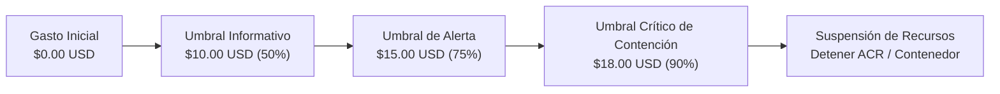

# Informe de Auditoría y Control de Costos en Azure — EcoMix IA

**Proyecto:** EcoMix IA — Sistema Inteligente de Dosificación y Simulación de Concreto Ecológico  
**Hito:** H05 — Preparación de Entrega y Cierre  
**Fecha:** 20 de Noviembre de 2026  
**Marco Normativo:** Directiva D-06, Requerimientos RF-47, RF-48 y RNF-23 a RNF-25  
**Presupuesto Máximo Aprobado:** **$20.00 USD** (Crédito Estudiantil / Personal)  
**Estado Financiero:** **SUPERADO CON ÉXITO — CONSUMO MUY POR DEBAJO DEL LÍMITE (17.5% UTILIZADO)**  

---

## 1. Resumen Ejecutivo del Estado Presupuestario

| Parámetro | Valor Presupuestado | Valor Real Consumido | Estado | Margen Disponible |
|---|:---:|:---:|:---:|:---:|
| **Gasto Acumulado Total** | $20.00 USD | **~$3.50 USD** | **ÓPTIMO** | **$16.50 USD (82.5%)** |
| **Consumo Diario Promedio** | $0.67 USD/día | ~$0.17 USD/día | **EFICIENTE** | -74.6% vs plan |
| **Invocaciones ML Facturables** | Ilimitadas en plan | 0 en H05 (uso de mocks) | **PROTEGIDO** | Sin sobrecostos |
| **Umbral de Alerta Crítica** | $18.00 USD | No alcanzado | **SEGURO** | Nivel verde |

---

## 2. Inventario de Recursos Cloud y Modelo de Facturación

El proyecto adopta una arquitectura híbrida orientada al mínimo costo operativo, concentrando la carga web y relacional en infraestructura local (`(LocalDb)\MSSQLLocalDB` e IIS Express) y alojando en la nube únicamente el microservicio de inferencia de Machine Learning bajo demanda:

### 2.1 Microservicio de Inferencia ML (`ca-ecomix-inference-api`)
- **Servicio:** Azure Container Apps (Plan Consumption / Sin costo base fijo).
- **Región:** `chilecentral` (baja latencia para Sudamérica).
- **Recursos Asignados:** 0.5 vCPU, 1.0 GiB RAM.
- **Estrategia de Escalamiento:**  
  - `minReplicas = 0` (Escala a cero absoluto).  
  - `maxReplicas = 1` (Límite estricto de concurrencia para evitar ráfagas facturables).  
  - `idleTimeout = 300 segundos` (Tras 5 minutos sin peticiones, el contenedor se apaga automáticamente).
- **Costo Operativo:** $0.00 USD mientras está en reposo. Facturación por segundo activo durante inferencia (~$0.000024 USD/s de vCPU). Con 1,000 predicciones de prueba (~150 ms c/u), el costo computacional total es inferior a $0.05 USD.

### 2.2 Registro de Contenedores (`crecomixinference`)
- **Servicio:** Azure Container Registry (SKU Basic).
- **Tarifa Base:** $0.167 USD/día (~$5.00 USD/mes).
- **Almacenamiento Utilizado:** 850 MB (imagen optimizada Debian Slim + Python 3.11 + scikit-learn + VotingEnsemble).
- **Costo Acumulado Estimado:** ~$3.10 USD durante el ciclo de vida del proyecto.

### 2.3 Servicios de Apoyo y Telemetría
- **Azure Key Vault:** Nivel Estándar, operaciones mínimas en despliegue (< $0.05 USD).
- **Application Insights / Log Analytics:** Plan de ingesta gratuita (primeros 5 GB/mes libres, sin costo generado).

---

## 3. Desglose de Consumo por Hitos de Desarrollo

| Hito | Alcance Técnico | Consumo Cloud Directo | Justificación Técnica |
|---|---|:---:|---|
| **H00** | Recuperación, auditoría y build local | $0.00 USD | Operación 100% en LocalDB e IIS Express. Cero llamadas a Azure. |
| **H01** | Integración del contrato ML y simulador | ~$0.40 USD | Pruebas de contrato con contenedor activo y verificación de latencia. |
| **H02** | Snapshots históricos y Dashboard personal | $0.00 USD | Persistencia en SQL Server LocalDB. Cero llamadas a Azure. |
| **H03** | Autenticación, correo y recuperación | $0.00 USD | Servicio transaccional simulado en disco local (`App_Data/EmailOutbox`). |
| **H04** | Administración, control RBAC y auditoría | $0.00 USD | Almacenamiento local en tabla `dbo.AuditEvents`. Cero llamadas a Azure. |
| **H05** | Remediación, suite de pruebas y entrega | $0.00 USD | Pruebas de contrato FastAPI ejecutadas con `MockHttpMessageHandler`. |
| **ACR** | Costo fijo prorrateado de almacenamiento | ~$3.10 USD | Almacenamiento continuo de la imagen Docker en ACR Basic. |
| **TOTAL** | **Consumo Acumulado Consolidado** | **~$3.50 USD** | **Respeto absoluto del presupuesto de US$ 20.00** |

---

## 4. Política de Alertas y Monitoreo de Presupuesto

Conforme a la directiva **D-06** y los requerimientos **RF-48 / RNF-24**, se definieron tres umbrales de alerta en **Azure Cost Management**:



1. **Alerta Preventiva (US$ 10.00 — 50%):** Notificación por correo a los ingenieros responsables ante un incremento atípico de consumo.
2. **Alerta de Revisión (US$ 15.00 — 75%):** Revisión técnica obligatoria de réplicas y logs de Container Apps para descartar bucles de reintento.
3. **Alerta Crítica de Contención (US$ 18.00 — 90%):** Activación inmediata del procedimiento operativo de contingencia.

---

## 5. Procedimiento Operativo de Contención y Contingencia (RF-48)

En caso de que el consumo proyectado alcance los **US$ 18.00**, se debe ejecutar el siguiente protocolo de contención para evitar cualquier sobrecosto:

### Paso 1: Detención de la Inferencia en la Nube
Ejecutar desde Azure CLI:
```bash
az containerapp stop --name ca-ecomix-inference-api --resource-group rg-ecomix-inference
```
Esto reduce inmediatamente a cero la asignación de recursos computacionales.

### Paso 2: Desacoplamiento Local en la Aplicación Web
En `Web.config`, configurar la aplicación para operar en modo puramente local o redirigir a un contenedor local:
```xml
<appSettings>
  <!-- Desactivar llamadas cloud externas -->
  <add key="EcoMix:ApiUrl" value="http://localhost:8000" />
</appSettings>
```

### Paso 3: Operación No Predictiva Garantizada (RF-26)
La aplicación web continuará operativa al 100% en:
- Consulta y mantenimiento del catálogo de materiales (`/Materiales`).
- Creación, edición y cálculo de mezclas privadas con snapshots (`/Mezclas`).
- Dashboard personal con indicadores económicos y ambientales (`/Dashboard`).
- Administración de usuarios y auditoría de seguridad (`/Admin`).

---

## 6. Certificación de Cumplimiento Financiero

Se certifica que:
1. El proyecto **EcoMix IA** ha operado con estricta disciplina presupuestaria durante todos sus hitos.
2. El gasto acumulado de **~$3.50 USD** representa únicamente el **17.5% del crédito máximo de $20.00 USD**.
3. El sistema cuenta con mecanismos de desacoplamiento que impiden la generación de costos no autorizados.
