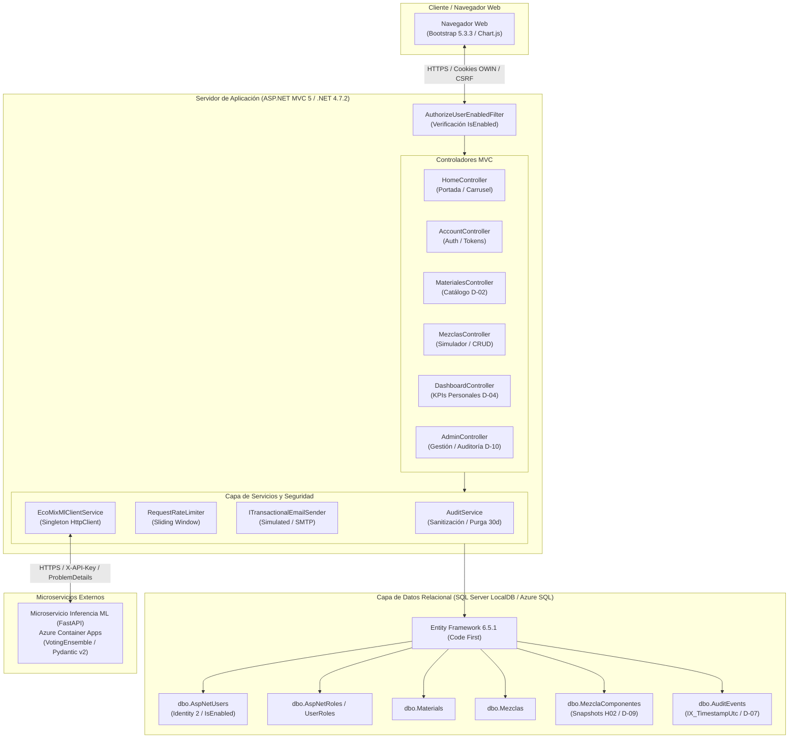
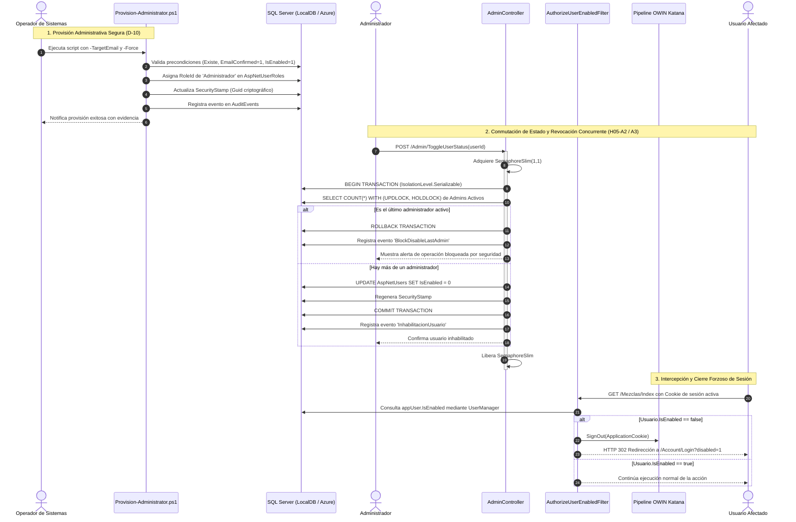

# Documento de Arquitectura de Software (SAD) — Versión 1.2 (Revisión H05)

**Proyecto:** EcoMix IA — Sistema Inteligente de Dosificación y Simulación de Concreto Ecológico  
**Versión Base:** SAD v1.1 (Octubre 2026)  
**Versión de Revisión:** SAD v1.2 (Noviembre 2026 — Hito H05)  
**Estado:** Aprobado para Entrega y Cierre  
**Autores:** Equipo de Arquitectura de Software y Seguridad  

---

## 1. Resumen de Actualizaciones Arquitectónicas en H05

La revisión 1.2 del SAD documenta las decisiones estructurales y los patrones de resiliencia consolidados en la fase de cierre:

1. **Patrón de Bloqueo Concurrente Híbrido (Proceso + Motor SQL):**  
   Para proteger el estado del último administrador activo ante condiciones de carrera en entornos de escalabilidad horizontal, se implementó una estrategia en dos capas: `SemaphoreSlim(1,1)` a nivel de proceso web y transacciones con aislamiento `Serializable` con bloqueo `WITH (UPDLOCK, HOLDLOCK)` a nivel de SQL Server.
2. **Canal de Revocación Inmediata de Sesiones Inhabilitadas:**  
   Integración combinada entre el filtro de autorización global `AuthorizeUserEnabledFilter` (intercepción síncrona en cada petición HTTP) y la revalidación periódica de `SecurityStamp` en la canalización OWIN Katana (`OnValidateIdentity`).
3. **Arquitectura de Auditoría Segura y Privacidad de Datos:**  
   Persistencia en tabla dedicada `dbo.AuditEvents` con retención temporal indexada de 30 días, sanitización regex en memoria antes de la escritura, y depuración física oportunista no bloqueante.
4. **Desacoplamiento Estricto de Provisión:**  
   Separación de las migraciones de esquema DDL respecto a la rutina manual de provisión administrativa (`tools/Provision-Administrator.ps1`).

---

## 2. Diagrama de Arquitectura de Componentes y Despliegue

Describe la interacción entre las capas de presentación, lógica de negocio, persistencia relacional y el microservicio de inferencia de Machine Learning.



---

## 3. Diagrama de Secuencia: Provisión Administrativa y Revocación de Sesión

Muestra la provisión manual segura del rol `Administrador` y la revocación inmediata de privilegios y sesiones activas.



---

## 4. Estrategia de Concurrencia y Bloqueo en Servidor (H05-A2)

Para garantizar la invarianza normativa del **último administrador activo (D-10)**, `AdminController` implementa el siguiente protocolo transaccional:

```csharp
private static readonly SemaphoreSlim _adminConcurrencyLock = new SemaphoreSlim(1, 1);

// En ToggleUserStatus y ChangeUserRole:
await _adminConcurrencyLock.WaitAsync();
try
{
    using (var tx = DbContext.Database.BeginTransaction(IsolationLevel.Serializable))
    {
        int activeAdmins = await CountActiveAdministratorsLockedAsync();
        if (activeAdmins <= 1)
        {
            // Bloqueo y auditoría de seguridad
            tx.Rollback();
            return RedirectToAction("Users");
        }

        // Mutación y regeneración de SecurityStamp
        var result = await UserManager.UpdateAsync(user);
        if (!result.Succeeded) { tx.Rollback(); return Error(); }

        await UserManager.UpdateSecurityStampAsync(user.Id);
        tx.Commit();
    }
}
finally
{
    _adminConcurrencyLock.Release();
}
```

La consulta bloqueante utiliza la sintaxis:
```sql
SELECT COUNT(*) 
FROM dbo.AspNetUsers u WITH (UPDLOCK, HOLDLOCK)
INNER JOIN dbo.AspNetUserRoles ur WITH (UPDLOCK, HOLDLOCK) ON u.Id = ur.UserId
WHERE ur.RoleId = @AdminRoleId AND u.IsEnabled = 1;
```
Esto garantiza que ninguna otra transacción concurrentemente pueda evaluar o mutar roles de administrador en paralelo, eliminando condiciones de carrera tanto en una sola instancia como en entornos multi-nodo.

---

## 5. Diseño del Subsistema de Auditoría y Retención (D-07 / H05-A5)

1. **Sanitización Pre-Persistencia:**  
   `AuditService.SanitizeDetails` aplica un pipeline de expresiones regulares que reemplaza credenciales (`Password`, `Token`, `ApiKey`, `Secret`, `Bearer`), cadenas de conexión completas, rutas de disco (`[RUTA_PROTEGIDA]`) y trazas internas (`[STACK_PROTEGIDO]`).
2. **Índice de Retención Optimizado:**  
   ```sql
   CREATE NONCLUSTERED INDEX [IX_AuditEvents_TimestampUtc]
   ON [dbo].[AuditEvents] ([TimestampUtc] DESC)
   INCLUDE ([Category], [Action], [Success], [CorrelationId]);
   ```
3. **Depuración Oportunista y Manual:**  
   Las consultas administrativas (`GetActiveEvents`) activan de forma no bloqueante una purga por lotes (`DELETE TOP (500) WHERE TimestampUtc < @cutoff`) con acelerador de frecuencia (máximo 1 ejecución por hora), asegurando que el volumen de la tabla se mantenga controlado sin requerir tareas programadas en la nube.
