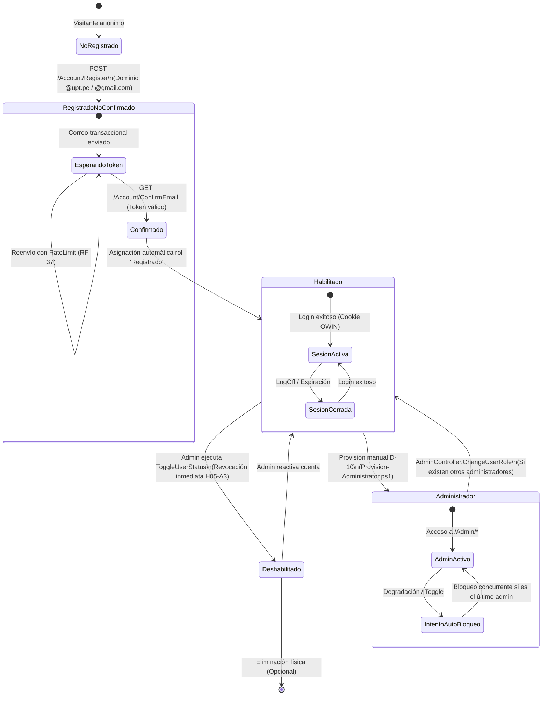
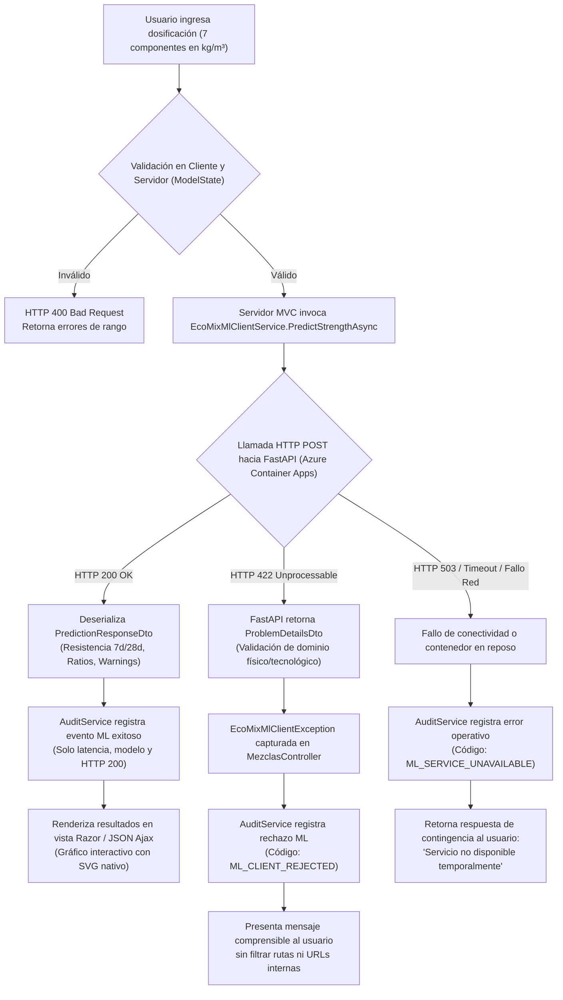

# Especificación de Requerimientos de Software (SRS) — Versión 1.3 (Revisión H05)

**Proyecto:** EcoMix IA — Sistema Inteligente de Dosificación y Simulación de Concreto Ecológico  
**Versión Base:** SRS v1.2 (Octubre 2026)  
**Versión de Revisión:** SRS v1.3 (Noviembre 2026 — Hito H05)  
**Estado:** Aprobado para Entrega y Cierre  
**Autores:** Equipo de Ingeniería y QA de EcoMix IA  

---

## 1. Justificación y Alcance de la Revisión v1.3

La presente versión 1.3 del SRS formaliza las remediaciones de seguridad, precisiones arquitectónicas y descargos de responsabilidad técnica consolidados durante el hito **H05 (Auditoría Integral, Remediación y Preparación de Entrega)**, garantizando la total congruencia entre la documentación normativa y el código ejecutable verificado.

### Principales Modificaciones respecto a la versión 1.2:

1. **Alineación de la Política D-02 (Catálogo de Materiales):**
   Se aclara formalmente que el catálogo de materiales `Materials` es exclusivo para usuarios autenticados. Los visitantes no autenticados son redirigidos al inicio de sesión (`/Account/Login`). Los usuarios registrados disponen de permisos de consulta y los administradores tienen el control exclusivo de mutación (CRUD).
2. **Desacoplamiento de la Provisión Administrativa (Directiva D-10):**
   Se erradica definitivamente cualquier asignación o promoción hardcoded de usuarios privilegiados en los scripts de migración DDL (`H04_add_audit_and_user_enabled.sql`). La elevación al rol `Administrador` se formaliza exclusivamente a través de la rutina independiente `tools/Provision-Administrator.ps1` bajo precondiciones estrictas de verificación de correo y cuenta activa.
3. **Mecanismo Oportunista de Depuración de Auditoría (Directiva D-07 / RF-49 a RF-51):**
   Se formaliza la depuración física asíncrona de registros anteriores a 30 días en `dbo.AuditEvents`, protegida por semáforo de concurrencia en servidor y optimizada mediante el índice `IX_AuditEvents_TimestampUtc`.
4. **Protección Concurrente del Último Administrador:**
   Se incorpora la garantía transaccional serializable (`WITH (UPDLOCK, HOLDLOCK)`) en servidor para prevenir que solicitudes concurrentes deshabiliten o degraden al último administrador activo del sistema.
5. **Inclusión Obligatoria del Descargo de Responsabilidad Estructural:**
   Se añade la cláusula normativa que delimita la naturaleza estadística y no certificadora del modelo de Machine Learning `VotingEnsemble`.

---

## 2. Descargo de Responsabilidad Técnica y Normativa (Cláusula de Uso)

> [!IMPORTANT]
> **DESCARGO DE RESPONSABILIDAD ESTRUCTURAL Y NORMATIVA**  
> El modelo de Machine Learning (`VotingEnsemble`) integrado en **EcoMix IA** es una herramienta de software destinada exclusivamente a la **estimación referencial, orientación pedagógica y optimización preliminar** de dosificaciones de concreto con adiciones puzolánicas y escoria.
> 
> 1. **No Sustitución de Ensayos Normalizados:** Las predicciones de resistencia a la compresión (MPa a 7 y 28 días) calculadas por el modelo **NO constituyen bajo ninguna circunstancia una certificación estructural ni reemplazan los ensayos destructivos de rotura de probetas cilíndricas normalizados**, según las normas técnicas **ASTM C39 / NTP 339.034**.
> 2. **Cumplimiento Obligatorio del Reglamento Nacional de Edificaciones (RNE):** En cualquier proyecto de ingeniería civil o edificación real, el diseño de mezclas, control de calidad y aceptación en obra deben realizarse bajo la supervisión de un ingeniero colegiado habilitado y en estricto cumplimiento de la **Norma Técnica E.060 (Concreto Armado)** del RNE.
> 3. **Propiedad Industrial y Confidencialidad:** Las dosificaciones y recetas privadas registradas por los usuarios se encuentran estrictamente aisladas mediante control de acceso multi-inquilino en backend y no son utilizadas para reentrenamiento público ni persistidas en registros de auditoría accesibles a terceros.

---

## 3. Diagramas de Comportamiento del Sistema

### 3.1 Diagrama de Máquina de Estados del Usuario

Describe el ciclo de vida seguro de una cuenta de usuario en EcoMix IA, desde su registro inicial con correo institucional hasta su habilitación, suspensión y eventual promoción administrativa.

---

### 3.2 Diagrama de Flujo del Simulador de Dosificación y Manejo de Errores

Ilustra la interacción asíncrona entre el navegador, el servidor MVC y el microservicio FastAPI, destacando las barreras de sanitización y enmascaramiento seguro de excepciones de H05.

---

## 4. Estado de Requerimientos Específicos Modificados

| Código | Descripción Actualizada (v1.3) | Criterio de Aceptación y Validación |
|---|---|---|
| **RF-12** | Catálogo de materiales global con **lectura para registrados y CRUD exclusivo para Administrador (D-02)**. Los visitantes anónimos no consultan el catálogo. | Intento anónimo a `/Materiales` redirige a `/Account/Login`. Usuario con rol `Registrado` puede ver `Index` y `Details` pero obtiene HTTP 403 al intentar `Create`, `Edit` o `Delete`. |
| **RF-22** | Conmutación de estado de cuenta auditada y protegida contra concurrencia. | Si existe un único administrador activo, ningún hilo o proceso simultáneo puede deshabilitarlo. La operación genera evento `BlockDisableLastAdmin`. |
| **RF-23** | Asignación y cambio de roles protegida contra concurrencia y con verificación atómica de resultado. | Si existe un único administrador activo, se bloquea la revocación del rol `Administrador`. La operación genera evento `BlockDemoteLastAdmin`. |
| **RF-49** | Retención estricta de 30 días en consultas activas y estadísticas. | Toda consulta a `dbo.AuditEvents` filtra por `TimestampUtc >= UtcNow.AddDays(-30)`. Los registros antiguos quedan fuera de la interfaz administrativa. |
| **RF-50** | Depuración física idempotente y oportunista de auditoría. | `AuditService` ejecuta periódicamente eliminación por lotes de 500 registros con semáforo no bloqueante, dejando intactas las tablas de negocio. |
| **RF-52** | Provisión controlada del primer Administrador fuera del código y de las migraciones automáticas. | La migración `H04_add_audit_and_user_enabled.sql` es puramente DDL. La promoción exige ejecutar `tools/Provision-Administrator.ps1` con precondiciones. |
